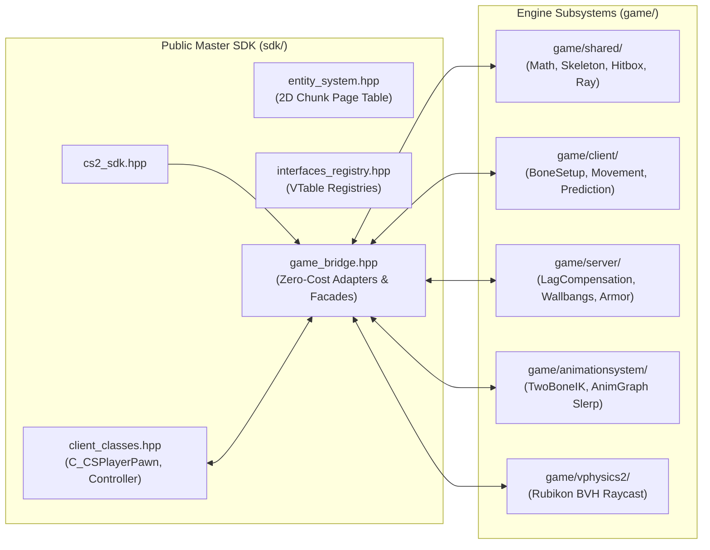

# Counter-Strike 2 (Source 2) Reverse Engineering & Architecture Reference

[-informational.svg)](#)

> 🌐 **Interactive Documentation & Visualizers Portal**: [**https://hanzkii.github.io/cs2-reverse/**](https://hanzkii.github.io/cs2-reverse/)  
> Features 10 live interactive Web visualizers (Sub-Tick prediction, Multi-Material Bullet Penetration, Lag Compensation Unlag, Rubikon BVH Raymarching, Volumetric Smoke Voxel Carving, Two-Bone IK, and Recoil Decay), 34-binary Source 2 module catalog, canonical function signature registry, dual-mode C++20 SDK viewer, and full architecture reports with KaTeX math and Mermaid diagrams.

---

## 📖 About This Project

**cs2-reverse** is an authoritative, ground-truth technical knowledge base and reconstructed clean-room SDK for Valve's **Source 2** engine as implemented in **Counter-Strike 2**.

Key pillars of this project include:
1. **Zero Dynamic Injection / Pure Static Analysis**: No game process hooks, DLL injection, dynamic memory modification, or anti-cheat circumvention. All research is performed against static PE binaries on disk using **NSA Ghidra** paired with **Google DeepMind Antigravity** via MCP.
2. **Unified C++20 Engineering Standard**: All reconstructed code across `sdk/`, `game/`, and `docs/simulators/` strictly adheres to **pure ISO C++20** compiled with MSVC x64 (`/std:c++20 /O2 /EHsc /W4 /WX`) with zero external third-party dependencies.
3. **10 Standalone Mathematical Simulators**: Reconstructed algorithms (Sub-Tick prediction, Rubikon physics raycasting, volumetric smoke voxel grids, bullet penetration ODEs, and bone hierarchy forward kinematics) are provably verified with standalone C++20 runners and interactive web canvas visualizers.
4. **Static AI & Modding API**: Machine-readable JSON endpoints (`docs/api/v1/`) and LLM discovery documents (`llms.txt`, `llms-full.txt`) powering automated agentic analysis and modding workflows.
5. **Decoupled 34-Binary Ecosystem**: Exhaustive architectural coverage of all 34 Source 2 modular PE binaries (`client.dll`, `server.dll`, `engine2.dll`, `schemasystem.dll`, `networksystem.dll`, `vphysics2.dll`, `animationsystem.dll`, `particles.dll`, `pulse_system.dll`, etc.).

---

## 🤖 Engineering Environment: Antigravity + Ghidra MCP

This repository is developed using an autonomous pair-programming pipeline combining **Google DeepMind's Antigravity** with **NSA Ghidra** through the **Model Context Protocol (MCP)**:

- **Google Antigravity Agentic Workflow**:
  - Autonomous reasoning, static decompilation tracing, mathematical modeling, and documentation bundling.
  - Custom Source 2 skill ([`.agents/skills/source2-sdk/`](.agents/skills/source2-sdk/)) providing ground-truth memory structures, AlliedModders `s2sdk` virtual method tables, and Valve Developer Community (VDC) architecture references.
- **NSA Ghidra + Ghidra MCP Server Bridge**:
  - Centralized Ghidra project database (`CS2.gpr`) synchronizing disassembly, symbol tables, and data types across all 34 Counter-Strike 2 binaries.
  - High-throughput bi-directional MCP server allowing the AI agent to:
    - Query symbols, decompile functions, trace cross-references (`xrefs`), and inspect control-flow graphs directly on demand.
    - Analyze virtual method tables (VTables) and reconstruct clean-room C++ implementations without manual copy-paste bottlenecks.
    - Extract, pad, and verify canonical IDA/Ghidra byte signatures (AOB) against baseline binaries.

---

## 🔍 Reverse Engineering Methodology

Our reverse-engineering approach is strictly **static binary analysis** and **clean-room reconstruction**:

1. **Static Analysis Only / Zero Injection**:
   - Zero dynamic DLL injection, live game process hooking, or runtime memory manipulation.
   - All findings are derived through static decompilation in Ghidra, PE structure inspection, and static reflection extraction.

2. **Interface & VTable Disambiguation**:
   - Stripped virtual function tables (VTables) are cross-referenced against AlliedModders `s2sdk` virtual method table orders (`tier0`, `engine2`, `entity2`, `schemasystem`, `vphysics2`).
   - Interface factories exported via `CreateInterface` are located and traversed in `.rdata` to map master interfaces (`Source2Client002`, `Source2ServerConfig001`, `SchemaSystem_001`, `VPhysics2_Interface_001`, etc.).

3. **Dynamic Reflection via SchemaSystem**:
   - Source 2 replaces legacy compile-time RTTI with runtime reflection (`schemasystem.dll`).
   - Field names, byte offsets, and inheritance hierarchies are resolved by analyzing `CSchemaSystem` type scopes and 32-bit MurmurHash2 token lookup tables.

4. **Canonical Pattern Signatures & Automated RVA Shift Diffing**:
   - Every reversed internal routine is cataloged in `data/function_signatures.json` with an unambiguous, discriminator-padded IDA/Ghidra byte pattern (AOB).
   - Our automated scanner verifies that every pattern produces exactly 1 match across the baseline binaries and alerts to RVA shifts whenever CS2 updates.

5. **Clean-Room C++ Reconstruction**:
   - Reconstructed engine algorithms are implemented in pure standard C++20 under `game/` grouped strictly by binary module (`game/client/`, `game/server/`, `game/engine2/`, etc.) with zero third-party runtime dependencies.

---

## 🧩 Architecture: `sdk/` vs `game/` Integration

The repository implements a two-tier, zero-copy architecture that integrates public headers with modular engine services:

- **`sdk/` (Public C++20 SDK Headers)**: Authoritative entity layouts with verified byte offsets, inheritance graphs, Master VTables, and static singleton accessors (`client_classes.hpp`, `entity_system.hpp`, `interfaces_registry.hpp`).
- **`game/` (Modular Engine Subsystems)**: Clean-room C++20 implementations of reversed Source 2 algorithms (lag compensation backtracking, bullet penetration ODEs, sub-tick prediction, Rubikon collision, and bone matrix setup).
- **`sdk/game_bridge.hpp` (Integration Bridge)**: Connects both worlds with zero-cost adapters (`ToGame`, `ToSDK`), seamless handle-to-pawn resolution (`SDK::GetPlayerPawn`), and unified engine facades (`SDK::SolveTwoBoneIK`, `SDK::EvaluateDamage`).
- **Validated Interoperability**: Fully tested end-to-end via [`docs/simulators/test_sdk_game_integration.cpp`](docs/simulators/test_sdk_game_integration.cpp) compiled with MSVC x64 `/std:c++20 /W4 /WX`.

---

## 📚 External Reference Frameworks & Skills

To accelerate reverse-engineering precision and cross-reference stripped binary VTables:
- **[AlliedModders s2sdk](https://github.com/alliedmodders/s2sdk)**: Unofficial Source 2 SDK providing community-maintained C++ header structures, entity handle bitmasks (`0x7FFF` index, 17-bit serial), SchemaSystem classes, and virtual method orders across `tier0`, `engine2`, `entity2`, `schemasystem`, and `vphysics2`.
- **[Valve Developer Community: Source 2](https://developer.valvesoftware.com/wiki/Source_2)**: Architectural documentation covering sub-tick input sampling, Rubikon physics, Sound Operator System (SOS), Panorama UI, and compiled asset structures.
- **Antigravity Custom Skill (`source2-sdk`)**: Formalized into [`.agents/skills/source2-sdk/SKILL.md`](.agents/skills/source2-sdk/SKILL.md) for automated lookup of VTable indices, struct offsets, and memory signatures.
