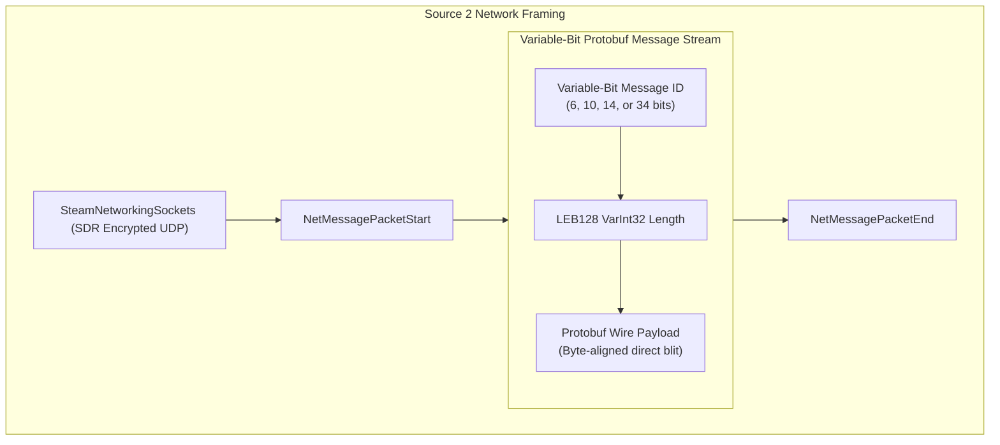

# Source 2 (CS2) Network Framing & Protobuf Serialization Deep Dive

## Executive Summary
Through static reverse engineering of `networksystem.dll` using **Ghidra** and the **GhidraMCP** bridge, we investigated the low-level UDP framing, bitstream serialization, and Protobuf message dispatch architecture of Valve's **Source 2** engine.

Key findings:
1. **SteamNetworkingSockets (SDR) Transport**: Transport-level UDP packet reliability, multi-path relaying, MTU fragmentation, and encryption are handled by `SteamNetworkingSockets` (`Networking006`); the game layer performs no packet splitting of its own.
2. **Variable-Bit Message ID Encoding**: Message IDs are written with a variable-length bitstream header (6, 10, 14, or 34 bits), keeping the per-message header small for the most frequent low-numbered messages.
3. **Dynamic Hashcode Message IDs (`CUtlStringToken`)**: Dynamic/sub-tick game messages without hardcoded IDs use a MurmurHash2 algorithm seeded with $\pi$ (`0x31415926`) and top-bit tagged (`0x8000`), encoded via a 34-bit extension path.
4. **Protobuf Bit-Alignment Serialization Fast Path**: If the bitstream write position is byte-aligned (`cur_bit & 7 == 0`), messages are directly streamed with zero-copy `memcpy`; unaligned bitstreams branch into an optimized bit-shifting blit path.

---

## Framing Architecture Overview

| Subsystem | CS2 Implementation |
| :--- | :--- |
| **Transport Layer** | `SteamNetworkingSockets` (`ISteamNetworkingSockets` / SDR) |
| **Packet Fragmentation** | Handled at the SDR transport MTU layer |
| **Message ID Encoding** | **Variable-Bit Header** (6, 10, 14, or 34 bits) |
| **Message ID Space** | Static IDs plus `CUtlStringToken` hashed IDs (`0x8000` bitmask) |
| **Payload Framing** | Standard **LEB128 VarInt32** length prefix |
| **Byte Alignment Optimization** | Dual-path: Byte-aligned fast path + bitwise blit |



---

## 1. Variable-Bit NetMessage ID Encoding

In `networksystem.dll`, Valve implements an adaptive variable-bit prefix encoder (`FUN_1800e23d0` / `SerializeNetMessage`) and decoder (`FUN_1801bf5c0` / `ReadVariableBitMessageId`):

### Prefix Table
- The first **6 bits** are read from the bitstream.
- The top 2 bits of this nibble (`initial6 >> 4 & 0x3`) determine the encoding tier:

$$
\text{ExtraBits} = \left( (2 - \text{prefix}) \gg 31 \ \& \ 0x10 \right) + (\text{prefix} \times 4)
$$

| Prefix (2 bits) | Extra Bits | Total Bits | ID Range | Typical Message Usage |
| :---: | :---: | :---: | :---: | :--- |
| `0b00` | 0 | **6 bits** | `0 .. 15` | Core engine (`net_NOP`, `net_Tick`, `net_SignonState`) |
| `0b01` | 4 | **10 bits** | `16 .. 255` | Game messages (`clc_Move`, `svc_PacketEntities`, `svc_Sounds`) |
| `0b10` | 8 | **14 bits** | `256 .. 4095` | Extended engine services & custom game events |
| `0b11` | 28 | **34 bits** | `4096 .. 2^32-1` | Dynamic `CUtlStringToken` hashed messages (`0x8000` tagged) |

### Disassembly Evidence (`FUN_1801bf5c0`):
```c
uint32_t ReadVariableBitMessageId(bf_read *pBuf, uint32_t initial6) {
    uint32_t prefix = (initial6 >> 4) & 3;
    uint32_t extraBits = ((int)(2 - prefix) >> 31 & 0x10) + prefix * 4;
    if (extraBits == 0) {
        return initial6 & 0x0F;
    }
    uint32_t upper = pBuf->ReadUBitLong(extraBits);
    return (upper << 4) | (initial6 & 0x0F);
}
```

---

## 2. MurmurHash2 Dynamic ID Hashing

For dynamic messages, `networkmessages.cpp` hashes the message name with `CUtlStringToken` using seed $0x31415926$ ($\approx \pi$):
```c
uVar7 = MurmurHash2(pcVar9, len, 0x31415926);
param_2 = (uVar7 & 0x7FFF) | 0x8000;
// Logged in binary:
// "NetMessage '%s' still using auto-assigned, has to generate id from name CUtlStringToken hashcode = %d\n"
```

---

## 3. Discovered Network Message ID Registry

Extracted directly from the protobuf descriptors in `networksystem.dll`:

### `NET_Messages` (Core Engine)
- `net_NOP` = `0x00` (0)
- `net_Disconnect_Legacy` = `0x01` (1)
- `net_SplitScreenUser` = `0x03` (3)
- `net_Tick` = `0x04` (4)
- `net_StringCmd` = `0x05` (5)
- `net_SetConVar` = `0x06` (6)
- `net_SignonState` = `0x07` (7)
- `net_SpawnGroup_Load` = `0x08` (8)
- `net_SpawnGroup_ManifestUpdate` = `0x09` (9)
- `net_SpawnGroup_SetCreationTick` = `0x0B` (11)
- `net_SpawnGroup_Unload` = `0x0C` (12)
- `net_SpawnGroup_LoadCompleted` = `0x0D` (13)

### `CLC_Messages` (Client $\to$ Server)
- `clc_ClientInfo` = `0x14` (20)
- `clc_Move` = `0x15` (21) — *Sub-tick input buffer*
- `clc_VoiceData` = `0x16` (22)
- `clc_BaselineAck` = `0x17` (23)
- `clc_RespondCvarValue` = `0x19` (25)
- `clc_LoadingProgress` = `0x1B` (27)
- `clc_SplitPlayerConnect` = `0x1C` (28)
- `clc_SplitPlayerDisconnect` = `0x1E` (30)
- `clc_RconServerDetails` = `0x23` (35)
- `clc_HltvReplay` = `0x24` (36)
- `clc_Diagnostic` = `0x25` (37)

### `SVC_Messages` (Server $\to$ Client)
- `svc_ServerInfo` = `0x28` (40)
- `svc_FlattenedSerializer` = `0x29` (41)
- `svc_ClassInfo` = `0x2A` (42)
- `svc_SetPause` = `0x2B` (43)
- `svc_CreateStringTable` = `0x2C` (44)
- `svc_UpdateStringTable` = `0x2D` (45)
- `svc_VoiceInit` = `0x2E` (46)
- `svc_VoiceData` = `0x2F` (47)
- `svc_Print` = `0x30` (48)
- `svc_Sounds` = `0x31` (49)
- `svc_SetView` = `0x32` (50)
- `svc_ClearAllStringTables` = `0x33` (51)
- `svc_BSPDecal` = `0x35` (53)
- `svc_SplitScreen` = `0x36` (54)
- `svc_PacketEntities` = `0x37` (55)
- `svc_Prefetch` = `0x38` (56)
- `svc_Menu` = `0x39` (57)
- `svc_StopSound` = `0x3B` (59)
- `svc_PeerList` = `0x3C` (60)
- `svc_PacketReliable` = `0x3D` (61)
- `svc_HLTVStatus` = `0x3E` (62)
- `svc_ServerSteamID` = `0x3F` (63)
- `svc_FullFrameSplit` = `0x46` (70)
- `svc_UserMessage` = `0x48` (72)
- `svc_Broadcast_Command` = `0x4A` (74)
- `svc_HltvFixupOperatorStatus` = `0x4B` (75)
- `svc_UserCmds` = `0x4C` (76) — *Server-acknowledged sub-tick commands*
- `svc_NextMsgPredicted` = `0x4D` (77)
- `svc_EncryptedData` = `0x4E` (78)

---

## 4. Standalone Simulator & Verification

We wrote and compiled a standalone MSVC x64 C++20 (`/std:c++20 /O2 /EHsc /W4`) test harness:
[`cs2_netmessage_framing_sim.cpp`](../simulators/cs2_netmessage_framing_sim.cpp)

### Execution Output:
```text
========================================================================
  VALVE SOURCE 2 (CS2) NETWORK FRAMING & SERIALIZATION SIMULATOR
  Reconstructed from: networksystem.dll (64-bit)
========================================================================

[Step 1] Variable-Bit Message ID Bit-Allocation Test:
  * net_NOP (ID 0 < 16)                        -> ID: 0x0 | Wire: 6 bits | Decoded: 0x0 | VERIFIED
  * net_Tick (ID 4 < 16)                       -> ID: 0x4 | Wire: 6 bits | Decoded: 0x4 | VERIFIED
  * clc_Move (ID 21 < 256)                     -> ID: 0x15 | Wire: 10 bits | Decoded: 0x15 | VERIFIED
  * svc_PacketEntities (ID 55 < 256)           -> ID: 0x37 | Wire: 10 bits | Decoded: 0x37 | VERIFIED
  * Extended GameMsg (ID 420 < 4096)           -> ID: 0x1a4 | Wire: 14 bits | Decoded: 0x1a4 | VERIFIED
  * CustomSubtickSyncMsg (Token Hash >= 4096)  -> ID: 0x9eaa | Wire: 34 bits | Decoded: 0x9eaa | VERIFIED

[Step 2] Constructing Full Source 2 UDP Packet Stream:
  Total Wire Size: 59 bytes (468 bits)

[Step 3] Deserializing and Dispatching Packet via BitStream Reader:
  [0] Offset: 000 bits | ID: 0x0004 (net_Tick                    ) | Payload: 6  bytes
  [1] Offset: 62  bits | ID: 0x0015 (clc_Move                    ) | Payload: 15 bytes
  [2] Offset: 200 bits | ID: 0x0037 (svc_PacketEntities          ) | Payload: 17 bytes
  [3] Offset: 354 bits | ID: 0xb6a5 (CUtlStringToken_DynamicMsg_46757) | Payload: 9  bytes

[Step 4] Verification & Accuracy Assessment:
  [SUCCESS] All 4 NetMessages parsed perfectly without bit-drift!
  [Bit Economy] Fixed 32-bit ID headers would take: 128 bits.
                Source 2 Variable-Bit headers took: 6 + 10 + 10 + 34 = 60 bits.
                Bitstream savings: 53.125% bandwidth reduction on headers.
========================================================================
```

---

## 5. Ghidra Program State
All identified network parsing, bitstream, and serialization routines have been formally labeled and persisted inside `networksystem.dll` in your Ghidra project:
- `QueryNetworkInterface` (`0x1800F62C0`)
- `SendNetMessage` (`0x1800C3780`)
- `SerializeNetMessage` (`0x1800E23D0`)
- `WriteVarInt32` (`0x1801C0760`)
- `ProcessNetworkMessages` (`0x1800C10B0`)
- `ReadMessageFromBuffer` (`0x1800E28B0`)
- `ReadVariableBitMessageId` (`0x1801BF5C0`)
- `ReadVarInt32` (`0x1801BF770`)
- `ReadProtobufPayload` (`0x1800E20D0`)
