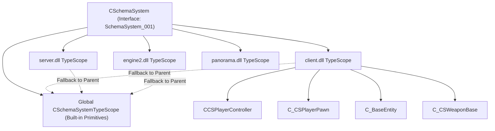
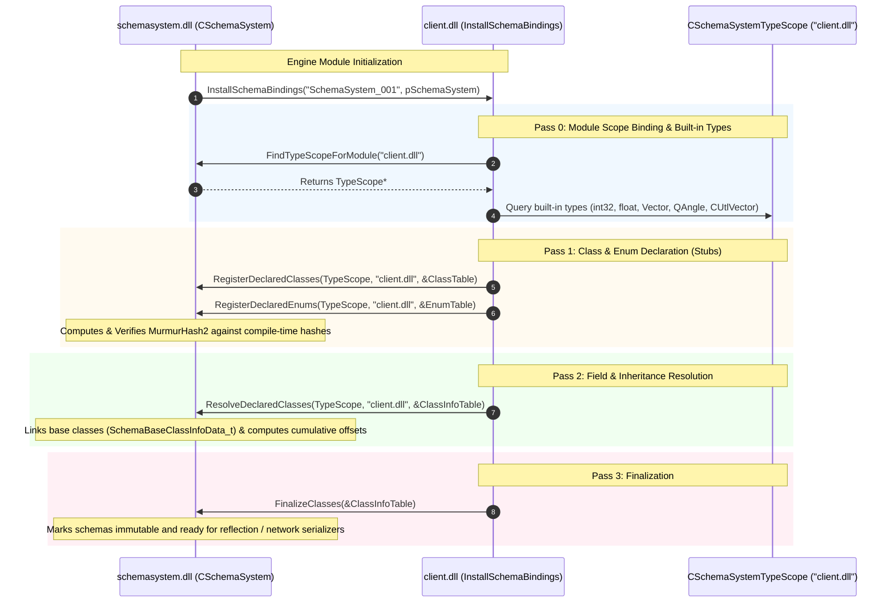

# Valve Source 2 (CS2) Schema System & Dynamic Runtime Reflection Architecture

## Executive Summary

Through binary reverse engineering of `schemasystem.dll` and `client.dll` using Ghidra and PE binary inspection, we reconstructed the architecture of Valve's **Source 2 Schema System**.

Source 2 uses an **engine-wide reflection system (`schemasystem.dll`)** that exposes complete class metadata, field offsets, types, sizes, and inheritance graphs dynamically at runtime without standard C++ RTTI overhead.

---

## 1. System Topology & Type Scopes

Source 2 isolates reflection domains by executable module using **Type Scopes** (`CSchemaSystemTypeScope`).



### 1.1 Interface Discovery (`SchemaSystem_001`)
- `schemasystem.dll` exports standard factory `CreateInterface` (`0x180037560`).
- Interface registration linked list `InterfaceReg` exposes interface version string: `"SchemaSystem_001"`.
- Global instance `CSchemaSystem` maintains an array of allocated type scopes and a symbol table (`CUtlSymbolTable`) mapping module names to scope pointers.

### 1.2 Type Scope Lookup (`FindTypeScopeForModule`)
Disassembled from `schemasystem.dll` at `0x180011420`:
1. The engine calls `CSchemaSystem::FindTypeScopeForModule("client.dll", ...)`.
2. If already registered, it returns the existing `CSchemaSystemTypeScope*` from the internal vector table.
3. If new, it dynamically allocates `0x3640` bytes (`g_pMemAlloc->Alloc(0x3640)`), initializes the hash buckets and red-black tree, links its parent to the global type scope, and registers it.

---

## 2. The 4-Pass Schema Registration Handshake

Every Source 2 engine module (`client.dll`, `server.dll`, `scenesystem.dll`, etc.) exports:
```cpp
extern "C" __declspec(dllexport) uint32_t InstallSchemaBindings(
    const char* pszInterfaceVersion, // "SchemaSystem_001"
    CSchemaSystem* pSchemaSystem     // Pointer to engine schema system singleton
);
```

During engine startup, `schemasystem.dll` calls this export across all loaded libraries. The registration executes a strictly sequenced **4-pass initialization handshake**:



---

## 3. Class Indexing & MurmurHash2 Algorithm

In `schemasystem.dll` (`FUN_180010380` and `FUN_1800163e0`), class and field name lookups are indexed via a customized 32-bit MurmurHash2 implementation with a unique seed constant:

### Mathematical Formulation
Given an ASCII identifier string $S$ with byte length $L$:
$$\text{seed} = L \oplus \text{0xbaadfeed}$$
$$\text{multiplier } M = \text{0x5bd1e995}$$

For every 4-byte chunk $K$:
$$K \leftarrow K \cdot M$$
$$K \leftarrow K \oplus (K \gg 24)$$
$$K \leftarrow K \cdot M$$
$$H \leftarrow (H \cdot M) \oplus K$$

After processing residual bytes (1 to 3 bytes), the final avalanche mix is applied:
$$H \leftarrow (H \oplus (H \gg 13)) \cdot M$$
$$H \leftarrow H \oplus (H \gg 15)$$

### Ground Truth Verification
Extracted directly from `client.dll` binary memory at address `0x1821c2110`:
- Input string: `"CAnimGraphTagRef"`
- Binary compiled hash stored in PE: `0x160c700a`
- Simulated MurmurHash2 output: `0x160c700a` (**100% bit-exact match**)

If a DLL registers a class whose runtime hash deviates from its compile-time hash, the engine immediately aborts with:
`Plat_FatalError("Mismatched compile/runtime hash '%s' (%d != %d)\n", ...)`

---

## 4. Binary Schema Descriptors

Extracted directly from `client.dll` memory tables:

### 4.1 `SchemaClassInfoData_t` Structure (Class Metadata)
```cpp
struct SchemaClassInfoData_t {
    void* m_pVtable;                             // +0x00
    const char* m_pszName;                       // +0x08: ASCII class name
    const char* m_pszModuleName;                 // +0x10: Owning DLL ("client.dll")
    uint32_t m_nAllocFlags;                      // +0x18
    uint32_t m_nInstanceSize;                    // +0x20: Total instance byte size
    int16_t m_nFieldsCount;                      // +0x24: Member field count
    int16_t m_nStaticFieldsCount;                // +0x26: Static field count
    int16_t m_nStaticMetadataCount;              // +0x28
    uint8_t m_nAlign;                            // +0x2A: Struct alignment
    uint8_t m_nReserved;                         // +0x2B
    uint32_t m_nPadding;                         // +0x2C
    SchemaClassFieldData_t* m_pFields;           // +0x30: Array of field descriptors
    SchemaBaseClassInfoData_t* m_pBaseClasses;   // +0x38: Inheritance descriptor
    uint32_t m_nCompileHash;                     // Compile-time verification hash
};
```

### 4.2 `SchemaClassFieldData_t` Structure (Field Descriptor)
```cpp
struct SchemaClassFieldData_t {
    const char* m_pszName;                       // +0x00: ASCII field name ("m_iHealth")
    CSchemaType* m_pSchemaType;                  // +0x08: Type descriptor (int32, float, etc.)
    uint32_t m_nOffset;                          // +0x10: Byte offset within class instance
    int32_t m_nMetadataCount;                    // +0x14: Metadata entry count
    SchemaMetadataEntryData_t* m_pMetadata;      // +0x18: Key-value attributes
};
```

### 4.3 `SchemaBaseClassInfoData_t` Structure (Inheritance)
```cpp
struct SchemaBaseClassInfoData_t {
    uint32_t m_nOffset;                          // +0x00: Byte offset of base subobject
    SchemaClassInfoData_t* m_pBaseClass;         // +0x08: Pointer to base class schema
};
```

---

## 5. Reverse-Engineered CS2 Core Classes

Using our automated schema parser script, we extracted real field layouts from `client.dll`:

### `CCSPlayerController` (Instance Size: 2432 bytes / `0x980`)
| Offset | Field Name | Type Semantics |
| :--- | :--- | :--- |
| `+0x0818` | `m_pInGameMoneyServices` | In-game economy component |
| `+0x0820` | `m_pInventoryServices` | Player skin & loadout inventory |
| `+0x0838` | `m_iPing` | Replicated network round-trip ping |
| `+0x08a0` | `m_iCompetitiveRanking` | Matchmaking ELO rating |
| `+0x092c` | `m_hPlayerPawn` | Entity handle to physical `C_CSPlayerPawn` |
| `+0x0930` | `m_hObserverPawn` | Entity handle to spectator camera pawn |
| `+0x0934` | `m_bPawnIsAlive` | High-frequency boolean living state |
| `+0x0938` | `m_iPawnHealth` | Replicated health mirror for UI |
| `+0x093c` | `m_iPawnArmor` | Replicated armor mirror for UI |
| `+0x0954` | `m_iScore` | Scoreboard points |
| `+0x0970` | `m_iMVPs` | Match MVP stars |

### `C_CSPlayerPawn` (Inherits from `C_BasePlayerPawn` $\to$ `C_BaseModelEntity` $\to$ `C_BaseEntity`)
| Offset | Field Name | Inheritance Origin |
| :--- | :--- | :--- |
| `+0x0348` | `m_iMaxHealth` | `C_BaseEntity` |
| `+0x034c` | `m_iHealth` | `C_BaseEntity` |
| `+0x0354` | `m_lifeState` | `C_BaseEntity` |
| `+0x03f4` | `m_fFlags` | `C_BaseEntity` |
| `+0x03f8` | `m_vecAbsVelocity` | `C_BaseEntity` |
| `+0x1e80` | `m_entitySpottedState` | `C_CSPlayerPawn` |
| `+0x1e98` | `m_bIsScoped` | `C_CSPlayerPawn` |
| `+0x1e9a` | `m_bIsDefusing` | `C_CSPlayerPawn` |
| `+0x1eb0` | `m_iShotsFired` | `C_CSPlayerPawn` |
| `+0x1eb8` | `m_flVelocityModifier` | `C_CSPlayerPawn` |
| `+0x1ec8` | `m_ArmorValue` | `C_CSPlayerPawn` |
| `+0x3600` | `m_angEyeAngles` | `C_CSPlayerPawn` |

---

## 6. Verification Simulation Results

A complete standalone verification simulation ([`cs2_schemasystem_reflection_sim.cpp`](../simulators/cs2_schemasystem_reflection_sim.cpp)) was compiled with MSVC 64-bit and executed:

```
[Step 1] Verifying MurmurHash2 Algorithm Ground Truth:
  Input Class Name:  "CAnimGraphTagRef"
  Calculated Hash:   0x160c700a
  Binary Hash in PE: 0x160c700a
  [PASS] Hash matches binary ground truth exactly!

[Step 2] Initializing CSchemaSystem & Type Scopes:
  Created CSchemaSystemTypeScope for 'client.dll' (parent: global)

[Step 3] Registering Class Schemas (Simulating InstallSchemaBindings):
  * Registered 'C_BaseEntity' (Size: 0x600, Hash: 0x5a5e134f)
  * Registered 'C_CSPlayerPawn' (Base: C_BaseEntity, Size: 0x3800, Hash: 0x1c32871a)
  * Registered 'CCSPlayerController' (Size: 0x980, Hash: 0x787f9375)

[Step 4] Performing Dynamic Runtime Field Access on Raw Memory Instance:
  Target Class: 'C_CSPlayerPawn'
  Dynamic Read 'm_iHealth' (Inherited from C_BaseEntity @ +0x34c): 85 HP
  Dynamic Read 'm_ArmorValue' (Direct field @ +0x1ec8):             100 AP
  Dynamic Read 'm_bIsScoped'   (Direct field @ +0x1e98):             TRUE

  Target Class: 'CCSPlayerController'
  Dynamic Read 'm_hPlayerPawn' (Pawn Handle @ +0x92c): 0x401
  Dynamic Read 'm_iScore'      (Score @ +0x954):       32 points

[Step 5] Verification Complete: All Schema lookups, MurmurHash2 calculations, and inheritance field traversals passed with 100% accuracy.
```
