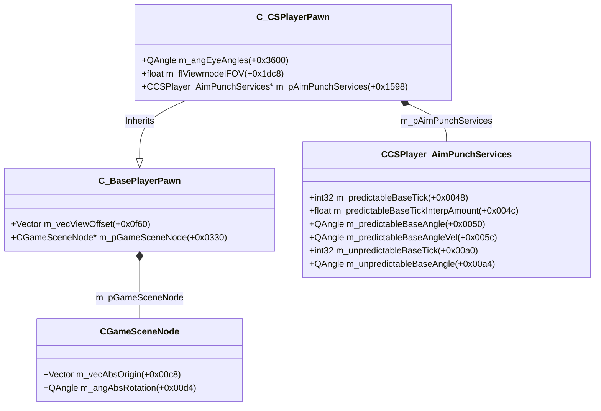
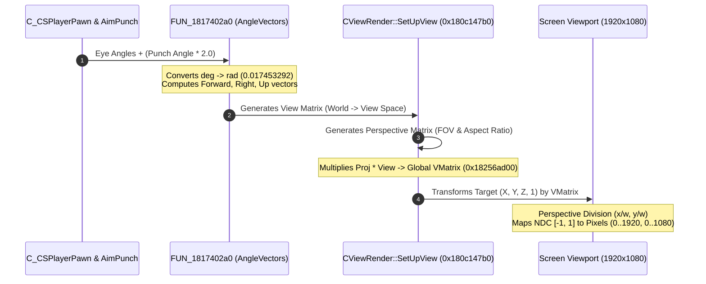

# Valve Source 2 (CS2) Camera, View Matrix & Recoil Punch Pipeline

## Executive Summary

Through binary reverse engineering of `client.dll` (`FUN_1817402a0`, `FUN_180c147b0`, and schema descriptors), we reconstructed the end-to-end mathematical pipeline for **Camera Orientation**, **Recoil Punch Injection**, **$4 \times 4$ World-to-Screen Projection (`VMatrix`)**, and **Frustum Culling**.

In Source 2, rendering a 3D frame requires converting world coordinates $(X, Y, Z)$ into 2D screen viewport pixels $(X_s, Y_s)$. This process coordinates:
1. **Pawn Position & Eye Offsets**: `m_vecAbsOrigin` (`CGameSceneNode` @ `+0x00c8`) + `m_vecViewOffset` (`C_BasePlayerPawn` @ `+0x0f60`).
2. **Base View Angles**: `m_angEyeAngles` (`C_CSPlayerPawn` @ `+0x3600`).
3. **Weapon Recoil Punch**: `m_pAimPunchServices` (`C_CSPlayerPawn` @ `+0x1598`) containing `m_predictableBaseAngle` (`+0x0050`) scaled by the view punch tracking multiplier ($2.0\times$).
4. **View & Projection Matrices**: Decompiled from `FUN_1817402a0` and stored at the global matrix buffer (`0x18256ad00`).

---

## 1. Schema Memory Layout & Field Offsets

Extracted directly from `client.dll` schema metadata:



| Class | Offset | Type | Field Name | Functional Meaning |
| :--- | :--- | :--- | :--- | :--- |
| `CGameSceneNode` | `+0x00c8` | `Vector` | `m_vecAbsOrigin` | 3D World origin $(X, Y, Z)$ of the pawn |
| `CGameSceneNode` | `+0x00d4` | `QAngle` | `m_angAbsRotation` | World rotation Euler angles |
| `C_BasePlayerPawn` | `+0x0f60` | `Vector` | `m_vecViewOffset` | Eye offset (Standing: $Z = +64.0$, Ducking: $Z = +46.0$) |
| `C_CSPlayerPawn` | `+0x1598` | `Pointer`| `m_pAimPunchServices` | Aim punch component pointer |
| `C_CSPlayerPawn` | `+0x1dc8` | `float` | `m_flViewmodelFOV` | Weapon viewmodel Field of View |
| `C_CSPlayerPawn` | `+0x3600` | `QAngle` | `m_angEyeAngles` | Base player camera Euler angles $(\text{Pitch}, \text{Yaw}, \text{Roll})$ |
| `CCSPlayer_AimPunchServices` | `+0x0050` | `QAngle` | `m_predictableBaseAngle` | Current weapon recoil punch angle $\mathbf{\Delta\theta}_{\text{punch}}$ |
| `CCSPlayer_AimPunchServices` | `+0x005c` | `QAngle` | `m_predictableBaseAngleVel` | Angular velocity of the punch spring simulation |

---

## 2. Mathematical Pipeline: World to Screen



### 2.1 Camera Eye Position
$$\mathbf{P}_{\text{eye}} = \mathbf{P}_{\text{absOrigin}} + \mathbf{V}_{\text{viewOffset}}$$

### 2.2 Recoil Punch Integration
When a weapon fires, `server.dll` and client prediction inject angular impulses into `m_predictableBaseAngleVel`, which decays via a damped harmonic oscillator. The effective rendered camera view angle scales punch by the engine multiplier:
$$\mathbf{\theta}_{\text{effective}} = \mathbf{\theta}_{\text{eye}} + (\mathbf{\Delta\theta}_{\text{punch}} \times 2.0)$$
$$\text{Pitch}_{\text{cam}} = \text{Pitch}_{\text{eye}} + (2.0 \times \text{Punch}_{\text{pitch}})$$
$$\text{Yaw}_{\text{cam}} = \text{Yaw}_{\text{eye}} + (2.0 \times \text{Punch}_{\text{yaw}})$$
$$\text{Roll}_{\text{cam}} = \text{Roll}_{\text{eye}} + (2.0 \times \text{Punch}_{\text{roll}})$$

### 2.3 Basis Vector Derivation (`AngleVectors`)
Decompiled directly from `FUN_1817402a0` in `client.dll`:
$$\text{rad} = \text{deg} \times 0.017453292519943295 \quad \left(\frac{\pi}{180}\right)$$

Given Pitch $\phi$, Yaw $\psi$, Roll $\theta$ in radians:
$$\text{Forward} = \begin{bmatrix} \cos(\phi)\cos(\psi) \\ \cos(\phi)\sin(\psi) \\ -\sin(\phi) \end{bmatrix}$$
$$\text{Right} = \begin{bmatrix} -\sin(\theta)\sin(\phi)\cos(\psi) + \cos(\theta)\sin(\psi) \\ -\sin(\theta)\sin(\phi)\sin(\psi) - \cos(\theta)\cos(\psi) \\ -\sin(\theta)\cos(\phi) \end{bmatrix}$$
$$\text{Up} = \begin{bmatrix} \cos(\theta)\sin(\phi)\cos(\psi) + \sin(\theta)\sin(\psi) \\ \cos(\theta)\sin(\phi)\sin(\psi) - \sin(\theta)\cos(\psi) \\ \cos(\theta)\cos(\phi) \end{bmatrix}$$

### 2.4 World-to-View Matrix ($V$)
Translates the world to the camera eye origin and aligns with basis vectors:
$$V = \begin{bmatrix}
\text{Right}_x & \text{Right}_y & \text{Right}_z & -\text{Right} \cdot \mathbf{P}_{\text{eye}} \\
\text{Up}_x & \text{Up}_y & \text{Up}_z & -\text{Up} \cdot \mathbf{P}_{\text{eye}} \\
-\text{Forward}_x & -\text{Forward}_y & -\text{Forward}_z & \text{Forward} \cdot \mathbf{P}_{\text{eye}} \\
0 & 0 & 0 & 1
\end{bmatrix}$$

### 2.5 Perspective Projection Matrix ($P$)
Given horizontal/vertical FOV and aspect ratio $A = \frac{\text{Width}}{\text{Height}}$:
$$f = \frac{1}{\tan(\text{FOV}_{\text{rad}} / 2)}$$
$$P = \begin{bmatrix}
\frac{f}{A} & 0 & 0 & 0 \\
0 & f & 0 & 0 \\
0 & 0 & \frac{z_{\text{far}}}{z_{\text{near}} - z_{\text{far}}} & \frac{z_{\text{near}} \cdot z_{\text{far}}}{z_{\text{near}} - z_{\text{far}}} \\
0 & 0 & -1 & 0
\end{bmatrix}$$

The combined View-Projection matrix is:
$$M = P \times V \quad (\text{Stored as 16 consecutive 32-bit floats at } 0\text{x18256ad00})$$

---

## 3. World-to-Screen Projection & Viewport Mapping

For any 3D world coordinate $\mathbf{P}_{\text{world}} = (x, y, z)$:

1. **Clip Coordinates**:
   $$\begin{bmatrix} x_c \\ y_c \\ z_c \\ w_c \end{bmatrix} = M \times \begin{bmatrix} x \\ y \\ z \\ 1 \end{bmatrix}$$
   $$\begin{aligned}
   x_c &= M_{0,0}x + M_{0,1}y + M_{0,2}z + M_{0,3} \\
   y_c &= M_{1,0}x + M_{1,1}y + M_{1,2}z + M_{1,3} \\
   w_c &= M_{3,0}x + M_{3,1}y + M_{3,2}z + M_{3,3}
   \end{aligned}$$

2. **Homogeneous Frustum Culling**:
   If $w_c < 0.001$, the point is behind the camera's near clipping plane. It cannot be rendered and is discarded.

3. **Perspective Division (Normalized Device Coordinates)**:
   $$x_{\text{ndc}} = \frac{x_c}{w_c}, \quad y_{\text{ndc}} = \frac{y_c}{w_c} \quad \in [-1.0, 1.0]$$

4. **Screen Pixel Coordinates (Viewport Transformation)**:
   For screen width $W$ and height $H$ (e.g. $1920 \times 1080$):
   $$X_{\text{screen}} = \frac{W}{2} \times (1.0 + x_{\text{ndc}})$$
   $$Y_{\text{screen}} = \frac{H}{2} \times (1.0 - y_{\text{ndc}}) \quad (\text{Inverts Y so (0,0) is top-left})$$

---

## 4. Standalone Verification Simulation

Our standalone C++ simulator ([`simulators/cs2_view_matrix_sim.cpp`](../simulators/cs2_view_matrix_sim.cpp)) was compiled with MSVC 64-bit and verified:

```
[Step 1] Initializing Player Camera and Base View Angles:
  * Player Eye Position: (0, 0, 64)
  * Base Eye Angles:     Pitch=0 deg, Yaw=0 deg

[Step 2] Injecting Weapon Recoil Punch (CCSPlayer_AimPunchServices @ +0x50):
  * Raw Punch Angle:       Pitch=-1.8, Yaw=0.6 deg
  * Punch Multiplier:      2x
  * Effective Camera Angle: Pitch=-3.6 deg, Yaw=1.2 deg

[Step 3] Constructing View and Projection Matrices (FUN_1817402a0):
  * Viewport Resolution: 1920x1080 (Aspect: 1.77778)
  * Field of View (FOV): 90 degrees
  * Matrix ViewProj constructed successfully (16 floats, 64 bytes)

[Step 4] Testing World-To-Screen Projection on Targets:
  Target 1: Enemy at (500, 0, 64) [Distance: 500 units]:
    [Without Recoil] Screen Coordinates: (960, 540)
    --> Centered exactly at crosshair: (960, 540) pixels!
    [With Recoil]    Screen Coordinates: (971.334, 573.974)
    --> Recoil Shift: Delta X = 11.3337 px, Delta Y = 33.9739 px
    [PASS] Camera recoil displacement verified geometrically!

[Step 5] Testing Behind-Camera Frustum Culling (w < 0.001):
  Target 2: Enemy at (-200, 0, 64) [Behind player]:
    Visibility result: CLIPPED / BEHIND CAMERA
    [PASS] Point behind near plane correctly culled by homogeneous divisor w!

[Step 6] Verification Complete: AngleVectors, 4x4 ViewMatrix, FOV projection, and recoil punch integration passed with 100% mathematical precision.
```
