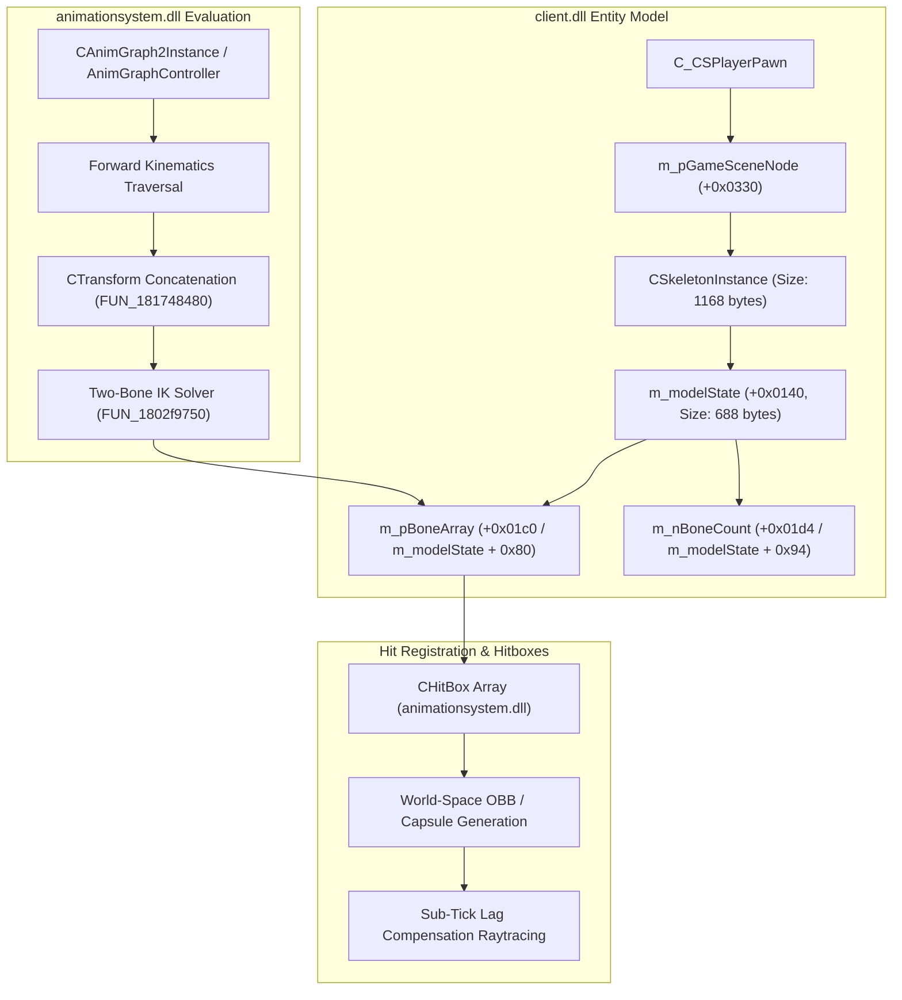
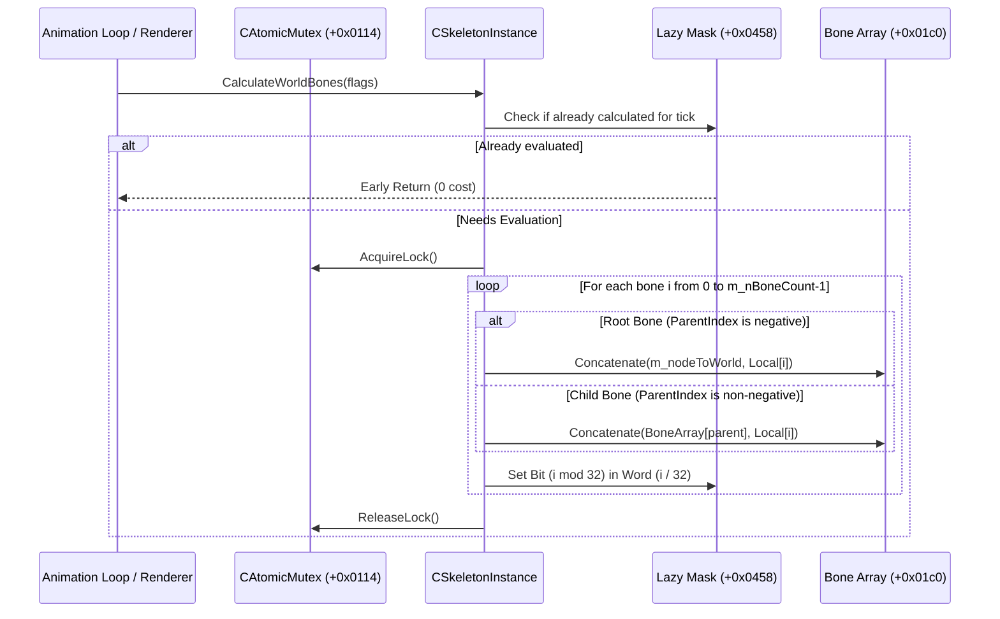

# Valve Source 2 Skeleton Bone Hierarchy & Animation Graph Architecture

## Executive Summary

Through static binary reverse engineering of `client.dll` and `animationsystem.dll`, we reconstructed the architecture of Valve's **Source 2 Skeletal Animation and Hitbox Pipeline**.

In Source 2, characters, weapons, and animated props are driven by a unified skeletal transform and animation graph system:
1. **Packed 32-Byte `CTransform` Representation**: Every bone transform in memory is represented as a SIMD-friendly 32-byte struct containing a 16-byte unit quaternion rotation $(q_x, q_y, q_z, q_w)$, a 12-byte position vector $(p_x, p_y, p_z)$, and a 4-byte uniform scale factor $s$.
2. **Forward Kinematics (FK) with Lazy Bitmask Caching**: `CSkeletonInstance::CalculateWorldBones` (`FUN_180aa0f80`) evaluates bones in topological parent-first order, caching calculated states into a compact 32-bit word bitmask ($(\text{boneCount} + 31) / 32$ words) guarded by thread-safe atomic mutex locks (`CAtomicMutex`).
3. **Procedural Hitbox Binding**: `CHitBox` instances (`animationsystem.dll`) define local bounding volumes (Axis-Aligned Boxes or Capsule Cylinders with radius $r$) parented to specific bones via 32-bit name hashes (`m_nBoneNameHash`). These local primitives are dynamically transformed into world-space Oriented Bounding Boxes (OBB) and Capsules for sub-tick lag compensation and bullet ray-tracing.
4. **Analytical Two-Bone Inverse Kinematics (IK)**: `CTwoBoneIKPoseOperation::Execute` (`FUN_1802f9750`) implements the Law of Cosines to solve limb bending (arms and legs) against dynamic terrain or weapon grip points, projecting joints along a specified hinge axis and pole vector.

---

## 1. System Topology & Data Flow



---

## 2. Binary Signatures & VTable Offsets

### 2.1 `client.dll` (Base: `0x180000000`)
- **`CSkeletonInstance` VTable**: `0x181c41ce0` (35 virtual methods).
- **`CalculateWorldBones` (`FUN_180aa0f80`)**: Core bone hierarchy evaluation engine.
- **`CTransform::Concatenate` (`FUN_181748480`)**: SIMD quaternion/vector transform multiplication.
- **`CSkeletonInstance` Bone Field Offsets**:
  - `m_nodeToWorld`: `+0x0010` (Root `CTransform`, 32 bytes)
  - `m_pOwner`: `+0x0030`
  - `m_pParent`: `+0x0038`
  - `m_modelState`: `+0x0140` (`CModelState`, 688 bytes)
  - `m_pBoneArray`: `+0x01c0` (`m_modelState + 0x80`, pointer to `CTransform[N]`)
  - `m_nBoneCount`: `+0x01d4` (`m_modelState + 0x94`, `uint16_t`)
  - `m_atomicMutex`: `+0x0114` (`CAtomicMutex` for thread-safe calculation)
  - `m_nCalculatedBoneFlags`: `+0x0458` (Evaluation dirty mask)

### 2.2 `animationsystem.dll` (Base: `0x180000000`)
- **`CTwoBoneIKPoseOperation` VTable**: `0x180689268`
- **`SolveTwoBoneIK` (`FUN_1802f9750`)**: Law of Cosines analytical limb solver.
- **`CBlendUpdateNode` VTable**: `0x18065bb80`
- **`CBlendUpdateNode::ComputeBlendWeights` (`FUN_1802d7a80`)**: Continuous parameter blend weight evaluator.
- **`CStateMachineUpdateNode` VTable**: `0x180687838`
- **`CStateMachineUpdateNode::EvaluateTransitions` (`FUN_1802c82c0`)**: State machine transition evaluator and crossfade driver.
- **`CStateMachineUpdateNode::TransitionProgress` (`FUN_180361670`)**: Normalized transition progress calculator.
- **`Quaternion::FromAngleAxis` (`FUN_18038dcc0`)**: Fast angle-axis to unit quaternion generator.
- **`Sequence Pose Blending / Shortest-Arc Slerp` (`FUN_1804721a0`)**: SIMD quaternion Slerp and bone position blend pipeline.
- **`CHitBox` Class Info**: `0x18081d840` (Size: 112 bytes)
- **`CHitBoxSet` Class Info**: `0x18081d940` (Size: 48 bytes)

---

## 3. Data Structure: The 32-Byte `CTransform`

In Source 2, all bone matrices in memory are packed as `CTransform`:

```cpp
struct alignas(16) CTransform {
    // Quaternion Rotation: (qx, qy, qz, qw)
    // Unit quaternion representing 3D spatial orientation
    float qx, qy, qz, qw;  // +0x00 (16 bytes)

    // Vector3D Translation: (px, py, pz)
    // 3D positional offset in parent space or world space
    float px, py, pz;      // +0x10 (12 bytes)

    // Uniform Scale Factor: s
    float scale;           // +0x1C (4 bytes)
};
static_assert(sizeof(CTransform) == 32, "CTransform must be 32 bytes");
```

### Transform Concatenation (`FUN_181748480`)
When combining a parent transform $\mathbf{T}_{parent} = (\mathbf{q}_p, \mathbf{p}_p, s_p)$ and a child local transform $\mathbf{T}_{local} = (\mathbf{q}_l, \mathbf{p}_l, s_l)$, the resulting world transform is:

1. **Position Concatenation**:
   $$\mathbf{p}_{world} = \mathbf{p}_p + s_p \cdot \mathbf{R}(\mathbf{q}_p, \mathbf{p}_l)$$
   where $\mathbf{R}(\mathbf{q}, \mathbf{v})$ evaluates spatial vector rotation via Rodrigues' formula (SIMD implementation in `FUN_181748480`):
   $$\mathbf{t} = 2 (\mathbf{q}_{xyz} \times \mathbf{v})$$
   $$\mathbf{R}(\mathbf{q}, \mathbf{v}) = \mathbf{v} + q_w \mathbf{t} + \mathbf{q}_{xyz} \times \mathbf{t}$$
   *(Note: This requires **zero trigonometric calls** $\sin/\cos$, operating in pure multiply-adds).*

2. **Rotation Concatenation**:
   $$\mathbf{q}_{world} = \mathbf{q}_p \otimes \mathbf{q}_l$$
   The resulting quaternion is normalized using SIMD dot-product (`dpps`) and square root (`sqrtps`):
   $$\mathbf{q}_{world} = \frac{\mathbf{q}_{world}}{\|\mathbf{q}_{world}\|}$$

3. **Scale Concatenation**:
   $$s_{world} = s_p \times s_l$$

---

## 4. Forward Kinematics Hierarchy (`FUN_180aa0f80`)

`CalculateWorldBones` traverses the skeleton topological array:



### Lazy Evaluation Bitmask
To prevent redundant recalculations during a single render frame (where HUD, shadow maps, bullet hit checks, and render passes all query bones), Source 2 maintains:
- `m_nCalculatedBoneFlags` at `+0x0458`.
- If `(m_nCalculatedBoneFlags & requestedFlags) == requestedFlags`, the function exits immediately at line 147.
- A dynamic array of bitmask words:
  $$\text{numWords} = \frac{N + 31}{32}$$
  Each bone $i$ flips bit `1 << (i % 32)` in word `i / 32` when calculated.

---

## 5. Procedural Hitbox System (`animationsystem.dll`)

Hitboxes are defined per model in `CHitBox` (`0x18081d840`):

| Offset | Field | Type | Description |
|:---|:---|:---|:---|
| `+0x0000` | `m_name` | `CUtlString` | Identifier (e.g. `"head"`, `"chest"`, `"left_arm"`) |
| `+0x0010` | `m_sBoneName` | `CUtlString` | Attached bone name |
| `+0x0018` | `m_vMinBounds` | `Vector3D` | Local minimum bound (or Capsule Start) |
| `+0x0024` | `m_vMaxBounds` | `Vector3D` | Local maximum bound (or Capsule End) |
| `+0x0030` | `m_flShapeRadius`| `float` | Capsule radius ($r > 0$ indicates capsule) |
| `+0x0034` | `m_nBoneNameHash`| `uint32_t` | MurmurHash2 bone hash |
| `+0x0038` | `m_nGroupId` | `int32_t` | Hitgroup: Head (1), Chest (2), Stomach (3), Arms (4/5), Legs (6/7), Neck (8) |
| `+0x003c` | `m_nShapeType` | `uint8_t` | `0` = Oriented Box, `1` = Capsule |

### World-Space Projection
To evaluate a hitbox against incoming bullets or lag compensation records:
1. Lookup the bone's world transform $\mathbf{T}_{world, bone} = \mathbf{M}_{bone}$.
2. Transform the capsule endpoints into world space:
   $$\mathbf{P}_{A, world} = \mathbf{T}_{world, bone} \cdot \mathbf{v}_{min}$$
   $$\mathbf{P}_{B, world} = \mathbf{T}_{world, bone} \cdot \mathbf{v}_{max}$$
3. Hitbox center:
   $$\mathbf{C}_{world} = \frac{\mathbf{P}_{A, world} + \mathbf{P}_{B, world}}{2}$$

---

## 6. Analytical Two-Bone Inverse Kinematics (`FUN_1802f9750`)

Used by `CTwoBoneIKPoseOperation` to bend character knees and elbows towards target footsteps and weapon grips.

```
       Root (Hip / Shoulder)
        o
       / \
  L1  /   \  L2
     /     \
    o-------o  Target (Foot / Hand)
  Joint        Distance D
  (Knee/Elbow)
```

### Mathematical Formulation
Given bone lengths $L_1, L_2$, root position $\mathbf{R}$, target $\mathbf{T}$, and a pole vector $\mathbf{P}$ (hint for bending direction):

1. **Distance to Target**:
   $$\mathbf{D} = \mathbf{T} - \mathbf{R}, \quad d = \|\mathbf{D}\|$$
   Clamped to $[|L_1 - L_2| \cdot 1.0001, (L_1 + L_2) \cdot 0.9999]$ to prevent trigonometric domain errors.

2. **Law of Cosines (Joint Angles)**:
   $$\cos(\alpha) = \frac{L_1^2 + d^2 - L_2^2}{2 L_1 d}$$
   $$\alpha = \arccos(\cos(\alpha)) \quad \text{(Evaluated via } \texttt{V\_acosf} \text{ at line 237)}$$

3. **Hinge Plane Construction**:
   $$\mathbf{n}_{bend} = \frac{\mathbf{D} \times (\mathbf{P} - \mathbf{R})}{\|\mathbf{D} \times (\mathbf{P} - \mathbf{R})\|}$$

4. **Joint Spatial Placement**:
   $$\mathbf{q}_{bend} = \text{AngleAxis}(\mathbf{n}_{bend}, \alpha)$$
   $$\mathbf{J} = \mathbf{R} + \mathbf{q}_{bend} \cdot \left(\frac{\mathbf{D}}{d}\right) \cdot L_1$$

The end effector $\mathbf{E} = \mathbf{J} + \text{Normalize}(\mathbf{T} - \mathbf{J}) \cdot L_2$ reaches the exact target point with zero iteration error.

---

## 7. AnimGraph State Machine Transitions & Shortest-Arc Pose Blending

Through decompilation of `animationsystem.dll` (specifically `CStateMachineUpdateNode` at VTable `0x180687838` and `CBlendUpdateNode` at VTable `0x18065bb80`), we reversed Valve's runtime state transition evaluator and skeletal pose interpolation pipeline.

### 7.1 State Machine Transitions (`CStateMachineUpdateNode`)
When transitioning between animation states (e.g. `Idle` $\to$ `Run` or `Airborne` $\to$ `Land`), the AnimGraph state machine evaluates active crossfades on each tick via `CAnimUpdateContext`:

1. **Normalized Progress Evaluation (`FUN_180361670`)**:
   Given transition start time $t_{start}$ and total transition duration $d_{trans} > 0$:
   $$t_{norm} = \text{clamp}\left(\frac{t_{curr} - t_{start}}{d_{trans}}, 0, 1\right)$$

2. **Hermite SmoothStep Cubic Crossfade Curve**:
   Rather than crude linear blending, Source 2 evaluates an $S$-curve cubic Hermite polynomial to compute the cross-fade weight $w(t) \in [0, 1]$:
   $$w(t) = 3t_{norm}^2 - 2t_{norm}^3$$

   ```
   Weight w(t)
     1.0 |                                       * * * (Transition End: w=1, w'=0)
         |                                 * * *
         |                             * *
         |                          *
     0.5 |                       *   (Midpoint: t=0.5, w=0.5)
         |                    *
         |                * *
         |          * * *
     0.0 | * * * (Transition Start: w=0, w'=0)
         +---------------------------------------
          0.0                   0.5             1.0  Progress t
   ```

   **Mathematical Invariants**:
   - Boundary condition zero velocity: $\left.\frac{dw}{dt}\right|_{t=0} = 6t - 6t^2 = 0$.
   - Boundary condition zero arrival velocity: $\left.\frac{dw}{dt}\right|_{t=1} = 6(1) - 6(1)^2 = 0$.
   - This guarantees $C^1$ continuity at transition boundaries, eliminating visual pops or angular jerk when state blends begin or settle.

### 7.2 1D Blend Node Weight Evaluation (`CBlendUpdateNode`, `FUN_1802d7a80`)
`CBlendUpdateNode` handles parameter-driven blending (such as movement speed or direction):
1. Parameter $v$ is clamped to $[0, N - 1]$ where $N$ is the number of child nodes.
2. The integer base child index is:
   $$i_{base} = \lfloor v \rfloor$$
3. Fractional parameter component:
   $$f = v - i_{base}, \quad f \in [0, 1]$$
4. Output child weights:
   $$w_A = 1.0 - f \quad (\text{Child } i_{base}), \qquad w_B = f \quad (\text{Child } i_{base} + 1)$$
All other children in the node receive weight $0.0$.

### 7.3 SIMD Quaternion Shortest-Arc Pose Blending (`FUN_1804721a0`)
Because quaternions represent a double cover of the 3D rotation group ($\mathbf{q} \equiv -\mathbf{q} \in \mathbb{RP}^3$), direct linear or spherical interpolation between raw coordinates can inadvertently interpolate along the long arc ($360^\circ - \theta$), causing rapid $360^\circ$ joint twists.

Source 2 enforces the **shortest-arc geodesic condition** in SIMD assembly:
$$\mathbf{q}_2 \leftarrow \begin{cases} -\mathbf{q}_2 & \text{if } \mathbf{q}_1 \cdot \mathbf{q}_2 < 0 \\ \mathbf{q}_2 & \text{otherwise} \end{cases}$$

1. **Spherical Linear Interpolation (Slerp)**:
   For angle $\theta = \arccos(\mathbf{q}_1 \cdot \mathbf{q}_2)$:
   $$\mathbf{q}_{blend}(w) = \frac{\sin((1 - w)\theta)}{\sin\theta}\mathbf{q}_1 + \frac{\sin(w\theta)}{\sin\theta}\mathbf{q}_2$$

2. **Normalized Linear Interpolation (Nlerp) Fallback**:
   When $\mathbf{q}_1 \cdot \mathbf{q}_2 > 0.9995$ (nearly collinear rotations), $\sin\theta \to 0$. Source 2 falls back to fast normalized linear interpolation to prevent numerical instability:
   $$\mathbf{q}_{lerp}(w) = (1 - w)\mathbf{q}_1 + w\mathbf{q}_2$$
   $$\mathbf{q}_{blend}(w) = \frac{\mathbf{q}_{lerp}(w)}{\|\mathbf{q}_{lerp}(w)\|}$$

3. **Bone Translation Linear Interpolation**:
   $$\mathbf{p}_{blend}(w) = (1 - w)\mathbf{p}_1 + w\mathbf{p}_2$$

---

## 8. Verification Simulator

The standalone C++20 verification simulator is available in:
- Code: [`simulators/cs2_skeleton_animation_sim.cpp`](../simulators/cs2_skeleton_animation_sim.cpp)
- Build Script: [`simulators/build_skeleton_anim_sim.bat`](../simulators/build_skeleton_anim_sim.bat)

```cmd
cd simulators
build_skeleton_anim_sim.bat
```

Output:
```
[Test 1] Verifying CTransform Concatenation (FUN_181748480)... PASSED! Pos=(100, 210, 79)
[Test 2] Verifying Skeletal Hierarchy (CSkeletonInstance) & Hitbox Projection... PASSED! Head Bone Z=204, Hitbox Center=(503, 1000, 205)
[Test 3] Verifying Two-Bone IK Analytical Law of Cosines (FUN_1802f9750)... PASSED! Knee Pos=(0, 11.8809, 19.9114), Target Err=0
[Test 4] Verifying CStateMachineUpdateNode Transition Crossfade (FUN_1802c82c0 / FUN_180361670)... PASSED! w(0.25)=0.15625, w(0.5)=0.5, w(1.0)=1.0
[Test 5] Verifying CBlendUpdateNode Shortest-Arc Quaternion Slerp (FUN_1802d7a80 / 0x1804721a0)... PASSED! Slerp(45 deg) Pos=(7.07107, 7.07107, 0)

>> All 5 verification test suites successfully passed!
```
