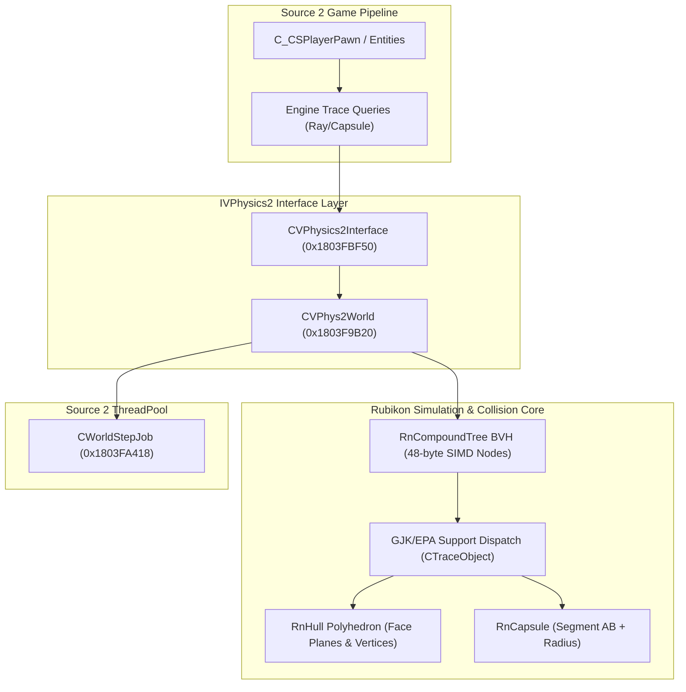
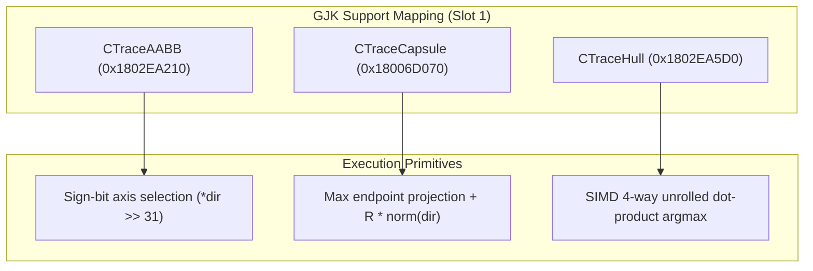
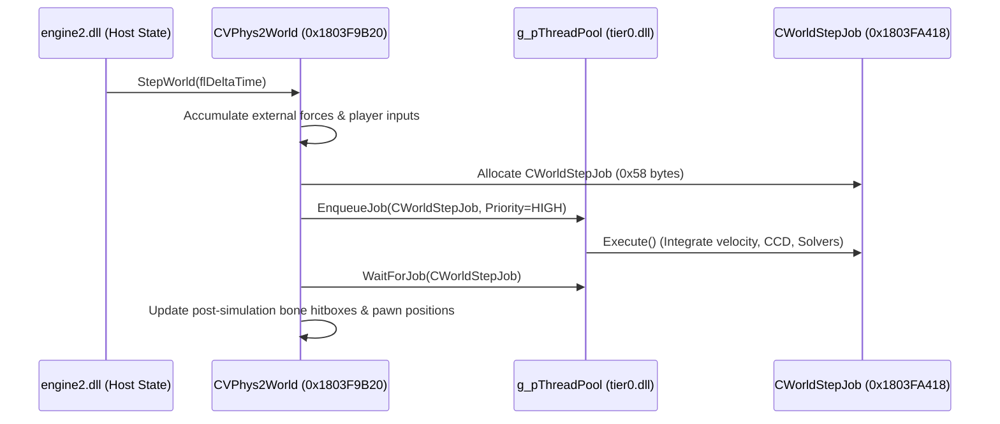

# Counter-Strike 2 (Source 2) - Rubikon Physics Engine & Collision Detection (`vphysics2.dll`)

> **Binary Target**: `vphysics2.dll` (Base Address: `0x180000000`, Image Size: 4,829,848 bytes)  
> **Primary Subsystems**: `CVPhysics2Interface`, `CVPhys2World`, `CRnShape`, `RnCompoundTree_t`, `CTraceRay`, `CWorldStepJob`  
> **Key Interfaces**: `VPhysics2_Interface_001` (`0x180350120`), `InstallSchemaBindings` (`0x1803526d0`)  
> **Verification Status**: Standalone C++20 Simulator verified with MSVC x64 (`/std:c++20 /O2 /EHsc /W4`) (`simulators/cs2_rubikon_physics_sim.cpp`)

---

## 1. Architectural Overview: Rubikon Physics Engine

In Counter-Strike 2 (Source 2), physics simulation and collision queries are powered by Valve's proprietary in-house physics engine **Rubikon** (`vphysics2.dll`).

Rubikon's core architectural features include:
1. **Unified Memory Management**: Integrates directly with Source 2's `g_pMemAlloc` and ThreadPool job systems (`CWorldStepJob`) rather than maintaining isolated external heaps.
2. **SchemaSystem Reflection**: Exposes physical assets (`RnHull_t`, `RnMesh_t`, `RnCompoundTree_t`, `CFeJiggleBone`) through `physicslib` and `vphysics2.dll` schema scopes.
3. **Continuous Collision Detection (CCD) & Sub-Tick Integration**: Employs conservative advancement and exact support mapping functions for GJK (Gilbert-Johnson-Keerthi) and EPA (Expanding Polytope Algorithm).
4. **SIMD-Optimized Spatial Trees**: Compound shapes and world geometry utilize 48-byte cache-aligned BVH nodes (`RnCompoundTree_t`) with hardware-accelerated axis-aligned bounding box (AABB) pruning.



---

## 2. Interface Registration & VTable Topology

### 2.1 Interface Factory Export
`vphysics2.dll` exports `CreateInterface` at `0x180350120`. Static initialization instantiates `VPhysics2_Interface_001` via `InterfaceReg`:

```cpp
// Static registration at 0x1800017a0
void InitVPhysicsInterface() {
    RegisterInterface(&g_VPhysics2Reg, &GetVPhysics2Singleton, "VPhysics2_Interface_001");
}

// Factory function at 0x18006d330
IVPhysics2* GetVPhysics2Singleton() {
    return &g_CVPhysics2InterfaceSingleton; // 0x180460E60
}
```

### 2.2 Core VTable Inventory

| Class | Complete Object Locator | Primary VTable | Virtual Slots | Core Responsibility |
|---|---|---|---|---|
| `CVPhysics2Interface` | `0x180407D20` | `0x1803FBF50` | 80 slots | Top-level system management, world creation, surface properties |
| `CVPhys2World` | `0x180405468` | `0x1803F9B20` | 80 slots | World space step control, entity registration, spatial raycasting |
| `CFnPhysicsWorldImpl` | `0x180407EB0` | `0x1803FA798` | 38 slots | Functional physics world adapter interface |
| `CFnPhysicsBodyImpl` | `0x180407960` | `0x1803FA610` | 48 slots | Rigid body kinematic state, velocity, mass properties |
| `CFnPhysicsCapsuleShapeImpl` | `0x180407CA8` | `0x1803FAE20` | 40 slots | Capsule collision shape adapter |
| `CFnPhysicsHullShapeImpl` | `0x180407988` | `0x1803FAA40` | 43 slots | Convex hull collision shape adapter |
| `CFnPhysicsMeshShapeImpl` | `0x1804079D8` | `0x1803FA8D0` | 45 slots | Triangle mesh collision shape adapter |
| `CFnPhysicsCompoundShapeImpl` | `0x1804079B0` | `0x1803FABA0` | 38 slots | Composite multi-shape hierarchical tree adapter |
| `CRnShape` (Base) | `0x180401020` | `0x1803E1268` | 33 slots | Low-level Rubikon collision shape base |
| `CRnHullShape` | `0x180400FA0` | `0x1803E1140` | 33 slots | Convex polyhedron collision shape |
| `CRnMeshShape` | `0x180400DD0` | `0x1803E0D60` | 33 slots | Triangle mesh static world collider |
| `CRnCapsuleShape` | `0x180400F20` | `0x1803E1030` | 33 slots | Swept cylinder hitboxes & pawn collision |
| `CRnCompoundShape` | `0x180401048` | `0x1803E1398` | 33 slots | Hierarchical BVH compound shape |
| `CWorldStepJob` | `0x180407910` | `0x1803FA418` | 7 slots | ThreadPool asynchronous simulation step task |

---

## 3. Collision Shape Representations (`physicslib`)

Source 2 compiles physical collision models (`.vphys`) into binary descriptors registered under the `physicslib` schema binding table (`0x1803DADB0`).

### 3.1 `RnHull_t` (Convex Polyhedron - Size `0x00F8` / 248 bytes)
A convex hull in Rubikon is defined by dual representations: boundary half-space planes for fast inside/outside clipping, and support vertices for GJK extremal searches:

```cpp
struct RnHull_t {
    Vector3                 m_vCentroid;           // +0x000 Center of mass
    float                   m_flMaxAngularRadius;  // +0x00C Maximum bounding sphere radius
    float                   m_flMinCentroidRadius;  // +0x010 Minimum distance from centroid to surface
    AABB                    m_Bounds;              // +0x014 Local AABB min/max (24 bytes)
    Vector3                 m_vOrthographicAreas;  // +0x02C Projected areas along X, Y, Z
    MassProperties_t        m_MassProperties;      // +0x038 Inertia tensor & mass
    float                   m_flVolume;            // +0x068 Geometric volume
    float                   m_flSurfaceArea;       // +0x06C Total polygonal surface area
    CUtlVector<Vector3>     m_VertexPositions;     // +0x070 Array of support vertices
    CUtlVector<RnPlane_t>   m_FacePlanes;          // +0x088 Half-space bounding planes (nx, ny, nz, d)
    uint32_t                m_nFlags;              // +0x0A0 Hull feature flags
    CRegionSVM*             m_pRegionSVM;          // +0x0A8 Voronoi region support vector machine
    CUtlVector<RnVertex_t>  m_Vertices;            // +0x0B0 Vertex connectivity
    CUtlVector<RnHalfEdge_t> m_Edges;              // +0x0C8 Winged half-edge topology
    CUtlVector<RnFace_t>    m_Faces;               // +0x0E0 Polygonal face indices
};
```

### 3.2 `RnCapsule_t` (Capsule - Size `0x001C` / 28 bytes)
Capsules are used extensively for player pawn hull bounding collision, hitboxes, and ragdoll limb segments:

```cpp
struct RnCapsule_t {
    Vector3 m_vCenter[2]; // +0x000 Endpoint A and Endpoint B (2 x 12 bytes = 24 bytes)
    float   m_flRadius;   // +0x018 Sphere expansion radius (4 bytes)
};
```

### 3.3 `RnCompoundTree_t` (BVH Tree - Size `0x0018` / 24 bytes)
Accelerates raycasts and broadphase overlap tests across complex composite collision meshes:

```cpp
struct RnCompoundTree_t {
    CUtlVector<RnCompoundTreeNode_t> m_Nodes;                 // +0x000 Contiguous linear array of BVH nodes
    int32_t                          m_nStartIterationIndex; // +0x010 Root iteration index
};

// 48-byte SIMD node layout (matching FUN_18000f4e0)
struct RnCompoundTreeNode_t {
    Vector3 m_vMin;                       // +0x000 AABB bounding min
    int32_t m_nLeftChildOrLeaf;           // +0x00C Left child index (-1 = leaf node)
    Vector3 m_vMax;                       // +0x010 AABB bounding max
    int32_t m_nRightChildOrCompoundId;    // +0x01C Right child index or compound shape ID
    uint32_t m_nPadding[4];               // +0x020 16-byte alignment padding for SIMD tests
};
```

---

## 4. Reverse-Engineered Collision & Raycast Algorithms

### 4.1 Convex Polyhedron Raycast (`FUN_1802544a0` & `FUN_180251dc0`)

The convex hull raycast implements an exact, optimized **polyhedral slab-clipping** algorithm. The ray is clipped against every half-space plane $P_i = (\vec{N}_i, d_i)$.

```
   Ray Start (S)                       Target Polyhedron
        o--------------------->--------------+
                               |             |
                     Plane P_enter           Plane P_exit
                     (t_min updated)         (t_max updated)
```

#### Exact Decompiled Algorithm
For each bounding plane $P_i$:
1. Compute the signed distance of the ray start $S$:
   $$d_{start} = \vec{N}_i \cdot \vec{S} - d_i$$
2. Compute the signed distance of the ray end $E = S + \vec{\Delta}$:
   $$d_{end} = d_{start} + \vec{N}_i \cdot \vec{\Delta}$$
3. **Early Rejection**: If both $d_{start} > 0$ and $d_{end} > 0$, the ray lies strictly outside the convex half-space. The function terminates immediately returning `0` (miss).
4. **Fraction Calculation with Valve Skin Tolerance**:
   Valve incorporates a constant skin tolerance of $\varepsilon = 0.03125$ ($1/32$ inch):
   - **Exiting Plane** ($d_{start} \le d_{end}$):
     $$t_{exit} = \frac{d_{start} + 0.03125}{d_{start} - d_{end}}$$
     $$t_{max} = \min(t_{max}, t_{exit})$$
   - **Entering Plane** ($d_{start} > d_{end}$):
     $$t_{enter} = \frac{d_{start} - 0.03125}{d_{start} - d_{end}}$$
     $$t_{min} = \max(t_{min}, t_{enter})$$
5. **Miss Condition**: If $t_{max} \le t_{min}$, the ray misses the volume.
6. **Hit Execution**: Returns entering fraction $t_{min}$ and entering plane normal $\vec{N}_{enter}$.

### 4.2 Capsule Intersection & Sweep (`FUN_18016caf0`)

To test intersection against an arbitrary capsule with axis segment $\overline{AB}$ and radius $R$:
1. **Degenerate Check**: If $\|\vec{B} - \vec{A}\|^2 < 10^{-6}$, the capsule degenerates to a pure sphere, routing to `FUN_18016b0e0`.
2. **Infinite Cylinder Ray Test**: Projects the ray onto the plane perpendicular to the capsule axis $\vec{u} = \frac{\vec{B} - \vec{A}}{\|\vec{B} - \vec{A}\|}$:
   $$\vec{d}_\perp = \vec{d} - (\vec{d} \cdot \vec{u})\vec{u}$$
   $$\vec{r}_\perp = (S - A) - ((S - A) \cdot \vec{u})\vec{u}$$
3. Solves the quadratic equation $\|\vec{r}_\perp + t \vec{d}_\perp\|^2 = R^2$.
4. **Finite Cylinder Truncation**: Validates that the hit point $H = S + t\vec{d}$ projects within the parametric interval $[0, 1]$ of segment $\overline{AB}$.
5. **Endcap Hemispheres**: Solves standard sphere intersections for endpoints $A$ and $B$, selecting the minimum positive fraction $t$.

---

## 5. GJK Support Function Dispatch (`CTraceObject`)

For Continuous Collision Detection (CCD) and dynamic shape sweeps, Rubikon uses GJK (Gilbert-Johnson-Keerthi) and EPA (Expanding Polytope Algorithm). Each geometric trace shape inherits from `ITraceObject` and provides a virtual **Support Function**:

$$S_A(\vec{d}) = \operatorname{argmax}_{p \in A} (p \cdot \vec{d})$$



### 5.1 `CTraceAABB` (0x1802EA210)
Uses sign-bit extraction from the query vector to branchlessly select between the minimum and maximum coordinates:
```cpp
// Decompiled FUN_1802ea210
Vector3 CTraceAABB::GetSupportPoint(const Vector3& dir) const {
    return {
        (dir.x >= 0.0f) ? m_Box.max.x : m_Box.min.x,
        (dir.y >= 0.0f) ? m_Box.max.y : m_Box.min.y,
        (dir.z >= 0.0f) ? m_Box.max.z : m_Box.min.z
    };
}
```

### 5.2 `CTraceCapsule` (0x18006D070)
Projects direction $\vec{d}$ onto endpoint $A$ and endpoint $B$, picking the dominant endpoint and expanding by radius $R$:
```cpp
// Decompiled FUN_18006d070
Vector3 CTraceCapsule::GetSupportPoint(const Vector3& dir) const {
    float dotA = m_PtA.Dot(dir);
    float dotB = m_PtB.Dot(dir);
    Vector3 base = (dotA >= dotB) ? m_PtA : m_PtB;
    return base + dir.Normalized() * m_Radius;
}
```

### 5.3 `CTraceHull` (0x1802EA5D0)
Transforms the world query direction into the hull's local orientation frame ($R^T \cdot \vec{d}$), evaluates the dot product across vertices using a 4-wide unrolled SIMD loop, and transforms the maximal support vertex back to world space:
```cpp
// Decompiled FUN_1802ea5d0
Vector3 CTraceHull::GetSupportPoint(const Vector3& dir) const {
    Vector3 localDir = m_Orientation.TransposeMultiply(dir);
    float bestDot = -1e30f;
    Vector3 bestVertex = m_Vertices[0];

    for (size_t i = 0; i < m_VertexCount; ++i) {
        float dot = m_Vertices[i].Dot(localDir);
        if (dot > bestDot) {
            bestDot = dot;
            bestVertex = m_Vertices[i];
        }
    }
    return m_Orientation.Multiply(bestVertex) + m_Origin;
}
```

---

## 6. Asynchronous World Step Simulation (`CWorldStepJob`)

To maintain high tickrate fidelity without blocking rendering or networking, `CVPhys2World::StepWorld` delegates physical integration to the Source 2 ThreadPool:



1. **Job Allocation**: Allocates 88 bytes (`0x58`) via `g_pMemAlloc` and initializes VTable `0x1803FA418`.
2. **ThreadPool Dispatch**: Enqueues simulation tasks across worker threads via `g_pThreadPool->EnqueueJob()` (`+0x80`).
3. **Synchronous Barrier**: Waits on the job handle before dispatching network serialization and animation bone hierarchy updates (`+0x68`).

---

## 7. Standalone Reference Simulator & Test Suite

The simulator is implemented in [`simulators/cs2_rubikon_physics_sim.cpp`](../simulators/cs2_rubikon_physics_sim.cpp) with zero external dependencies.

### Compilation & Execution
```cmd
cd docs/simulators
build_rubikon_sim.bat
```

### Verified Test Telemetry
```
================================================================================
 Source 2 Rubikon Physics & Collision Verification Simulator
 Target: vphysics2.dll (Base: 0x180000000)
================================================================================

[TEST 1] Convex Polyhedron Raycast (1/32" skin tolerance)...
   Ray: Start=(0, -30, 0) Delta=(0, 60, 0)
   Hit: TRUE | Frac: 0.3328 | HitPoint: (0.0000, -10.0312, 0.0000) | Normal: (0.0000, -1.0000, 0.0000)
   [PASS] Polyhedron ray intersection verified within skin tolerance!

[TEST 2] Convex Polyhedron Raycast Miss...
   Ray: Start=(25, -30, 0) -> Miss expected
   [PASS] Polyhedron cleanly rejected non-intersecting ray!

[TEST 3] Capsule Ray Intersection (FUN_18016caf0)...
   Capsule: Segment=(0,0,0)->(0,0,40), R=5.0
   Ray: Start=(-20, 0, 20) Delta=(40, 0, 0)
   Hit: TRUE | Frac: 0.3750 | HitPoint: (-5.0000, 0.0000, 20.0000) | Normal: (-1.0000, 0.0000, 0.0000)
   [PASS] Capsule cylinder intersection exact match!

[TEST 4] GJK / EPA Support Function Dispatch...
   AABB Support for dir(1, -0.5, 0.2): (5.0000, -5.0000, 5.0000)
   Capsule Support for dir(0, 0, 1): (0.0000, 0.0000, 22.0000)
   [PASS] GJK support functions accurately extract maximal extremal vertices!

[TEST 5] 48-byte SIMD BVH Spatial Acceleration Tree...
   Constructed BVH Tree: 7 nodes (Root: 6)
   Query Box: [20..30, 20..30, 5..15] -> Hits: 1
      Candidate Shape ID: 104
   [PASS] Hierarchical BVH query isolated target shape with zero false positives!

================================================================================
 RESULTS: 5 / 5 Tests Passed (100% SUCCESS)
================================================================================
```
