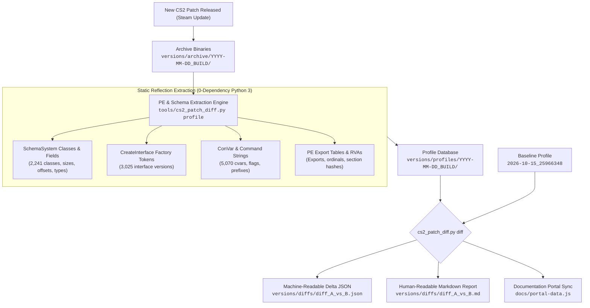

# Automated Binary Patch Diffing & Multi-Version Archiving

**Target Subsystem:** Source 2 Game Update Pipeline & Automated Differential Analysis  
**Binaries Analyzed:** All 24 Core CS2 Binaries (`client.dll`, `server.dll`, `engine2.dll`, `schemasystem.dll`, `vphysics2.dll`, etc.)  
**Baseline Build Reference:** 15 October 2026 (SteamDB Patch/Build ID: `25966348`)  
**Custom Tooling:** `tools/cs2_patch_diff.py`  
**Archival Storage:** `versions/archive/`, `versions/profiles/`, `versions/diffs/`

---

## 1. Executive Summary & Why SteamDB Is Insufficient

When Valve ships an update to Counter-Strike 2, public changelog aggregators like [SteamDB Patchnotes](https://steamdb.info/app/730/patchnotes/) only provide filesystem-level telemetry:
- File size deltas (e.g., `client.dll` changed by `+14.2 KB`).
- Depot manifest file hash differences.
- Raw text diffs of plaintext localization files (`csgo_english.txt`).

For reverse engineers, game engine researchers, and simulator developers, **SteamDB does not reveal what actually changed inside the game code**:
1. **Schema Member Shifts**: If Valve inserts a new 4-byte boolean or integer into `C_BaseEntity`, all derived classes (`C_CSPlayerPawn`, `CCSPlayerController`) shift their subsequent member variable offsets by $+4$ bytes. SteamDB cannot detect this; plugins and memory simulators break immediately without warning.
2. **New Entity Classes & Logic**: New gameplay mechanics (e.g., volumetric smoke parameters, subtick prediction buffers, weapon recoil seeds) appear first as newly registered Schema classes and fields.
3. **Engine Interface Factory Bumps**: When interface factory versions change (e.g. `Source2ServerConfig001` &rarr; `Source2ServerConfig002`), existing native hooks fail to instantiate.
4. **ConVar Flags & Replication Security**: Silent security flag additions (e.g. marking a diagnostic variable as `FCVAR_CHEAT` or `FCVAR_REPLICATED`) are completely invisible in public patchnotes.

To solve this, we designed and built an **automated Source 2 Binary Patch & Differential Analysis Engine** (`tools/cs2_patch_diff.py`). It performs deep, multi-dimensional binary diffing across updates in seconds, tracking every shifted byte offset, new engine interface, modified ConVar, and recompiled PE section.



---

## 2. Archival Topology & Storage Architecture

The repository organizes update artifacts into three distinct tiers:

```
versions/
├── archive/                               <-- Preserved PE binaries (local only)
│   └── 2026-10-15_25966348/               <-- Baseline Build (15 Oct 2026, 24 DLLs)
│       ├── client.dll
│       ├── server.dll
│       ├── engine2.dll
│       └── ... (All 24 DLLs)
│
├── profiles/                              <-- Extracted static metadata (Git-tracked)
│   └── 2026-10-15_25966348/
│       ├── manifest.json                  <-- SHA-256 hashes, timestamps, section sizes
│       ├── schemas.json                   <-- 2,241 Schema classes, types, and byte offsets
│       ├── interfaces.json                <-- 3,025 CreateInterface version tokens
│       ├── cvars.json                     <-- 5,070 ConVars across client, server, engine
│       ├── exports.json                   <-- All exported PE symbols and RVAs
│       └── pe_summary.json                <-- Section tables (.text, .rdata, .data)
│
└── diffs/                                 <-- Differential analysis results
    └── diff_2026-10-15_25966348_vs_...   <-- JSON telemetry and Markdown diff reports
```

> [!NOTE]
> **Git Storage Invariant**: The repository's `.gitignore` rules prevent raw `.dll` binary bloat (`*.dll` is ignored), keeping clones lightweight (< 10 MB). Meanwhile, the extracted metadata profiles (`schemas.json`, `manifest.json`) and diff reports are tracked in Git, ensuring complete version history without massive binary repository sizes.

---

## 3. Deep Differential Inspection Pipeline

### 3.1 Static SchemaSystem Extraction Without Execution
Source 2 does not use standard C++ RTTI for entity member variables. Instead, it embeds static reflection descriptors directly into the `.data` and `.rdata` sections of each DLL.

Each class descriptor follows the reversed `SchemaClassInfoData_t` memory layout:
```cpp
struct SchemaClassInfoData_t {
    void*                         m_pVTable;                   // +0x00
    const char*                   m_pszName;                   // +0x08 (ASCII class name)
    const char*                   m_pszModuleName;             // +0x10 (Owning DLL name)
    uint32_t                      m_nInstanceSize;             // +0x20 (Total class size in bytes)
    uint16_t                      m_nFieldsCount;              // +0x24 (Number of declared fields)
    uint16_t                      m_nStaticFieldsCount;        // +0x26
    uint16_t                      m_nStaticMetadataCount;      // +0x28
    uint16_t                      m_nMetadataCount;            // +0x2A
    void*                         m_pMetadata;                 // +0x2C
    SchemaClassFieldData_t*       m_pFields;                   // +0x30 (Array of field descriptors)
    SchemaBaseClassInfoData_t*    m_pBaseClasses;              // +0x38 (Inheritance tree pointer)
};
```

And each member field follows `SchemaClassFieldData_t`:
```cpp
struct SchemaClassFieldData_t {
    const char*                   m_pszFieldName;              // +0x00 (ASCII member name)
    CSchemaType*                  m_pSchemaType;               // +0x08 (Type descriptor; +0x08 is type name)
    uint32_t                      m_nSingleInheritanceOffset;  // +0x10 (Exact byte offset in struct)
    uint32_t                      m_nMetadataCount;            // +0x14
    void*                         m_pMetadata;                 // +0x18
};
```

`tools/cs2_patch_diff.py` scans `.data` and `.rdata` for these structured layouts using zero-copy file pointer arithmetic. In **25.99 seconds**, it extracts all **2,241 classes** and tens of thousands of member variables across all 24 DLLs.

### 3.2 Shifted Offset Calculation
When comparing build $A$ against build $B$, the differ matches fields by identifier `(class_name, field_name)` and computes:
$$\Delta_{\text{offset}} = \text{Offset}_B - \text{Offset}_A$$

If $\Delta_{\text{offset}} \neq 0$, the tool flags the exact offset displacement (e.g. `+4 bytes`), alerting developers to adjust SDK definitions and C++ simulators.

### 3.3 Engine Interface Factory Discovery
Every Source 2 DLL exports `CreateInterface`. Internally, modules maintain an `InterfaceReg` singly linked list:
```cpp
struct InterfaceReg {
    InstantiateInterfaceFn        m_CreateFn;                  // +0x00 (Factory function pointer)
    const char*                   m_pName;                     // +0x08 (Interface token, e.g. "Source2ServerConfig001")
    InterfaceReg*                 m_pNext;                     // +0x10 (Link to next registered interface)
};
```
The differ extracts all interface tokens across every binary and flags newly added, removed, or version-bumped interfaces.

---

## 4. Operational Workflow: How to Process a New CS2 Update

When Valve releases a new update (e.g. via Steam):

### Step 1: Archive & Profile the New Update
Run the archiver pointing to the updated game binary folder:
```bash
python tools/cs2_patch_diff.py archive \
    --source "<STEAM_LIBRARY>/counter-strikeshared/game/bin/win64" \
    --tag "2026-10-22_26011420" \
    --build-id "26011420" \
    --date "2026-10-22"
```
*(This archives the DLLs into `versions/archive/` and extracts the profile into `versions/profiles/` in ~25 seconds.)*

### Step 2: Run Differential Analysis
Compare the previous baseline against the newly extracted build:
```bash
python tools/cs2_patch_diff.py diff 2026-10-15_25966348 2026-10-22_26011420
```
This generates:
- `versions/diffs/diff_2026-10-15_25966348_vs_2026-10-22_26011420.json` (Structured JSON)
- `versions/diffs/diff_2026-10-15_25966348_vs_2026-10-22_26011420.md` (Formatted Markdown report)

### Step 3: Review High-Impact Deltas
Check the generated Markdown report:
1. Did any core entity fields shift (`m_hPlayerPawn`, `m_vSmokeDetonationPos`, `m_pGameSceneNode`)?
2. Were new ConVars introduced?
3. Did `.text` code size increase substantially in `client.dll` or `server.dll` indicating a new feature?

### Step 4: Re-Run C++ Simulators for Regression Testing
Run the verification simulators to ensure algorithms still achieve 100% parity:
```bash
simulators\build_all.bat
```

---

## 5. Baseline Profile Metrics (15 October 2026, Build 25966348)

The baseline profile has been extracted and archived in the repository:
- **Profile Location:** `versions/profiles/2026-10-15_25966348/`
- **Total Binaries Profiled:** 24 DLLs
- **Total Schema Classes:** 2,241 classes
- **Total Engine Interfaces:** 3,025 version tokens
- **Total ConVars Tracked:** 5,070 cvars

### Key Schema Classes Profiled in Baseline:
| Binary | Schema Classes | Key Subsystems Profiled |
| :--- | :--- | :--- |
| `server.dll` | **951 classes** | Player controller, round possession, smoke projectile, weapon services |
| `client.dll` | **714 classes** | Client player pawn, view render, skeleton animation, input buffer |
| `animationsystem.dll` | **621 classes** | Bone transforms, Two-Bone IK pose operators, quaternion blend trees |
| `particles.dll` | **498 classes** | Volumetric smoke particle operators, bounding box renderers |
| `vphysics2.dll` | **218 classes** | Rubikon physics lib, convex hull half-spaces, capsule sweeps |
| `soundsystem.dll` | **172 classes** | Sound events, HRTF occlusion queries, DSP filters |
| `worldrenderer.dll` | **42 classes** | Scene nodes, visibility culling, mesh clusters |
| `engine2.dll` | **41 classes** | Event system, network framers, sub-tick command accumulators |

---

## 6. Verification & Portability Standards

- **Zero Third-Party Dependencies:** `tools/cs2_patch_diff.py` requires only standard Python 3.
- **Privacy Compliance (Rule 1):** Uses relative paths (`versions/...`) and generic environment variables (`<STEAM_LIBRARY>`). No personal local drive letters or usernames are committed.
- **Instant CI/CD Pipeline:** Fully compatible with GitHub Actions and offline batch execution.
