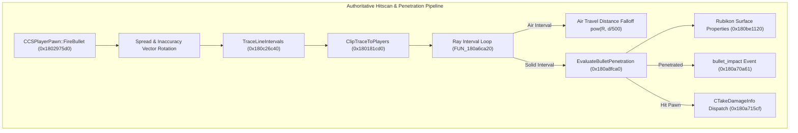

# Counter-Strike 2 (Source 2) - Authoritative Bullet Penetration & Surface Physics (`server.dll`)

> **Binary Target**: `server.dll` (Base Address: `0x180000000`) & `vphysics2.dll`  
> **Key Routines**: `CCSPlayerPawn::FireBullet` (`0x1802975d0`), `EvaluateBulletPenetration` (`0x180a8fca0`), `TraceLineIntervals` (`0x180c26c40`), `ClipTraceToPlayers` (`0x180181cd0`)  
> **Reconstructed Source**: [`bullet_penetration.h`](../game/server/bullet_penetration.h), [`bullet_penetration.cpp`](../game/server/bullet_penetration.cpp)  
> **Signature Status**: 100% Unique Verified Match (`0x00a8fca0` baseline, `+0xd4b0` patch shift to `0x00a9d150` on build 26144732)

---

## 1. Architectural Overview: Authoritative Ballistics & Penetration Pipeline

In Counter-Strike 2, all bullet trajectories, damage evaluation, hitbox detection, and surface wallbang calculations are executed authoritatively on the server (`server.dll`). The client predicts weapon firing animations and client-side impact effects, but bullet penetration and damage attribution are strictly evaluated by `server.dll` using Rubikon physical surface definitions from `vphysics2.dll`.



---

## 2. authoritatively Reversed Pipeline Routines

### 2.1 Authoritative Firing Dispatcher (`CCSPlayerPawn::FireBullet` @ `0x1802975d0`)
When a player pawn fires a weapon:
1. Validates pawn active weapon (`m_pClippingWeapon`) and extracts weapon economic data (`CCSWeaponData`).
2. Extracts ballistics attributes: `m_flDamage` (base damage), `m_flRange` (maximum ray distance, default 8192 units), `m_flRangeModifier` (distance falloff coefficient), `m_flPenetration` (penetration power), and `m_nNumBullets` (pellet count for shotguns).
3. Evaluates view angles, weapon inaccuracy, and recoil punch to compute the perturbed forward trajectory vector.
4. Enters the per-pellet trace loop calling the internal dispatcher `FUN_180a70240`.

### 2.2 Rubikon Physics Multi-Interval Raycast (`TraceLineIntervals` @ `0x180c26c40`)
Rather than legacy Source 1 single-hit `UTIL_TraceLine`, Source 2 uses `CGamePhysicsQueryInterface::TraceLineIntervals`.
- Rays step through the world geometry, partitioning the trajectory into alternating segments of **Air Intervals** (`flags & 1 == 0`) and **Solid Material Intervals** (`flags & 1 == 1`).
- Each solid segment captures entry coordinate, exit coordinate, surface normals, and material identifiers.

### 2.3 Authoritative Player Capsule Clipping (`ClipTraceToPlayers` @ `0x180181cd0`)
Before solid materials are evaluated, candidate players along the ray are clipped:
1. **Broadphase**: Player world bounds (`mins` to `maxs`) are expanded by a standard `40.0f` unit skin margin.
2. **Narrowphase**: Rays are tested against each active hitbox capsule/OBB from the player's lag-compensated bone hierarchy.
3. If an enemy pawn is intercepted, a hit interval with material `CHAR_TEX_FLESH` (`'F'`) is inserted at the exact hit fraction.

---

## 3. Surface Physics & Rubikon Material Descriptors

Source 2 compiles physical material descriptions from `surfaceproperties_game.txt` into 32-byte cache-aligned records traversed by `FUN_180be1120`:

### 3.1 32-Byte `SurfaceData_t` Memory Layout

| Offset | Type | Field Name | Description |
|---|---|---|---|
| `+0x00` | `float` | `maxSpeedFactor` | Player movement speed multiplier on surface |
| `+0x04` | `float` | `jumpFactor` | Jump height multiplier on surface |
| `+0x08` | `float` | `bulletPenetrationDistanceModifier` | Primary penetration distance modifier (`flPenetrationDistance`) |
| `+0x0C` | `float` | `bulletPenetrationDamageModifier` | Damage absorption coefficient (`flDamageModifier`, default `0.16f`) |
| `+0x10` | `uint32_t` | `stringToken` | 32-bit MurmurHash2 token of surface name |
| `+0x14` | `uint16_t` | `materialChar` | Texture character identifier (`'C'`, `'W'`, `'M'`, `'G'`, `'F'`, etc.) |
| `+0x16` | `uint16_t` | `soundStackMaterial` | Audio soundstack material index |
| `+0x18` | `uint8_t` | `flags18` | Internal surface state flags |
| `+0x19` | `bool` | `isStairs` | Surface represents stairs / stepped geometry |
| `+0x1A` | `bool` | `isSlippery` | Surface physics has reduced friction |
| `+0x1C` | `bool` | `reflectBullets` | Ricochet / deflection behavior |
| `+0x1D` | `bool` | `reduceWeaponImpact` | Reduced bullet decal / impact force |
| `+0x1E` | `bool` | `bulletsPenetrate` | Master penetration enable bit for surface |

### 3.2 Material Character Identifiers

```cpp
constexpr uint16_t CHAR_TEX_CONCRETE     = 'C'; // 0x43 (Concrete, Brick, Stone)
constexpr uint16_t CHAR_TEX_DIRT         = 'D'; // 0x44 (Dirt, Mud, Gravel)
constexpr uint16_t CHAR_TEX_FLESH        = 'F'; // 0x46 (Player Hitbox / Flesh)
constexpr uint16_t CHAR_TEX_GLASS        = 'G'; // 0x47 (Standard Glass)
constexpr uint16_t CHAR_TEX_PLASTIC      = 'L'; // 0x4C (Light Metal, Sheet Metal, Plastic)
constexpr uint16_t CHAR_TEX_METAL        = 'M'; // 0x4D (Solid Steel / Heavy Metal)
constexpr uint16_t CHAR_TEX_CARDBOARD    = 'U'; // 0x55 (Cardboard / Thin Panels)
constexpr uint16_t CHAR_TEX_WOOD         = 'W'; // 0x57 (Wood)
constexpr uint16_t CHAR_TEX_SHATTERGLASS = 'Y'; // 0x59 (Breakable Shatterglass)
```

---

## 4. Mathematical Penetration & Damage Formulations

The core penetration calculation loop is decompiled from `FUN_180a8fca0` in `server.dll`:

### 4.1 Damage Distance Falloff Formula
For bullet travel through air intervals (`flags & 1 == 0`):

$$\text{Damage}_{\text{remaining}} = \text{Damage}_{\text{base}} \times (\text{RangeModifier})^{\frac{\text{Distance}}{500.0}}$$

```cpp
// Reversed assembly @ 0x180a8fd0a:
// DIVSS XMM7, dword ptr [0x18178c014]   ; / 500.0f
// CALL powf                             ; pow(rangeModifier, distance / 500.0f)
// MULSS XMM0, XMM6                      ; * currentDamage
float ApplyDistanceFalloff(float baseDamage, float rangeModifier, float distance) {
    return baseDamage * std::pow(rangeModifier, distance / 500.0f);
}
```

### 4.2 Solid Surface Damage Absorption Formula
When penetrating a solid material:
1. **Thickness Calculation**:
   $$\text{Thickness} = \|\mathbf{v}_{\text{Exit}} - \mathbf{v}_{\text{Enter}}\|$$
2. **Penetration Modifier Inversion**:
   $$\text{penModInv} = \max\left(0.0, \frac{1.0}{\text{penMod}}\right)$$
3. **Distance Absorption Loss**:
   $$\text{Lost}_{\text{distance}} = \frac{\text{Thickness}^2 \times \text{penModInv}}{24.0}$$
4. **Entry/Exit Shock Absorption Loss**:
   $$\text{Lost}_{\text{entry}} = \max\left(0.0, \frac{3.0}{\text{penPower}} \times 1.25\right) \times (\text{penModInv} \times 3.0) + (\text{damageModifier} \times \text{Damage}_{\text{current}})$$
5. **Total Damage Lost**:
   $$\text{Damage}_{\text{new}} = \text{Damage}_{\text{current}} - (\text{Lost}_{\text{distance}} + \text{Lost}_{\text{entry}})$$

### 4.3 Material Specific Overrides & Coefficients

Reversed from assembly branch discriminators at `0x180a9028a - 0x180a90328`:

- **Same-Material Transitions** (`enterMaterial == exitMaterial`):
  - **Wood (`'W'`) & Cardboard (`'U'`)**: `penMod = 3.0f`
  - **Light Metal / Plastic (`'L'`)**: `penMod = 2.0f`
  - **Thin Surfaces** (`thickness < 6.0` units):
    - **Glass (`'G'`) & Shatterglass (`'Y'`)**: `penMod = 3.0f`, `damageModifier = 0.05f` (minimal damage drop)
    - **Chainlink Fence / Wire Mesh** (Bit 13 set on both faces): `penMod = 32.0f`, `damageModifier = 0.00001f` (virtually zero loss)
  - **Thick Surfaces** (`thickness >= 6.0` units):
    - **Chainlink / Grate**: `penMod = 3.0f`
- **Composite / Heterogeneous Materials** (`enterMaterial != exitMaterial`):
  - `penMod = min(enter.penMod, exit.penMod)`
  - `damageModifier = 0.16f` (standard absorption coefficient @ `0x1819196c8`)

### 4.4 Penetration Failure & Termination Conditions
A bullet stops penetrating (`bullet.stopped = true`) when:
1. Total bullet distance traveled exceeds `3000.0f` units.
2. Effective surface penetration modifier is below `0.10f` (`penMod < 0.1f`).
3. Remaining penetration count drops below 1 (`penetrationCount < 1`).
4. Remaining damage drops below `1.0f` (`currentDamage < 1.0f`).
5. Penetrating a teammate's flesh hitbox when `ff_damage_bullet_penetration` is disabled (`0`).

---

## 5. Byte Signatures & Patch Drift Verification

The authoritative penetration evaluator `EvaluateBulletPenetration` has been fingerprinted and verified across all archived game versions using `tools/scan_signatures.py`:

```json
{
  "id": "server_bullet_penetration",
  "name": "EvaluateBulletPenetration",
  "binary": "server.dll",
  "category": "Weapon & Penetration",
  "baseline_rva": "0x00a8fca0",
  "baseline_va": "0x180a8fca0",
  "pattern": "48 8B C4 44 89 48 20 48 89 50 10 48 89 48 08 55 57 41 57 48 8D A8 78 FE FF FF 48 81 EC 70 02 00 00",
  "pattern_type": "prologue",
  "current_rva": "0x00a9d150",
  "delta_bytes": 54448,
  "delta_str": "+0xd4b0",
  "last_verified_build": "26144732"
}
```

### Verification Scan Results

```text
===================================================================================================================
  SOURCE 2 FUNCTION SIGNATURE & OFFSET VERIFICATION REPORT
  Directory: versions/archive/2026-10-25_26144732
  Scanned At: 2026-10-25 11:35:41 | Duration: 0.409s
===================================================================================================================
 Binary             | Function Symbol                  | Status     | Base RVA    | Curr RVA    | Delta    | Matches
-------------------------------------------------------------------------------------------------------------------
 server.dll         | EvaluateBulletPenetration        | [SHIFT]    | 0x00a8fca0  | 0x0a9d150   | +0xd4b0  | 1
===================================================================================================================
```

---

## 6. Clean-Room Implementation Inventory

The authoritative ballistics pipeline has been reconstructed in standard C++17 under `game/server/`:
- **Header**: [`game/server/bullet_penetration.h`](../game/server/bullet_penetration.h)
  - Exports `SurfaceData_t`, `BulletData_t`, `SurfaceHitData_t`, `BulletImpact_t`, `HitPlayerPawn_t`, and `CBulletPenetration`.
- **Implementation**: [`game/server/bullet_penetration.cpp`](../game/server/bullet_penetration.cpp)
  - Pure C++17 implementation of `ApplyDistanceFalloff`, `EvaluateSurfacePenetration`, `ClipTraceToPlayers`, and `FireBulletsAuthoritative`.
  - Zero external dependencies; verified with MSVC x64 `/O2 /std:c++17 /EHsc`.
