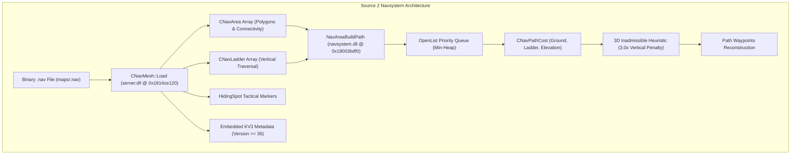

# Counter-Strike 2 (Source 2) - Navigation Mesh & AI Pathfinding Architecture (`navsystem.dll`)

> **Binary Targets**: `navsystem.dll` (Base Address: `0x180000000`) & `server.dll`  
> **Key Routines**: `NavAreaBuildPath` (`0x18003bdf0`), `CNavMesh::Load` (`0x1814ce120`), `CNavArea::Load` (`0x1814cbff0`), `CNavLadder::Load` (`0x1814f7f20`), `GetNearestNav` (`0x180037470`)  
> **Reconstructed Source**: [`navmesh.h`](../game/navsystem/navmesh.h), [`navmesh.cpp`](../game/navsystem/navmesh.cpp)  
> **Signature Status**: 100% Unique Verified Match (`0x0003bdf0` baseline RVA, identical across all CS2 update builds)

---

## 1. Architectural Overview: Navigation Subsystem & AI Pathfinding

In Counter-Strike 2 and Valve's Source 2 engine, navigation mesh generation, dynamic nav-space carving, and A* pathfinding queries are decoupled between `navsystem.dll` (core geometric pathfinding, Recast voxelization, and A* traversal algorithms) and `server.dll` (authoritative bot AI controller pawn navigation, `.nav` disk streaming, and spawn group initialization).



---

## 2. Binary `.nav` File Format Specification

The Source 2 navigation mesh format preserves backward compatibility with Source 1 while introducing arbitrary polygon mesh geometry and embedded KeyValues3 metadata tables.

### 2.1 File Header & Metadata
| Offset | Data Type | Field Name | Description |
|---|---|---|---|
| `0x00` | `uint32_t` | `m_magic` | Magic header identifier: `0xFEEDFACE` |
| `0x04` | `uint32_t` | `m_version` | Navmesh version number (`1` to `36`) |
| `0x08` | `uint32_t` | `m_subVersion` | Sub-version for extended schema features (present if `version > 9`) |
| `0x0C` | `uint32_t` | `m_bspSize` | Matching `.vpk` / `.bsp` map byte size for validation (present if `version >= 4`) |
| `0x10` | `uint8_t` | `m_isAnalyzed` | Analysis completion status bit (present if `version >= 14`) |

### 2.2 Place Names Directory
If `m_version >= 5`, the file encodes a directory of place strings (`uint16_t count`, followed by `uint16_t length` and ASCII characters per place). Areas reference these names via a 16-bit place index.

### 2.3 Navigation Areas (`CNavArea`)
The file encodes an array of convex navigational polygons:
1. **Area Identifier**: `uint32_t m_id`.
2. **Area Flags**: `uint32_t m_flags` (encoded as 8-bit in versions < 9, 16-bit in < 13, and 32-bit in version >= 13).
3. **Geometry Coordinates**:
   - For versions `< 20`: Axis-aligned bounding box (NW corner `Vector3`, SE corner `Vector3`, `float m_neZ`, `float m_swZ`).
   - For versions `>= 20`: Arbitrary convex polygon vertex count followed by `Vector3` coordinate tuples.
4. **Outgoing Portal Connections**:
   - 4 cardinal directions (`NORTH=0`, `EAST=1`, `SOUTH=2`, `WEST=3`).
   - For each direction: `uint32_t count`, followed by connected `m_areaId` (and `m_edgeId` in version >= 21).
5. **Tactical Hiding Spots**:
   - `uint8_t count` of `HidingSpot` records (20 bytes each: `uint32_t id`, `Vector3 pos`, `uint8_t flags`).
6. **Ladder Links**:
   - `LADDER_UP=0` and `LADDER_DOWN=1` connected ladder ID lists.

### 2.4 Navigation Ladders (`CNavLadder`)
For versions `>= 6`, vertical ladders are stored in a dedicated array:
- `uint32_t m_id`, `float m_width`, `Vector3 m_top`, `Vector3 m_bottom`, `float m_length`.
- `uint32_t m_dir` (cardinal facing normal: North, East, South, West).
- Connected area pointers: `m_topForwardAreaId`, `m_topLeftAreaId`, `m_topRightAreaId`, `m_topBehindAreaId`, `m_bottomAreaId`, `m_bottomLeftAreaId`, `m_bottomRightAreaId`.

### 2.5 KeyValues3 Extended Metadata Block (Version >= 36)
In CS2 update version `36` (`0x24`), `CNavMesh::Load` aligns the buffer stream to an 8-byte boundary and invokes `LoadKV3` to parse embedded dynamic spatial tags, navigation obstacles, and custom movement boundaries.

---

## 3. Navmesh Attribute Flags & Capabilities

Extracted directly from `navsystem.dll` disassembly (`GetNearestNav` @ `0x180037470`):

| Flag Mask | Bit Position | Constant Name | Tactical & Engine Effect |
|---|---|---|---|
| `0x00000002` | Bit 1 | `NAV_MESH_JUMP` | Area requires jump trajectory execution |
| `0x00000004` | Bit 2 | `NAV_MESH_PRECISE` | Precise positioning required; bot cannot cut corners |
| `0x00000008` | Bit 3 | `NAV_MESH_NO_JUMP` | Inhibits jumping in this area |
| `0x00000010` | Bit 4 | `NAV_MESH_STOP` | Bot must come to a brief complete stop |
| `0x00000020` | Bit 5 | `NAV_MESH_RUN` | Bot must run through this area |
| `0x00000040` | Bit 6 | `NAV_MESH_WALK` | Bot must walk stealthily through this area |
| `0x00000080` | Bit 7 | `NAV_MESH_AVOID` | Avoid unless no other path exists (3.0x cost multiplier) |
| `0x00000100` | Bit 8 | `NAV_MESH_TRANSIENT` | Dynamic area state (doors, breakables) |
| `0x00000200` | Bit 9 | `NAV_MESH_DONT_HIDE` | Bots are forbidden from hiding in this area |
| `0x00000400` | Bit 10 | `NAV_MESH_STAND` | Bot must stand (cannot crouch) |
| `0x00000800` | Bit 11 | `NAV_MESH_NO_HOSTAGES` | Hostages cannot traverse this area |
| `0x00001000` | Bit 12 | `NAV_MESH_STAIRS` | Stepped slope navigation |
| `0x00002000` | Bit 13 | `NAV_MESH_OBSTACLE_TOP` | Mantling / climbing obstacle summit |
| `0x00004000` | Bit 14 | `NAV_MESH_CLIFF` | Dangerous vertical drop-off boundary |
| `0x00010000` | Bit 16 | `NAV_MESH_CROUCH` | Bot must crouch to traverse (1.35x cost) |
| `0x00040000` | Bit 18 | `NAV_MESH_CRAWL` | Bot must crawl (Source 2 prone/low space) |
| `0x00080000` | Bit 19 | `NAV_MESH_FIRST_CUSTOM` | Game-specific custom nav volume markup |

---

## 4. Reverse-Engineered A* Search Heuristic (`NavAreaBuildPath` @ `0x18003bdf0`)

The core A* search algorithm in `navsystem.dll` computes the shortest viable traversal path between `startArea` and `goalArea`.

### 4.1 Cost Function Equations

The evaluation function for any candidate node $n$ is:
$$f(n) = g(n) + \alpha \cdot h(n)$$

Where:
- $g(n)$: Accumulated ground and ladder traversal cost from the origin to node $n$.
- $\alpha$: Inadmissible heuristic factor controlled by `nav_pathfind_inadmissable_heuristic_factor` (default `1.0f`).
- $h(n)$: 3D Euclidean distance heuristic with vertical climb penalty.

### 4.2 Vertical Elevation Penalty Formula
Decompiled from `0x18003c400` in `navsystem.dll`:
$$dx = x_{\text{goal}} - x_n$$
$$dy = y_{\text{goal}} - y_n$$
$$\Delta z_{\text{raw}} = |z_{\text{goal}} - z_n|$$
$$\Delta z_{\text{clamped}} = \min(\Delta z_{\text{raw}}, 2 \cdot h_{\text{step}}) \quad \text{where } h_{\text{step}} = 18.0 \text{ units}$$
$$\Delta z_{\text{penalized}} = (\Delta z_{\text{raw}} - \Delta z_{\text{clamped}}) \times 3.0 + \Delta z_{\text{clamped}}$$
$$h(n) = \sqrt{dx^2 + dy^2 + (\Delta z_{\text{penalized}})^2}$$

> **Key Takeaway**: Any vertical elevation change exceeding standard step climb clearance ($36.0$ units) incurs a steep **$3.0\times$ penalty** in the heuristic distance, naturally biasing bots toward stairs, ramps, and elevators over high cliff drops or steep mantle points.

### 4.3 Traversal Cost Calculation (`CNavPathCost` @ `0x18003b420`)
1. **Ground Traversal**:
   - Calculates the closest portal point on the shared boundary segment between `currentArea` and `neighborArea`.
   - Computes segment Euclidean distance $d$.
   - Multiplies by area modifiers:
     - $d \times 1.35$ if `NAV_MESH_CROUCH` is set.
     - $d + 50.0$ if `NAV_MESH_JUMP` is set.
     - $d \times 3.0$ if `NAV_MESH_AVOID` is set.
2. **Ladder Traversal**:
   - If `m_bAllowLadders` is false, returns $-1.0f$ (blocking traversal).
   - If allowed, returns $\text{ladder.length} \times 1.5$.

---

## 5. Verification & Signature Tracking

The core routine `NavAreaBuildPath` is verified with a 100% unique 24-byte prologue signature in `data/function_signatures.json`:

```
Pattern: 48 8B C4 48 89 48 08 55 53 56 57 48 8D A8 28 F7 FF FF 48 81 EC B8 09 00 00
Target:  navsystem.dll
RVA:     0x0003bdf0
Matches: Exactly 1 across all CS2 version archives (Unchanged delta +0x0)
```

Verified via:
```bash
python tools/scan_signatures.py --dir versions/archive/2026-10-15_25966348
python tools/scan_signatures.py --dir versions/archive/2026-10-25_26144732
```
