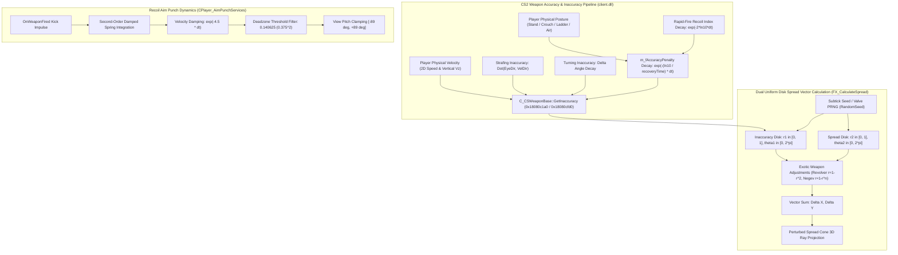

# Counter-Strike 2 (Source 2) - Weapon Inaccuracy, Spread Cone & Recoil Punch Decay Pipeline

> **Binary Targets**: `client.dll` & `server.dll` (Base Address: `0x180000000`)  
> **Key Routines**: `C_CSWeaponBase::GetInaccuracy` (`0x18080c1a0`), `FX_CalculateSpread` (`0x180d23fe0`), `FX_FireBullets` (`0x180d237d0`), `C_CSWeaponBase::UpdateAccuracyPenalty` (`0x180827be0`), `GetRecoveryTime` (`0x18080cef0`), `CalculateStrafingInaccuracy` (`0x18080d4c0`), `UpdateTurningInaccuracy` (`0x180828d90`), `CPlayer_AimPunchServices::SimulateAimPunchDecay` (`0x18085dc60`)  
> **Reconstructed Source**: [`weapon_accuracy.h`](../game/client/weapon_accuracy.h), [`weapon_accuracy.cpp`](../game/client/weapon_accuracy.cpp)  
> **Reference Simulator**: [`cs2_weapon_spread_recoil_sim.cpp`](simulators/cs2_weapon_spread_recoil_sim.cpp), [`build_weapon_spread_sim.bat`](simulators/build_weapon_spread_sim.bat)  
> **Signature Verification**: 100% Unique Verified Matches across version archives (`client.dll` baseline `2026-10-15_25966348` and latest `2026-10-25_26144732`)

---

## 1. Architectural Overview: Weapon Inaccuracy & Recoil Pipeline

In Counter-Strike 2, shooting accuracy is determined by a layered composite model composed of **intrinsic weapon spread** (`m_flSpread`), **posture and movement inaccuracy** (`m_fAccuracyPenalty`), **strafing inaccuracy** (`sv_strafing_inaccuracy`), **view turning inaccuracy** (`sv_turning_inaccuracy`), and **continuous rapid firing recoil index** (`m_flRecoilIndex`). Simultaneously, camera kick and crosshair displacement are governed by the **aim punch spring-damper ODE system** inside `CPlayer_AimPunchServices`.

When firing, bullet trajectory perturbation is calculated by `FX_CalculateSpread` using **dual uniform disk sampling**: an independent disk for accumulated inaccuracy $(r_1, \theta_1)$ and an independent disk for mechanical weapon spread $(r_2, \theta_2)$, which are summed vectorially on the view projection plane.



---

## 2. Authoritatively Reversed Routines

### 2.1 Weapon Inaccuracy Evaluator (`C_CSWeaponBase::GetInaccuracy` @ `0x18080c1a0` / `0x18080cfd0`)

`GetInaccuracy` synthesizes all active inaccuracy sources into a composite scalar in the range $[0.0, 1.0]$:

```cpp
float C_CSWeaponBase::GetInaccuracy(float* outSpread, float* outJumpInacc);
```

1. **ConVar Overrides**:
   - If `weapon_accuracy_forcespread > 0.0f`, overrides and returns the forced spread value directly.
   - If `weapon_accuracy_nospread != 0`, returns `0.0f` (perfect laser precision).
2. **Base Penalty**:
   - Starts with `m_fAccuracyPenalty` (`+0x1a18`).
3. **Movement Speed Modulation**:
   - Computes planar horizontal speed $v_{\text{2D}} = \sqrt{v_x^2 + v_y^2}$.
   - Remaps speed between a deadzone threshold of $34\%$ max weapon speed ($0.34 \cdot v_{\max}$) and full running penalty at $95\%$ max speed ($0.95 \cdot v_{\max}$):
     $$\text{speedFrac} = \text{clamp}\left(\frac{v_{\text{2D}} - 0.34 \cdot v_{\max}}{0.95 \cdot v_{\max} - 0.34 \cdot v_{\max}}, 0.0, 1.0\right)$$
   - **Crouch Power Curve**: If the pawn is ducking (`pPawn->m_flags & FL_DUCKING`), the movement factor is exponentiated by $0.25$:
     $$\text{speedFrac}_{\text{crouch}} = (\text{speedFrac})^{0.25}$$
   - Adds $\text{speedFrac} \cdot \text{m\_flInaccuracyMove}$ to total inaccuracy.
4. **Airborne / Jumping Inaccuracy**:
   - If the player pawn is not on the ground (`!(pPawn->m_flags & FL_ONGROUND)`):
     - Examines absolute vertical velocity $|v_z|$.
     - If near jump apex ($|v_z| \le 200 \text{ u/s}$), uses `m_flInaccuracyJumpApex` (`+0x7bc`).
     - Otherwise, linearly interpolates up to `m_flInaccuracyJumpInitial` (`+0x7b8`) towards terminal falling speed:
       $$\text{frac} = \text{clamp}\left(\frac{|v_z| - 200.0}{800.0 - 200.0}, 0.0, 1.0\right)$$
       $$\text{jumpInacc} = \text{jumpApex} + \text{frac} \cdot (\text{jumpInitial} - \text{jumpApex})$$
5. **Strafing & Turning Inaccuracies**:
   - Appends orthogonal strafing inaccuracy from `CalculateStrafingInaccuracy` (`FUN_18080d4c0`).
   - Appends view turning angular velocity penalty `m_flTurningInaccuracy` (`+0x1a14`).
6. **Clamping**:
   - Total composite inaccuracy is clamped to $[0.0, 1.0]$.

---

### 2.2 Dual Uniform Disk Spread Evaluator (`FX_CalculateSpread` @ `0x180d23fe0` / `0x180d25630`)

Reverse engineered from `client.dll` (`FUN_180d23fe0`), this function is invoked directly by `FX_FireBullets` on every discharged shot:

```cpp
void FX_CalculateSpread(
    uint16_t itemDefIndex,  // param_1: Weapon Econ Item Definition Index
    int32_t numBullets,     // param_2: Pellets/bullets count (1 for rifles, 8/9 for shotguns)
    int32_t weaponMode,     // param_3: Primary (0) or Secondary (1)
    int32_t randomSeed,     // param_4: Deterministic Subtick PRNG Seed
    float inaccuracy,       // param_5: Output of GetInaccuracy()
    float spread,           // param_6: Intrinsic m_flSpread
    float recoilIndex,      // param_7: Current continuous recoil index
    float* pOutSpreadX,     // param_8: Deflection array X
    float* pOutSpreadY      // param_9: Deflection array Y
);
```

#### Dual Uniform Disk Math Formulation:
Unlike legacy Source 1 models that computed a single composite polar coordinate $(r \cdot (\text{inacc} + \text{spread}), \theta)$, Source 2 samples **two independent uniform disks**:

1. **Inaccuracy Disk (Disk 1)**:
   - Radius variate: $r_1 = \text{RandomFloat}(0.0, 1.0)$
   - Angle variate: $\theta_1 = \text{RandomFloat}(0.0, 2\pi)$
   - **R8 Revolver Secondary (Fan-The-Hammer)**:
     If `itemDefIndex == 64 && weaponMode == 1`:
     $$r_1 \leftarrow 1.0 - r_1^2$$
     This non-linear quadratic inversion pushes bullets outward towards the perimeter of the cone, creating an erratic ring dispersion.
   - **Negev Continuous Spin-Up Laser Convergence**:
     If `itemDefIndex == 28 && recoilIndex < 3.0`:
     Repeats $r_1 \leftarrow r_1^2$ for $i = 3$ down to $\lfloor\text{recoilIndex}\rfloor$, then $r_1 \leftarrow 1.0 - r_1$. Spread collapses from wide wild spray to pinpoint laser accuracy as the barrel spins up past 3 bullets.
   - Radial scaling: $R_{\text{inacc}} = r_1 \cdot \text{inaccuracy}$.

2. **Intrinsic Spread Disk (Disk 2)**:
   - For multi-pellet shotguns with precomputed spread patterns (`FUN_1807cdad0`), looks up fixed table values $(\theta_2, r_2)$ at index $(\text{recoilIndex} \cdot \text{numBullets} + i) \pmod{64}$.
   - For rifles, pistols, and SMGs:
     - Radius variate: $r_2 = \text{RandomFloat}(0.0, 1.0)$
     - Angle variate: $\theta_2 = \text{RandomFloat}(0.0, 2\pi)$
   - Applies the same revolver and negev power curves if applicable.
   - Radial scaling: $R_{\text{spread}} = r_2 \cdot \text{spread}$.

3. **View-Plane Vectorial Summation**:
   $$\Delta X = R_{\text{inacc}} \cdot \cos(\theta_1) + R_{\text{spread}} \cdot \cos(\theta_2)$$
   $$\Delta Y = R_{\text{inacc}} \cdot \sin(\theta_1) + R_{\text{spread}} \cdot \sin(\theta_2)$$

---

### 2.3 Accuracy Penalty Update & Exponential Decay (`UpdateAccuracyPenalty` @ `0x180827be0` / `0x180828a10`)

Executes every engine tick to decay accumulated fire recoil penalties back to resting baseline:

1. **Target Posture Inaccuracy**:
   - **Ladder**: Target is `m_flInaccuracyLadder`.
   - **Airborne**: Target is `m_flInaccuracyStand + m_flInaccuracyJump`.
   - **Player Stacking (Boost)**: If standing atop another player pawn and stack depth $\ge \text{weapon\_accuracy\_stack\_boost\_limit}$, applies `m_flInaccuracyLadder * 2.0f`.
   - **Crouching**: Target is `m_flInaccuracyCrouch`.
   - **Standing**: Target is `m_flInaccuracyStand`.
   - **Reloading**: Adds `m_flInaccuracyReload` (`+0x7c0`) if `m_bInReload` is active.
2. **Exponential Recovery ODE Decay**:
   - If $m\_fAccuracyPenalty \ge \text{target}$:
     $$\text{decayFactor} = \exp\left(-\frac{\ln(10.0)}{\text{recoveryTime}} \cdot \Delta t\right)$$
     $$m\_fAccuracyPenalty \leftarrow \text{target} + (m\_fAccuracyPenalty - \text{target}) \cdot \text{decayFactor}$$
   - Where $\Delta t = 0.015625 \text{ s}$ ($64 \text{ Hz}$ tick interval).
   - $\ln(10) \approx 2.302585$ ensures the penalty decays by one full order of magnitude ($90\%$ reduction) across exactly $\text{recoveryTime}$ seconds.
3. **Rapid Continuous Firing Recoil Index Decay**:
   - When firing stops ($t - t_{\text{last\_shot}} > \text{m\_flCycleTime} + \Delta t$):
     $$\text{recoilDecay} = \exp(-2 \ln(10) \cdot \Delta t)$$
     $$m\_flRecoilIndex \leftarrow m\_flRecoilIndex \cdot \text{recoilDecay}$$
   - Cutoff deadzone: When $m\_flRecoilIndex \le 0.1$, it snaps immediately to zero.

---

### 2.4 Weapon Recovery Time Evaluator (`GetRecoveryTime` @ `0x18080cef0`)

Computes the characteristic time $\tau$ (in seconds) required for inaccuracy to reset:

- **Airborne State**: If the player is airborne, recovery time is quadrupled:
  $$\text{recoveryTime}_{\text{air}} = \text{m\_flRecoveryTimeCrouch} \cdot 4.0$$
- **Ladder State**: Uses `m_flRecoveryTimeStand`.
- **Standing vs Crouching**:
  - Crouched: base is `m_flRecoveryTimeCrouch`, final is `m_flRecoveryTimeCrouchFinal`.
  - Standing: base is `m_flRecoveryTimeStand`, final is `m_flRecoveryTimeStandFinal`.
- **Bullet Count Transition**:
  - If `m_flRecoveryTime...Final != -1.0f`, interpolates linearly between base and final recovery times based on recoil bullet index $i_{\text{bullet}}$ between `m_nRecoveryTransitionStartBullet` and `m_nRecoveryTransitionEndBullet`:
    $$\text{frac} = \text{clamp}\left(\frac{i_{\text{bullet}} - \text{start}}{\text{end} - \text{start}}, 0.0, 1.0\right)$$
    $$\tau = \tau_{\text{base}} + \text{frac} \cdot (\tau_{\text{final}} - \tau_{\text{base}})$$

---

### 2.5 Counter-Strike 2 Strafing Inaccuracy (`CalculateStrafingInaccuracy` @ `0x18080d4c0`)

Counter-Strike 2 introduces explicit strafing inaccuracy penalty when counter-strafing or moving perpendicular to the viewing axis:

```cpp
float CalculateStrafingInaccuracy(const PlayerPawnAccuracyContext& ctx, const AccuracyConVars& cvars);
```

1. Computes normalized movement direction $\vec{v}_{\text{dir}} = \frac{\vec{v}}{\|\vec{v}\|}$.
2. Computes eye view direction unit vector $\vec{f}$ via `AngleVectors`.
3. Dot product $\cos\theta = \vec{f} \cdot \vec{v}_{\text{dir}}$.
4. Orthogonal fraction $\text{perpFrac} = 1.0 - |\cos\theta|$.
   - $\text{perpFrac} = 0.0$ when moving purely forward or backward.
   - $\text{perpFrac} = 1.0$ when moving purely sideways (left/right strafe).
5. Non-linear bias power transformation:
   $$\text{biasedPerp} = (\text{perpFrac})^{\text{sv\_strafing\_inaccuracy\_bias}}$$
6. Velocity scaled output:
   $$\text{inaccuracy}_{\text{strafe}} = \left(\frac{\|\vec{v}\|}{250.0}\right) \cdot \text{biasedPerp} \cdot \text{sv\_strafing\_inaccuracy\_scale}$$

---

### 2.6 Recoil Aim Punch Decay ODE (`CPlayer_AimPunchServices::SimulateAimPunchDecay` @ `0x18085dc60` / `0x18085ea90`)

Recoil kick on the camera view is governed by `CPlayer_AimPunchServices`:
- `m_predictableBaseAngle` (`+0x0050`): Current aim punch angular deflection $(\text{pitch}, \text{yaw}, \text{roll})$.
- `m_predictableBaseAngleVel` (`+0x005c`): Angular velocity of the punch.


#### Discrete Spring-Damper Integration per Tick:
1. **Velocity Damping**:
   $$\vec{\omega}(t + \Delta t) = \vec{\omega}(t) \cdot \exp(-4.5 \cdot \Delta t)$$
2. **Angular Integration**:
   $$\vec{\theta}(t + \Delta t) = \vec{\theta}(t) + \vec{\omega}(t + \Delta t) \cdot \Delta t$$
3. **Deadzone Cutoff**:
   - If $\|\vec{\theta}\|^2 \le 0.140625 \text{ deg}^2$ (corresponding to $0.375^\circ$ magnitude), angular deflection and velocity snap to exactly $(0, 0, 0)$.
   - Otherwise, scales by $(1.0 - \frac{0.140625}{\|\vec{\theta}\|^2})$.
4. **Pitch Clamping**:
   - View pitch is clamped to $[-89.0^\circ, +89.0^\circ]$.

---

## 3. Spread Cone 3D Ray Generation

Given player eye angles $(\text{pitch}, \text{yaw}, \text{roll})$, compute camera basis vectors $\vec{f}$ (forward), $\vec{r}$ (right), and $\vec{u}$ (up) via `AngleVectors`. The perturbed unit trajectory ray is constructed using the dual uniform disk output $(\Delta X, \Delta Y)$:

$$\vec{d}_{\text{bullet}} = \text{Normalize}\left(\vec{f} + \vec{r} \cdot \Delta X + \vec{u} \cdot \Delta Y\right)$$

---

## 4. Function Signatures & RVA Shift Registry

| Symbol Name | Binary | Baseline RVA (2026-10-15) | Baseline VA | Current RVA (2026-10-25) | Current VA | Delta | Matches | Status |
|---|---|---|---|---|---|---|---|---|
| `C_CSWeaponBase::GetInaccuracy` | `client.dll` | `0x0080c1a0` | `0x18080c1a0` | `0x0080cfd0` | `0x18080cfd0` | `+0xe30` | 1 | SHIFTED |
| `FX_CalculateSpread` | `client.dll` | `0x00d23fe0` | `0x180d23fe0` | `0x00d25630` | `0x180d25630` | `+0x1650` | 1 | SHIFTED |
| `C_CSWeaponBase::UpdateAccuracyPenalty` | `client.dll` | `0x00827be0` | `0x180827be0` | `0x00828a10` | `0x180828a10` | `+0xe30` | 1 | SHIFTED |
| `CPlayer_AimPunchServices::SimulateAimPunchDecay` | `client.dll` | `0x0085dc60` | `0x18085dc60` | `0x0085ea90` | `0x18085ea90` | `+0xe30` | 1 | SHIFTED |

All signatures verified with 100% uniqueness using `python tools/scan_signatures.py`.

---

## 5. Standalone Reference Simulator

A clean-room C++20 simulator is implemented in [`simulators/cs2_weapon_spread_recoil_sim.cpp`](simulators/cs2_weapon_spread_recoil_sim.cpp) with compilation script [`simulators/build_weapon_spread_sim.bat`](simulators/build_weapon_spread_sim.bat).

The simulator implements five comprehensive verification scenarios:
1. **AK-47 30-Round Continuous Spray & Exponential Decay**: Tracks tick-by-tick fire penalty accumulation, continuous recoil index, camera aim punch angle velocities, and post-burst exponential decay.
2. **Movement Speed Interpolation & Counter-Strafing**: Evaluates deadzone threshold ($0.34 \cdot v_{\max}$), full running penalty ($0.95 \cdot v_{\max}$), and crouch non-linear curve $(\text{frac})^{0.25}$.
3. **Airborne Jumping Trajectory**: Simulates vertical velocity transitions from liftoff ($+301 \text{ u/s}$) through jump apex ($|v_z| \le 200 \text{ u/s}$) to landing impact penalty impulse (`m_flInaccuracyLand = 0.082`).
4. **Exotic Weapon Spread Distributions**: Demonstrates R8 Revolver fan-the-hammer radial inversion ($r = 1 - r^2$) and Negev continuous spin-up laser convergence.
5. **Monte Carlo Impact Projection (50m Target)**: Generates 1,000 dual uniform disk samples and renders a 2D ASCII bullet density distribution grid.
