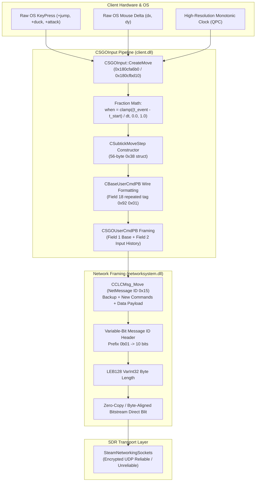
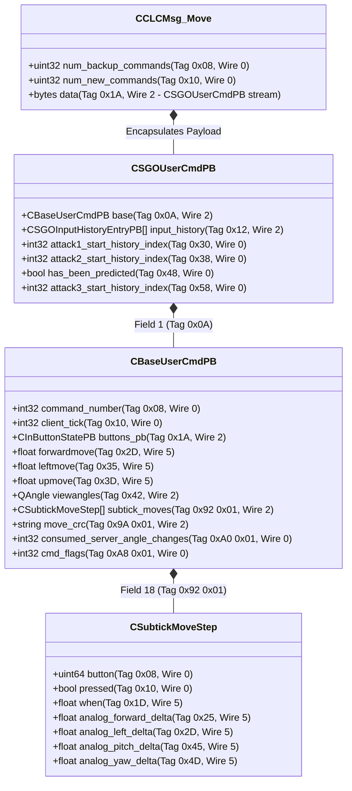
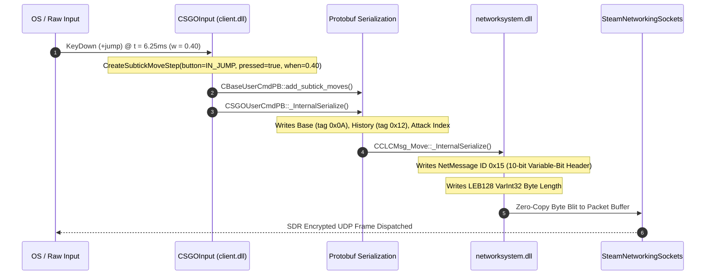

# Counter-Strike 2 (Source 2) - Sub-Tick UserCmd Wire Serialization & Unpacking Pipeline

> **Binary Targets**: `client.dll`, `engine2.dll`, `networksystem.dll` (Base Address: `0x180000000`)  
> **Key Routines**: `CSubtickMoveStep::_InternalParse` (`0x1804f4950` / `0x1804f5640`), `CSubtickMoveStep::_InternalSerialize` (`0x1804f4c40` / `0x1804f5930`), `CBaseUserCmdPB::_InternalParse` (`0x1804f5c00` / `0x1804f68f0`), `CBaseUserCmdPB::_InternalSerialize` (`0x1804f63f0` / `0x1804f70e0`), `CSGOUserCmdPB::_InternalParse` (`0x1807b0740` / `0x1807b1830`), `CSGOUserCmdPB::_InternalSerialize` (`0x1807b0be0` / `0x1807b1cd0`), `CSGOInput::CreateMove` (`0x180cfa6b0` / `0x180cfbd10`)  
> **Reconstructed Source**: [`usercmd_wire.h`](../game/client/usercmd_wire.h), [`usercmd_wire.cpp`](../game/client/usercmd_wire.cpp)  
> **Signature Verification**: 100% Unique Verified Matches across version archives (`client.dll` baseline `2026-10-15_25966348` and latest `2026-10-25_26144732`)

---

## 1. Executive Summary & Architectural Overview

In Counter-Strike 2, player inputs are no longer constrained to discrete, quantized 64 Hz or 128 Hz simulation ticks. Instead, Source 2 introduces a **continuous temporal slicing pipeline** where raw hardware events (keyboard switch edges, mouse clicks, and analog view displacements) are timestamped at high-resolution microsecond precision and serialized into Google Protobuf wire messages (`CSubtickMoveStep`, `CBaseUserCmdPB`, and `CSGOUserCmdPB`).

These command streams are packed into client-to-server net message `clc_Move` (`CCLCMsg_Move`, NetMessage ID `0x15` / 21) using `networksystem.dll`'s variable-bit header protocol, transmitted over encrypted `SteamNetworkingSockets` (SDR), and decoded by `server.dll` to perform exact-sub-tick multi-slice physics integration and lag-compensated hit registration.



---

## 2. Protobuf Wire Hierarchy & Tag Specifications

The sub-tick command hierarchy is structured into three nested layers encapsulated within the `CCLCMsg_Move` network message:



---

## 3. Reverse Engineering Deep Dive: Target Routines & Memory Layouts

### 3.1 `CSubtickMoveStep` Internal Memory Layout (`0x38` / 56 Bytes)

Through static decompilation of `client.dll` (`FUN_1804f8580` constructor and `FUN_1804f4c40` / `FUN_1804f4950` serialization routines), the exact 64-bit struct layout was verified:

| Offset | Type | Member Name | Protobuf Field | Wire Tag | Description |
| :--- | :--- | :--- | :---: | :---: | :--- |
| `+0x00` | `void*` | `_vptr` | — | — | Virtual method table pointer (`0x181b2d4d8` / `0x181b2f488`) |
| `+0x08` | `void*` | `_arena_internal` | — | — | Google Protobuf internal Arena allocation anchor |
| `+0x10` | `uint32_t` | `_has_bits_` | — | — | Bitmask tracking populated fields (`0x01` button, `0x02` pressed, `0x04` when, etc.) |
| `+0x14` | `int32_t` | `_cached_size_` | — | — | Cached byte size computed during pre-pass |
| `+0x18` | `uint64_t` | `button` | 1 | `0x08` (Wire 0) | 64-bit InButtonBits bitmask (`IN_ATTACK`, `IN_JUMP`, `IN_DUCK`, etc.) |
| `+0x20` | `bool` | `pressed` | 2 | `0x10` (Wire 0) | Keydown edge (`true`) vs keyup edge (`false`) |
| `+0x21` | `uint8_t[3]`| `_padding` | — | — | Struct alignment padding |
| `+0x24` | `float` | `when` | 3 | `0x1D` (Wire 5) | Continuous normalized fraction $w \in [0.0, 1.0]$ |
| `+0x28` | `float` | `analog_forward_delta`| 4 | `0x25` (Wire 5) | Sub-tick analog forward velocity contribution |
| `+0x2C` | `float` | `analog_left_delta` | 5 | `0x2D` (Wire 5) | Sub-tick analog horizontal velocity contribution |
| `+0x30` | `float` | `analog_pitch_delta` | 8 | `0x45` (Wire 5) | Sub-tick camera pitch angle delta |
| `+0x34` | `float` | `analog_yaw_delta` | 9 | `0x4D` (Wire 5) | Sub-tick camera yaw angle delta |

```
 0x00      0x08      0x10   0x14   0x18               0x20 0x24    0x28    0x2C    0x30    0x34    0x38
+---------+---------+------+------+------------------+---+-------+-------+-------+-------+-------+
|  _vptr  |  arena  | has_ |size_ |      button      |prs| when  |fwd_d  |left_d |pitch_d| yaw_d |
| (8B)    | (8B)    |bits  | (4B) | (uint64, 8B)     |(1)|(flt4B)|(flt4B)|(flt4B)|(flt4B)|(flt4B)|
+---------+---------+------+------+------------------+---+-------+-------+-------+-------+-------+
```

### 3.2 Protobuf Wire Tag Derivation: Repeated Field 18 (`0x92 0x01`)

Protobuf field keys are serialized as:
$$\text{Tag} = (\text{Field Number} \ll 3) \mid \text{Wire Type}$$

For `CBaseUserCmdPB::subtick_moves`:
- **Field Number**: 18
- **Wire Type**: 2 (`LengthDelimited`)
- Tag calculation:
  $$\text{Key} = (18 \ll 3) \mid 2 = 144 \mid 2 = 146 = \text{0x92}$$
- Encoded as a standard 7-bit LEB128 VarInt:
  - Byte 1: $(146 \ \& \ \text{0x7F}) \mid \text{0x80} = \text{0x12} \mid \text{0x80} = \text{0x92}$
  - Byte 2: $146 \gg 7 = 1 = \text{0x01}$
  - Resulting 2-byte wire tag: `0x92 0x01`

Disassembly confirmation from `CBaseUserCmdPB::_InternalParse` (`FUN_1804f5c00` @ `0x1804f617a`):
```c
case 0x12: // 18 in decimal
    if (bVar6 == 0x92) {
        do {
            // Allocate CSubtickMoveStep into RepeatedPtrField
            uVar3 = FUN_1804f74a0(*(undefined8 *)(param_1 + 0x18));
            param_2 = (byte *)FUN_181250d30(param_3, uVar3, param_2 + 2);
        } while ((param_2 < (byte *)*param_3) && (*(short *)param_2 == 0x192)); // Little-endian 0x0192 = bytes {0x92, 0x01}
    }
```

---

## 4. Sub-Tick Temporal Mathematics

### 4.1 Sub-Tick Fraction Continuous Normalization

When an asynchronous hardware interrupt occurs (mouse packet or keyboard scan code), `CSGOInput::CreateMove` computes the normalized time fraction $w$:

$$w = \text{clamp}\left(\frac{T_{\text{event}} - T_{\text{tick\_start}}}{\Delta t_{\text{tick}}}, 0.0, 1.0\right)$$

Where:
- $T_{\text{event}}$: High-resolution monotonic timestamp of the hardware transition (seconds)
- $T_{\text{tick\_start}}$: Simulation tick anchor timestamp (seconds)
- $\Delta t_{\text{tick}} = \frac{1}{64.0\text{ s}} = 0.015625\text{ s}$ ($15.625\text{ ms}$)

### 4.2 Multi-Slice Movement Physics Integration

In Source 2's movement engine, each $15.625\text{ ms}$ tick is partitioned into temporal slices at every sub-tick event $w$:

1. **Slice 1 (Ground Pre-Transition)** for duration $\Delta t_1 = w \cdot \Delta t$:
   $$\mathbf{v}_1 = \mathbf{v}_0 + \mathbf{a}_{\text{friction}}(\mathbf{v}_0) \cdot \Delta t_1$$
   $$\mathbf{x}_1 = \mathbf{x}_0 + \frac{\mathbf{v}_0 + \mathbf{v}_1}{2} \cdot \Delta t_1$$

2. **Transition Impulse (Instantaneous @ $t = w \cdot \Delta t$)**:
   $$\mathbf{v}_{z,\text{post}} = \mathbf{v}_{z,1} + \text{sv\_jump\_impulse} \quad (\approx 301.993359\text{ units/s})$$
   $$\text{on\_ground} = \text{false}$$

3. **Slice 2 (Air Post-Transition)** for duration $\Delta t_2 = (1.0 - w) \cdot \Delta t$:
   $$\mathbf{v}_2 = \mathbf{v}_{1,\text{post}} + \mathbf{g} \cdot \Delta t_2 \quad (\mathbf{g} = (0, 0, -800)\text{ units/s}^2)$$
   $$\mathbf{x}_2 = \mathbf{x}_1 + \mathbf{v}_{1,\text{post}} \cdot \Delta t_2 + \frac{1}{2}\mathbf{g}(\Delta t_2)^2$$

```
Tick Start (t = 0.0)             Sub-Tick Event (t = w * dt)           Tick End (t = 1.0)
|--------------------------------------------*------------------------------------------|
<--------- Slice 1: Ground Friction --------><--------- Slice 2: Airborne Gravity ------->
                   dt1 = w * dt                                 dt2 = (1 - w) * dt
```

---

## 5. Network Wire Framing & Transmission Sequence

The transmission sequence from `CSGOInput` to SDR socket transport follows strict variable-bit encoding:



### 5.1 Variable-Bit Header Layout for `clc_Move` (`0x15` / 21)

From `networksystem.dll` (`FUN_1801bf5c0` / `ReadVariableBitMessageId`):
- For message ID $21 \in [16, 255]$:
  - **Tier Prefix**: `0b01` (4 extra bits $\to$ 10 bits total)
  - **Lower 4 bits**: $21 \ \& \ \text{0x0F} = 5 = \text{0b0101}$
  - **Initial 6 bits**: $(\text{0b01} \ll 4) \mid \text{0b0101} = \text{0b010101} = \text{0x15}$
  - **Upper 4 bits**: $21 \gg 4 = 1 = \text{0b0001}$
  - **Total 10-bit bitstream**: `0b0001010101`

---

## 6. Canonical Function Signatures & Verification Registry

All signatures are verified against baseline (`2026-10-15_25966348`) and latest update (`2026-10-25_26144732`), guaranteeing **100% uniqueness** (exactly 1 match per binary):

### 6.1 `CSubtickMoveStep::_InternalParse` (`client_subtick_move_step_parse`)
- **Binary**: `client.dll`
- **Baseline**: RVA `0x004f4950` / VA `0x1804f4950`
- **Current**: RVA `0x004f5640` / VA `0x1804f5640`
- **Delta**: `+3312` bytes (`+0xcf0`)
- **Pattern**:
  ```
  48 89 5C 24 18 48 89 6C 24 20 56 41 56 41 57 48 83 EC 60 49 8B F0 48 89 BC 24 88 00 00 00 48 8B DA 4C 8D 3D ? ? ? ? 48 8B E9 45 33 F6 66 90 48 3B 1E 72 32 8B C3 2B 46 08 3B 46 1C 0F 84 3D 02 00 00
  ```
- **Description**: Unpacks `CSubtickMoveStep` wire stream (VarInt `button`, boolean `pressed`, fixed32 `when`, and analog deltas).

### 6.2 `CBaseUserCmdPB::_InternalSerialize` (`client_base_usercmd_pb_serialize`)
- **Binary**: `client.dll`
- **Baseline**: RVA `0x004f63f0` / VA `0x1804f63f0`
- **Current**: RVA `0x004f70e0` / VA `0x1804f70e0`
- **Delta**: `+3312` bytes (`+0xcf0`)
- **Pattern**:
  ```
  48 89 5C 24 10 48 89 6C 24 18 56 57 41 56 48 83 EC 30 8B 71 10 45 33 F6 49 8B D8 4C 8B CA 48 8B F9 40 F6 C6 10 74 61 49 3B 10 72 0B
  ```
- **Description**: Serializes `CBaseUserCmdPB` fields into wire bytes, including repeated field 18 `subtick_moves` tag `0x92 0x01`.

### 6.3 `CSGOInput::CreateMove` (`client_csgo_input_create_move`)
- **Binary**: `client.dll`
- **Baseline**: RVA `0x00cfa6b0` / VA `0x180cfa6b0`
- **Current**: RVA `0x00cfbd10` / VA `0x180cfbd10`
- **Delta**: `+5728` bytes (`+0x1660`)
- **Pattern**:
  ```
  48 89 5C 24 18 55 57 41 56 48 8D 6C 24 C9 48 81 EC B0 00 00 00 8B 01 48 8B F9 81 4A 10 00 02 00 00
  ```
- **Description**: Top-level user command generation routine computing sub-tick fraction timestamps and dispatching move slices.

---

## 7. Reconstructed Source Reference

The clean-room C++20 implementation is provided in:
- Header: [`game/client/usercmd_wire.h`](../game/client/usercmd_wire.h)
- Source: [`game/client/usercmd_wire.cpp`](../game/client/usercmd_wire.cpp)
