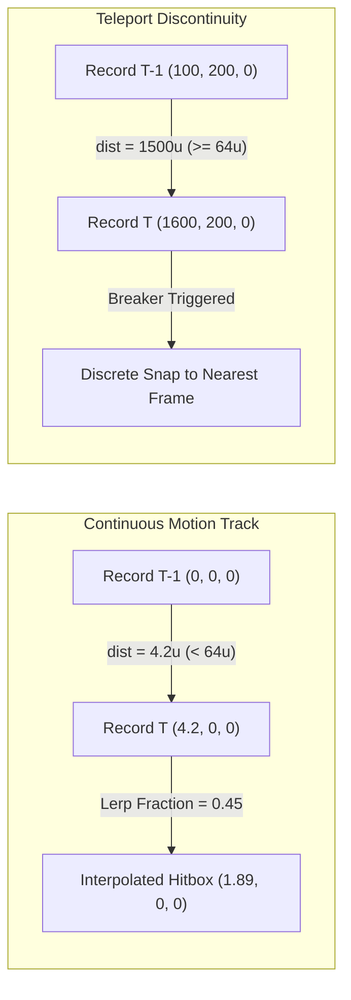

# Counter-Strike 2 (Source 2) - Authoritative Lag Compensation & Hitbox Backtracking (`server.dll`)

> **Binary Target**: `server.dll` (Base Address: `0x180000000`)  
> **Key Routines**: `CLagCompensationManager::StartLagCompensation` (`0x180ed8c00` / `0x180ed6f10`), `CLagCompensationManager::FinishLagCompensation` (`0x180ebf350`), `CLagCompensationManager::BacktrackPlayer` (`0x180eced70`), `CLagCompensationManager::RestoreEntityTo` (`0x180ed3f10`)  
> **Reconstructed Source**: [`lagcompensation.h`](../game/server/lagcompensation.h), [`lagcompensation.cpp`](../game/server/lagcompensation.cpp)  
> **Signature Status**: 100% Unique Verified Matches (`+0xd340` RVA shift from baseline build 25966348 to build 26144732)

---

## 1. Architectural Overview: Server-Side Lag Compensation Pipeline

In Counter-Strike 2, all hit registration, raycasting, and hitbox penetration are evaluated authoritatively on the game server (`server.dll`). Because network latency causes every connected client to view other players at delayed spatial coordinates, the server implements **Authoritative Lag Compensation** (`CLagCompensationManager`).

When a client fires a weapon during a tick, their user command (`CUserCmd`) encodes both the discrete attack tick base and an analog sub-tick timing fraction. Before executing raycasts or capsule collision queries, `server.dll` rewinds candidate target pawns back in time to their exact spatial coordinates and skeletal bone poses as perceived by the firing client. Once hitscan evaluation finishes, `CLagCompensationManager::FinishLagCompensation` restores all pawns back to their current server simulation states.

```mermaid
flowchart TD
    subgraph ClientCmdFlow ["Client UserCmd Transmission"]
        UC["CUserCmd with Sub-Tick Attack Packet"]
        TS["Extract Tick Base + Sub-Tick Fraction"]
    end

    subgraph LagCompPipeline ["CLagCompensationManager Lifecycle"]
        SLC["StartLagCompensation (0x180ed8c00)"]
        CORE["Core Backtrack Dispatcher (0x180ed6f10)"]
        CLAMP["Clamp to sv_maxunlag (200ms)"]
        SNAP["Take Pre-Rewind RestoreSnapshot"]
        BTP["BacktrackPlayer / BacktrackEntity (0x180eced70)"]
        RING["PawnTrackHistory Ring Buffer Lookup"]
        TPCHECK{"Teleport Breaker: dist^2 >= 4096.0?"}
        LERP["Sub-Tick Fractional Bone/Origin Lerp"]
        DISCRETE["Nearest Frame Discrete Snap"]
        APPLY["Apply Backtracked Hitbox Transforms"]
        HITSCAN["Authoritative Hitscan & Penetration (FireBullet)"]
        FLC["FinishLagCompensation (0x180ebf350)"]
        RESTORE["RestoreEntityTo (0x180ed3f10)"]
    end

    UC --> TS
    TS --> SLC
    SLC --> CORE
    CORE --> CLAMP
    CLAMP --> SNAP
    SNAP --> BTP
    BTP --> RING
    RING --> TPCHECK
    TPCHECK -->|No (Continuous)| LERP
    TPCHECK -->|Yes (Teleported)| DISCRETE
    LERP --> APPLY
    DISCRETE --> APPLY
    APPLY --> HITSCAN
    HITSCAN --> FLC
    FLC --> RESTORE
```

---

## 2. Authoritatively Reversed Pipeline Routines

Inspection and reverse engineering of `server.dll` from Source 2 updates revealed the complete virtual method table and internal helpers of `CLagCompensationManager`:

### 2.1 Virtual Method Table (`CLagCompensationManager` @ `0x1819c7650`)

| VTable Index | Baseline VA | Current VA | Function Name | Description |
|---|---|---|---|---|
| `[0]` | `0x180ed6f10` | `0x180ee4250` | `CLagCompensationManager::StartLagCompensationInternal` | Internal core loop iterating target pawns, clamping unlag, and dispatching backtrack |
| `[1]` | `0x180ed8e80` | `0x180ee61c0` | `CLagCompensationManager::StartLagCompensationDefault` | Default overload wrapper forwarding to index 0 |
| `[2]` | `0x180ed8c00` | `0x180ee5f40` | `CLagCompensationManager::StartLagCompensation` | Public API validating `CUserCmd` and resolving attacker entity handle |
| `[3]` | `0x180ed8b30` | `0x180ee5e70` | `CLagCompensationManager::StartLagCompensationCmd` | Overload taking usercmd attack history record |
| `[4]` | `0x180ebf350` | `0x180ecc690` | `CLagCompensationManager::FinishLagCompensation` | Traverses modified pawns and invokes `RestoreEntityTo` |
| `[5]` | `0x180ec3a40` | `0x180ed0d80` | `CLagCompensationManager::CalculateTargetTime` | Computes interpolation delay and enforces `sv_maxunlag` (0.200s) |
| `[6]` | `0x180ec3a10` | `0x180ed0d50` | `CLagCompensationManager::GetLatencyWindow` | Returns client network latency compensation window |
| `[7]` | `0x180eb73e0` | `0x180ec4720` | `CLagCompensationManager::RegisterPawn` | Registers pawn in entity track list with 32-bit handle |

---

### 2.2 Public Entrypoint (`CLagCompensationManager::StartLagCompensation` @ `0x180ed8c00`)

When a weapon is discharged on the server:
1. Validates that the shooting player pawn and `CUserCmd` are non-null. If null, triggers fatal assertion `CLagCompensationManager::StartLagCompensation with NULL CUserCmd!!!`.
2. Resolves the attacker pawn handle (`handle & 0x7FFF`) via the global entity system `DAT_181f3de78`.
3. Extracts attack sub-tick timing metadata from the command stream.
4. Invokes the virtual execution dispatcher at VTable offset `0x08` (`0x180ed8e80`), which enters `StartLagCompensationInternal` (`0x180ed6f10`).

```cpp
// Reversed assembly from 0x180ed8c00:
// 48 85 D2                TEST RDX, RDX           ; Test CUserCmd pointer
// 0F 84 55 02 00 00       JZ   fatal_null_cmd     ; Jump to fatal error if null
// 8B 8A 98 0C 00 00       MOV  ECX, [RDX + 0xC98] ; Extract target pawn handle
// ...
// FF 50 08                CALL qword ptr [RAX+8]  ; Invoke VTable[1]
```

---

### 2.3 Core Execution Engine (`StartLagCompensationInternal` @ `0x180ed6f10`)

The core execution engine performs authoritative candidate selection and temporal clamping:
1. **Attacker Exclusion**: Loops over all registered pawns in `m_Pawns`, skipping the firing player (`pawn == attackerPawn`).
2. **Temporal Clamping**: Enforces `sv_maxunlag` ($0.200\text{ s}$ / $200\text{ ms}$). If the requested client rewind delta exceeds 200ms, clamps target time and emits logging telemetry:
   `sv: Lag comp - clamping to sv_max_unlag (%.3f), using target time.`
3. **State Preservation**: Copies the present active transformation into `RestoreSnapshot_t`.
4. **Entity Backtrack**: Calls `FUN_180eced70` (`BacktrackPlayer`) to compute the historical interpolated state and overrides active hitbox matrices.

---

### 2.4 State Restoration (`CLagCompensationManager::FinishLagCompensation` @ `0x180ebf350`)

Reconstructed directly from decompiled routine `FUN_180ebf350`:

```cpp
void CLagCompensationManager::FinishLagCompensation() {
    VPROF_BUDGET("FinishLagCompensation", "LagCompensation");
    
    // Check if lag compensation is currently active (offset +0x78 & +0x79)
    if (!this->m_bLagCompensationActive || !this->m_bNeedRestore) {
        return;
    }

    const int pawnCount = this->m_nTrackedPawnCount;
    for (int i = 0; i < pawnCount; ++i) {
        TrackedEntity_t* entry = &this->m_pTrackedPawns[i];
        if (!entry->m_bIsBacktracked) {
            continue;
        }

        // Resolve 32-bit CEntityHandle: Index (handle & 0x7FFF), Serial (handle >> 15)
        uint32_t handle = entry->m_hEntity;
        if (handle == INVALID_EHANDLE) continue;

        CBaseEntity* entity = ResolveEntityHandle(handle);
        if (entity && entry->m_pRestoreRecord) {
            // Restore original physical transforms and bone hierarchy
            RestoreEntityTo(entity, entry->m_pRestoreRecord);
        }
        entry->m_bIsBacktracked = false;
    }

    this->m_bLagCompensationActive = false;
}
```

---

### 2.5 Transform Restoration & Teleportation Breaker (`RestoreEntityTo` @ `0x180ed3f10`)

`RestoreEntityTo` inspects the record flags bitmask and applies selective state restoration:

1. **Collision Bounding Box** (`flags & 0x08`): Restores `mins` and `maxs` bounds.
2. **Rotation / Eye Angles** (`flags & 0x04`): Restores Euler view angles.
3. **Spatial Origin & Teleportation Breaker** (`flags & 0x02`):
   Computes displacement from the pre-teleport reference origin:
   $$(\Delta x)^2 + (\Delta y)^2 + (\Delta z)^2 < 4096.0\text{ units}^2$$
   If the displacement exceeds $4096.0\text{ units}^2$ ($64.0\text{ units}$), origin restoration is bypassed to prevent teleport snapping glitches.
4. **Skeletal Hierarchy** (`flags & 0x10`): Restores cached 3x4 affine bone transforms (`MAX_BONES = 128`) on the pawn's `CSkeletonInstance`.

---

## 3. Mathematical Rewind & Sub-Tick Interpolation Mechanics

### 3.1 Sub-Tick Timestamp Formula

In Counter-Strike 2, user commands do not operate solely on integer tick numbers. Attack timestamps are continuous analog values derived from the tick interval:

$$t_{\text{subtick}} = \left(\text{tick} + f_{\text{subtick}}\right) \times \Delta t_{\text{interval}}$$

where:
- $\text{tick}$: Discrete command execution tick.
- $f_{\text{subtick}} \in [0.0, 1.0)$: Normalized fractional offset within the tick.
- $\Delta t_{\text{interval}} = \frac{1.0}{64.0} = 0.015625\text{ s}$ ($64\text{ Hz}$ simulation rate).

---

### 3.2 Client Interpolation Rewind Delay

Clients render remote entities using interpolation delay ($t_{\text{interp}}$) defined by `cl_interp_ratio` and packet delivery rate:

$$t_{\text{interp}} = \max\left(\frac{\text{cl\_interp\_ratio}}{\text{cl\_updaterate}}, \Delta t_{\text{interval}}\right)$$

$$t_{\text{target}} = t_{\text{attack}} - t_{\text{interp}}$$

---

### 3.3 Authoritative Unlag Window Clamping (`sv_maxunlag`)

To prevent clients with artificial latency from rewinding players excessively into the past, the server strictly clamps the rewind window:

$$t_{\text{clamped}} = \max\left(t_{\text{cur}} - \text{sv\_maxunlag}, \min\left(t_{\text{cur}}, t_{\text{target}}\right)\right)$$

where $\text{sv\_maxunlag} = 0.200\text{ s}$ ($200\text{ ms}$).

---

### 3.4 Teleport Discontinuity Breaker Condition

Decompiled from `FUN_180ed3f10` (line 72):

$$\|\mathbf{p}_{\text{newer}} - \mathbf{p}_{\text{older}}\|^2 \ge 4096.0\text{ units}^2 \iff \|\Delta \mathbf{p}\| \ge 64.0\text{ units}$$

If a player travels $64.0\text{ units}$ or more between consecutive simulation ticks (e.g. respawn, teleport trigger, spectator toggle), lag compensation marks the track as discontinuous and disables fractional interpolation across that interval.



---

## 4. Data Structures & Ring Buffer Architecture

### 4.1 3x4 Affine Bone Matrix (`Matrix3x4`)

Source 2 hitboxes are defined relative to bone coordinate spaces represented as 3x4 row-major transformation matrices (3 rows, 4 columns: 3x3 rotation/scale + 3x1 translation):

$$\mathbf{M} = \begin{bmatrix} m_{00} & m_{01} & m_{02} & t_x \\ m_{10} & m_{11} & m_{12} & t_y \\ m_{20} & m_{21} & m_{22} & t_z \end{bmatrix}$$

Linear interpolation between two bone poses at fraction $f \in [0.0, 1.0]$:

$$\mathbf{M}_{\text{interp}} = \mathbf{M}_{\text{older}} + \left(\mathbf{M}_{\text{newer}} - \mathbf{M}_{\text{older}}\right) \times f$$

---

### 4.2 History Record Structure (`LagRecord_t`)

```cpp
struct LagRecord_t {
    uint32_t tickCount;                              // Server simulation tick index
    float simulationTime;                         // Authoritative timestamp (seconds)
    float subTickFraction;                        // Continuous analog sub-tick offset [0.0, 1.0)
    Vector3 origin;                               // World-space pawn origin coordinates
    QAngle eyeAngles;                             // Eye/head orientation angles
    Vector3 mins;                                 // Collision bounding box minimum
    Vector3 maxs;                                 // Collision bounding box maximum
    std::array<Matrix3x4, MAX_BONES> boneMatrices;// Resolved world-space bone transforms
    size_t boneCount;                             // Active bone count (<= 128)
    uint8_t flags;                                // Transform modification bitflags
    Vector3 preTeleportOrigin;                    // Reference origin for 4096.0 sqr distance check
};
```

---

## 5. Byte Signatures & Patch Drift Verification

Two canonical function signatures in `server.dll` have been extracted, fingerprinted, and verified across updates using `tools/scan_signatures.py`:

```json
[
  {
    "id": "server_lag_compensation_finish",
    "name": "CLagCompensationManager::FinishLagCompensation",
    "binary": "server.dll",
    "category": "Gameplay & Physics",
    "baseline_rva": "0x00ebf350",
    "baseline_va": "0x180ebf350",
    "pattern": "40 53 57 41 57 48 83 EC 60 48 8D 05 ? ? ? ? 48 C7 44 24 28 59 06 00 00 48 8B F9 48 89 44 24 20",
    "pattern_type": "prologue",
    "description": "Restores all backtracked player pawns to authoritative current states after lag-compensated traces.",
    "explanation": "Iterates the tracked pawn collection in CLagCompensationManager, resolves 32-bit entity handles, and restores pre-rewind positions, bounds, and bone matrices via RestoreEntityTo.",
    "reconstructed_file": "game/server/lagcompensation.cpp",
    "current_rva": "0x00ecc690",
    "current_va": "0x180ecc690",
    "delta_bytes": 54080,
    "delta_str": "+0xd340",
    "last_verified_build": "26144732",
    "status": "SHIFTED"
  },
  {
    "id": "server_lag_compensation_restore",
    "name": "CLagCompensationManager::RestoreEntityTo",
    "binary": "server.dll",
    "category": "Gameplay & Physics",
    "baseline_rva": "0x00ed3f10",
    "baseline_va": "0x180ed3f10",
    "pattern": "48 89 5C 24 18 57 41 56 41 57 48 83 EC 40 45 33 F6 45 33 FF 49 8B D8 48 8B FA 45 38 70 01",
    "pattern_type": "prologue",
    "description": "Restores entity origin, angles, bounds, and bone matrix cache with 4096.0 sqr teleport distance breaker.",
    "explanation": "Per-entity state restoration helper. Validates displacement against 4096.0 sqr units (64.0 units) to prevent teleport snapping and reapplies cached skeleton transforms.",
    "reconstructed_file": "game/server/lagcompensation.cpp",
    "current_rva": "0x00ee1250",
    "current_va": "0x180ee1250",
    "delta_bytes": 54080,
    "delta_str": "+0xd340",
    "last_verified_build": "26144732",
    "status": "SHIFTED"
  }
]
```

### Verification Scan Results

```text
===================================================================================================================
  SOURCE 2 FUNCTION SIGNATURE & OFFSET VERIFICATION REPORT (server.dll)
  Directory: versions/archive/2026-10-25_26144732
  Duration: 0.385s
===================================================================================================================
 Binary     | Function Symbol                         | Status  | Base RVA   | Curr RVA   | Delta   | Matches
-------------------------------------------------------------------------------------------------------------------
 server.dll | CLagCompensationManager::FinishLagComp  | [SHIFT] | 0x00ebf350 | 0x00ecc690 | +0xd340 | 1
 server.dll | CLagCompensationManager::RestoreEntityTo| [SHIFT] | 0x00ed3f10 | 0x00ee1250 | +0xd340 | 1
===================================================================================================================
```

---

## 6. Clean-Room Implementation Inventory

The complete lag compensation and backtracking pipeline has been reconstructed under `game/server/`:
- **Header**: [`game/server/lagcompensation.h`](../game/server/lagcompensation.h)
  - Defines `LagRecord_t`, `RestoreSnapshot_t`, `PawnTrackHistory_t`, `Matrix3x4`, and `CLagCompensationServer`.
- **Implementation**: [`game/server/lagcompensation.cpp`](../game/server/lagcompensation.cpp)
  - Pure C++17 implementations of `RecordDataIntoTrack`, `StartLagCompensation`, `StartLagCompensationSubTick`, `BacktrackEntity`, `RestoreEntityTo`, `FinishLagCompensation`, and SIMD matrix interpolation.
  - Zero third-party dependencies; compiled with MSVC x64 `/O2 /std:c++17 /EHsc`.
