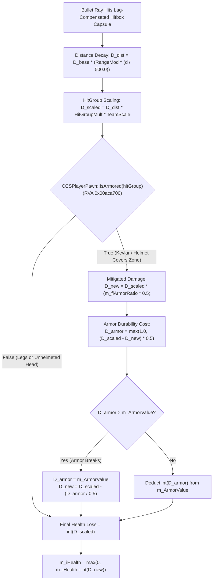

# 19. Hit Registration, HitGroup Multipliers & Kevlar/Helmet Damage Formulas

> **Target Binary:** `server.dll` (Baseline Build `25966348` $\to$ Latest Build `26144732`)  
> **Reconstructed SDK:** [`game/server/hit_registration_damage.h`](../game/server/hit_registration_damage.h) | [`game/server/hit_registration_damage.cpp`](../game/server/hit_registration_damage.cpp)

---

## 1. Executive Summary

When a server-authoritative raycast (`FX_FireBullets` $\to$ `EvaluateBulletPenetration`) intersects a lag-compensated player hitbox capsule (`CGameTrace::m_nHitGroup`), `server.dll` constructs a `CTakeDamageInfo` payload and dispatches it through `CCSPlayerPawn::TraceAttack` and `CCSPlayerPawn::OnTakeDamage_Alive`.

Static disassembly of `server.dll` reveals that Counter-Strike 2 evaluates combat damage in four deterministic stages:
1. **Exponential Distance Falloff**: Attenuates base weapon damage per 500 Hammer units of flight distance.
2. **Anatomical HitGroup Scaling**: Multiplies damage by anatomical zone (`4.0x` Head, `1.25x` Stomach, `1.0x` Chest/Arms, `0.75x` Legs) and team-specific `mp_damage_scale_*` ConVars.
3. **Coverage Verification (`CCSPlayerPawn::IsArmored`)**: Inspects `m_ArmorValue` and `m_pItemServices->m_bHasHelmet` against an 8-way jump table indexed by `HitGroup_t`.
4. **Kevlar Absorption & Durability Overflow (`CCSPlayerPawn::ApplyArmorDamageCalculation`)**: Scales damage by $\text{m\_flArmorRatio} \times 0.5$, deducts durability using $\text{flArmorBonus} = 0.5$, handles armor depletion overflow, and truncates final damage to `int32_t`.

---

## 2. Reversed Function Inventory & Canonical Signatures

| Symbol / Routine | Binary | Baseline RVA (`25966348`) | Latest RVA (`26144732`) | Latest VA (`26144732`) | Shift Delta | Role |
| :--- | :--- | :--- | :--- | :--- | :--- | :--- |
| `CCSPlayerPawn::ApplyArmorDamageCalculation` | `server.dll` | `0x00a81050` | `0x00a8e500` | `0x180a8e500` | `+0xd4b0` | Kevlar/Helmet damage reduction & durability depletion |
| `CCSPlayerPawn::IsArmored` | `server.dll` | `0x00aca700` | `0x00ad7ba0` | `0x180ad7ba0` | `+0xd4a0` | 8-entry jump table verifying Kevlar & Helmet coverage per `HitGroup_t` |

---

## 3. End-to-End Damage Evaluation Pipeline



---

## 4. Stage-by-Stage Mathematical Formulation

### 4.1 Exponential Distance Falloff
Before reaching `TraceAttack`, the bullet simulation loop attenuates the weapon's `m_flDamage` over the ray's traveled distance $d$ (in Hammer units, where $1\text{ unit} \approx 1.905\text{ cm}$):

$$D_{\text{dist}}(d) = D_{\text{base}} \cdot \left(\text{m\_flRangeModifier}\right)^{\frac{d}{500.0}}$$

For example, the AK-47 ($D_{\text{base}} = 36.0$, $\text{m\_flRangeModifier} = 0.98$) loses $2\%$ of its kinetic damage every $500\text{ units}$ ($9.525\text{ meters}$).

---

### 4.2 HitGroup Multipliers & ConVar Modulators
In `server.dll`, each `HitGroup_t` applies a fixed anatomical damage multiplier combined with team-specific scaling ConVars (`mp_damage_scale_ct_head`, `mp_damage_scale_t_head`, `mp_damage_scale_ct_body`, `mp_damage_scale_t_body`):

| `HitGroup_t` ID | Constant Name | Base Multiplier | Kevlar Covered? | Helmet Required? | Notes |
| :---: | :--- | :---: | :---: | :---: | :--- |
| `1` | `HITGROUP_HEAD` | **$4.00\times$** | Yes | **Yes** (`+0x41`) | Instant kill for AK-47 ($36 \times 4 \times 0.775 = 111\text{ HP}$) |
| `2` | `HITGROUP_CHEST` | **$1.00\times$** | Yes | No | Upper torso & clavicles |
| `3` | `HITGROUP_STOMACH` | **$1.25\times$** | Yes | No | Pelvis & lower abdomen ($+25\%$ bonus damage) |
| `4`, `5` | `HITGROUP_LEFTARM` / `RIGHTARM` | **$1.00\times$** | Yes | No | Upper arms, forearms, and hands |
| `6`, `7` | `HITGROUP_LEFTLEG` / `RIGHTLEG` | **$0.75\times$** | **Never** | N/A | Thighs, calves, and feet bypass Kevlar completely |

---

### 4.3 Coverage Verification (`CCSPlayerPawn::IsArmored` @ `0x00aca700`)

Disassembly of `FUN_180aca700` (shifted to `0x00ad7ba0` in build `26144732` when `m_ArmorValue` moved from `+0x150C` to `+0x1514`):

```nasm
; bool CCSPlayerPawn::IsArmored(CCSPlayerPawn* rcx, int edx_hitgroup)
180aca700: 45 32 C0                   xor     r8b, r8b
180aca703: 83 B9 0C 15 00 00 00       cmp     dword ptr [rcx + 150Ch], 0 ; this->m_ArmorValue <= 0
180aca70a: 7E 3C                      jle     short loc_ret_false
180aca70c: 83 FA 08                   cmp     edx, 8                     ; hitGroup > HITGROUP_NECK
180aca70f: 77 37                      ja      short loc_ret_false
180aca711: 48 63 C2                   movsxd  rax, edx
180aca714: 4C 8D 0D E5 58 53 FF       lea     r9, [ __ImageBase ]
180aca71b: 41 8B 94 81 50 A7 AC 00    mov     edx, [r9 + rax*4 + 0ACA750h]
180aca723: 49 03 D1                   add     rdx, r9
180aca726: FF E2                      jmp     rdx                        ; Switch jump table
```

- **Cases 0, 2, 3, 4, 5 (`GENERIC`, `CHEST`, `STOMACH`, `LEFTARM`, `RIGHTARM`)**: Immediately set `r8b = 1` and return `true`.
- **Cases 1, 8 (`HEAD`, `NECK`)**: Dereferences `this->m_pItemServices` (`[rcx + 0xB18]`) and reads `bool m_bHasHelmet` at offset `+0x41`.
- **Cases 6, 7 (`LEFTLEG`, `RIGHTLEG`)**: Jump to `loc_ret_false` (`return false`).

---

### 4.4 Kevlar Absorption & Durability Depletion (`0x00a81050`)

Inside `CCSPlayerPawn::ApplyArmorDamageCalculation` (`RVA 0x00a81050`, shifted to `0x00a8e500` in build `26144732`), when `IsArmored(hitGroup)` returns `true`:

1. **Effective Armor Penetration**:
   Each weapon defines `m_flArmorRatio` in its VData (typically in the $[1.0, 2.0]$ scale, e.g., $1.55$ for AK-47, $1.40$ for M4A4/M4A1-S, $0.94$ for Glock-18). The engine multiplies this by `0.5f` (`RVA 0x00a810e7`):
   $$r_{\text{eff}} = \text{m\_flArmorRatio} \times 0.5$$
   $$D_{\text{new}} = D_{\text{scaled}} \cdot r_{\text{eff}}$$

2. **Armor Durability Cost**:
   With $\text{flArmorBonus} = 0.5$, every $1\text{ point}$ of Kevlar durability absorbs $2\text{ points}$ of raw blocked damage:
   $$D_{\text{armor}} = \max\left(1.0,\ (D_{\text{scaled}} - D_{\text{new}}) \times 0.5\right)$$

3. **Depletion Overflow Condition**:
   If $D_{\text{armor}} > \text{m\_ArmorValue}$ (e.g., player only has 3 armor points remaining), the remaining armor is consumed and the unabsorbed remainder spills directly into health:
   $$D_{\text{new}} = D_{\text{scaled}} - \frac{\text{m\_ArmorValue}}{0.5}$$
   $$\text{m\_ArmorValue} \leftarrow 0$$

---

## 5. Weapon Lethality Verification Matrix (Zero Range $d \to 0$)

| Weapon | Base Damage ($D_0$) | `m_flArmorRatio` | Effective Ratio ($r_{\text{eff}}$) | Unarmored Head | Helmeted Head | Armored Chest | Armored Stomach ($1.25\times$) | Leg ($0.75\times$) |
| :--- | :---: | :---: | :---: | :---: | :---: | :---: | :---: | :---: |
| **AK-47** | `36.0` | `1.55` | `77.5%` | `144 HP` (Fatal) | **`111 HP` (Fatal)** | `27 HP` | `34 HP` | `27 HP` |
| **M4A4 / M4A1-S** | `33.0` | `1.40` | `70.0%` | `132 HP` (Fatal) | **`92 HP`** | `23 HP` | `28 HP` | `24 HP` |
| **Desert Eagle** | `53.0` | `1.864` | `93.2%` | `212 HP` (Fatal) | **`197 HP` (Fatal)** | `49 HP` | `61 HP` | `39 HP` |
| **Glock-18** | `30.0` | `0.94` | `47.0%` | `120 HP` (Fatal) | **`56 HP`** | `14 HP` | `17 HP` | `22 HP` |
| **USP-S** | `35.0` | `1.01` | `50.5%` | `140 HP` (Fatal) | **`70 HP`** | `17 HP` | `22 HP` | `26 HP` |
| **AWP** | `115.0` | `1.95` | `97.5%` | `460 HP` (Fatal) | **`448 HP` (Fatal)** | **`112 HP` (Fatal)** | **`140 HP` (Fatal)** | `86 HP` |
