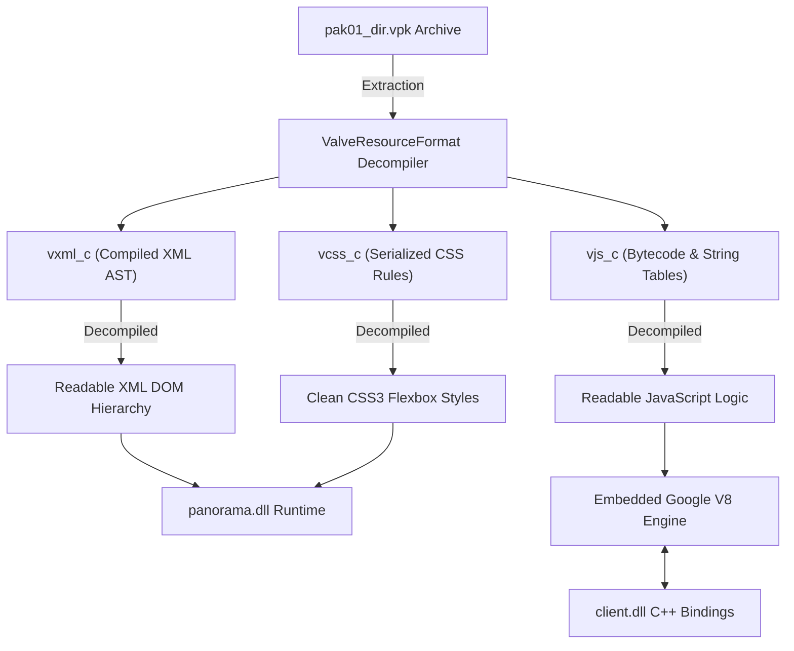

# Chapter 21: Panorama UI Architecture, Resource Decompilation & Demo Overlays

---

## Executive Overview

Counter-Strike 2 utilizes Valve's **Panorama UI Engine**, an integrated GPU-accelerated framework combining declarative XML, flexbox-driven CSS3 styling, and a Google V8 JavaScript runtime embedded within `panorama.dll` and `client.dll`.

This chapter details the reverse-engineered internal architecture of Source 2 Panorama, the compilation pipeline of `_c` resources (via ValveResourceFormat), client V8 bindings (`DemoAPI`, `GameEvents`, `GameStateAPI`), and the design of native in-engine replay HUD overlays.

---

## 1. Engine Subsystems & Decompiled Pipeline

In Counter-Strike 2, all HUD panels, match draft interfaces, scoreboard cards, and the demo playback timeline are governed by Panorama.



### Key Assets Tracked in SteamTracking
The [SteamTracking/GameTracking-CS2](https://github.com/SteamTracking/GameTracking-CS2/tree/master/game/csgo/pak01_dir/panorama) repository maintains real-time tracking of extracted and decompiled Panorama assets across CS2 updates:
- `layout/demo_viewer.xml`: The in-game demo scrubber bar, play/pause transport buttons, tick counter, and speed buttons.
- `layout/csgo_hud.xml`: Main in-game HUD container hosting player vital statistics, death notices, crosshairs, and radar.
- `scripts/demo_viewer.js`: Client-side logic for timeline scrubbing and round skipping using `DemoAPI`.

---

## 2. ValveResourceFormat (VRF) Binary Structure

All production Source 2 assets are compiled into binary containers bearing the `_c` extension (e.g. `demo_viewer.vxml_c`).

### 16-Byte Container Header
```cpp
struct ResourceHeader_t {
    uint32_t m_nFileSize;       // Total file byte size
    uint16_t m_nHeaderVersion;  // Source 2 format version (0x000C)
    uint16_t m_nVersion;        // Resource payload version (0x0001)
    uint32_t m_nBlockOffset;    // Relative offset to block directory (0x10)
    uint32_t m_nBlockCount;     // Number of binary payload blocks
};
```

### Binary Blocks
- **`DATA`**: Primary payload containing the compiled KeyValues3 (KV3) AST tree or bytecode.
- **`REDI` (Resource Edit Info)**: Dependency graph tracking source asset paths and compile flags.
- **`NTRO`**: Structural schema introspection tables for untyped engine structs.

---

## 3. JavaScript Runtime & Playback APIs (`DemoAPI`)

Panorama binds engine functionality directly into the V8 scripting context.

```javascript
// --- Live Demo Transport Controls ---
let currentTick = DemoAPI.GetPlaybackTick();
let maxTicks    = DemoAPI.GetTotalTicks();
let isPaused    = DemoAPI.IsPlaybackPaused();

// Set playback position (analogous to demo_gototick)
DemoAPI.SetPlaybackTick(27703);

// Dynamic timescale modulation (slow-motion audit)
DemoAPI.SetTimescale(0.25);
```

### Real-Time Combat Event Hooking
```javascript
GameEvents.Subscribe("player_hurt", function(ev) {
    let attacker = ev.attacker;
    let victim   = ev.userid;
    let dmg      = ev.dmg_health;
    let hitgroup = ev.hitgroup; // 1 = Head (Apex Joint #6)

    $.Msg(`[AUDIT] Damage Actuation: ${dmg} HP to Hitgroup ${hitgroup}`);
});
```

---

## 4. Native In-Engine Panorama HUD Implementation

Native Panorama overlays can be created and deployed directly to `game/csgo/panorama/` when launching with `-insecure`:

### Layout Template (`subtick_hud.xml`)
```xml
<root>
    <styles>
        <include src="s2r://panorama/styles/csgostyles.vcss_c" />
        <include src="s2r://panorama/styles/subtick_hud.css" />
    </styles>
    <scripts>
        <include src="s2r://panorama/scripts/subtick_hud.js" />
    </scripts>

    <Panel class="SubTickRoot" hittest="false">
        <Panel id="SubTickBarContainer" class="SubTickCard">
            <Label id="SubTickTitle" class="CardTitle" text="SUB-TICK TIMING // 15.625 ms WINDOW" />
            <Panel id="SubTickTrack" class="Track">
                <Panel id="SubTickFill" class="Fill" />
                <Panel id="SubTickNeedle" class="Needle" />
            </Panel>
            <Label id="SubTickCallout" class="Callout" text="Actuation @ 12.18 ms (w = 0.780)" />
        </Panel>
    </Panel>
</root>
```

---

## 5. Summary & Verification

1. **Clean Visuals**: Panorama renders within CS2's DirectX 11 / Vulkan graphics pipeline, providing native sub-pixel font anti-aliasing and zero latency.
2. **Decompilation Parity**: Using ValveResourceFormat (VRF), compiled `_c` resources can be inverted into clean XML, CSS, and JS source files.
3. **Event Synchronization**: `DemoAPI` combined with `GameEvents` enables precise sub-tick actuation auditing directly inside the game engine.
