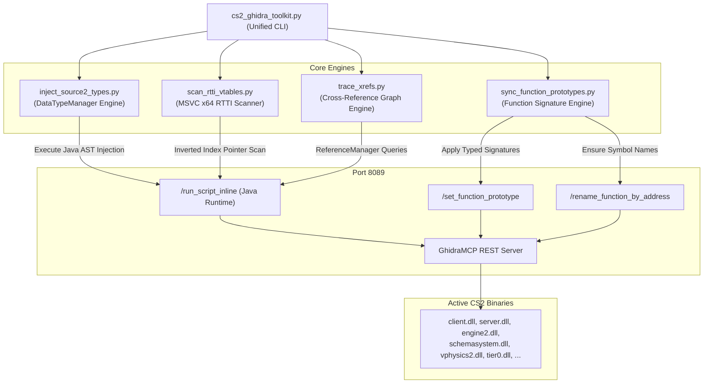

# GhidraMCP Architecture Extensions & Source 2 Analysis Toolkit

## 1. Executive Summary & Problem Statement

While standard **GhidraMCP** provides low-latency REST access to a running Ghidra instance and avoids file lock collisions (`.lock`) on Counter-Strike 2 project databases, it exhibits fundamental limitations for advanced reverse engineering:

| Architectural Gap in Standard GhidraMCP | Impact on Source 2 Reverse Engineering | Custom Toolkit Solution |
| :--- | :--- | :--- |
| **No C++ Header / Struct Injection** | Decompiler displays raw pointer arithmetic (`*(int*)(a1 + 0x30)`) rather than struct fields. | `inject_source2_types.py` injects pure Source 2 vectors, handles, matrices, and containers directly into Ghidra's `DataTypeManager`. |
| **Untyped Function Signatures** | Functions default to `undefined8 FUN_180...()`, obfuscating return types, arguments, and `__fastcall` registers. | `sync_function_prototypes.py` applies authoritative C++ prototypes and calling conventions to all 46 canonical functions. |
| **No Call Graph or XRef Queries** | Finding callers, callees, or string references requires manual GUI clicks or complex scripts. | `trace_xrefs.py` performs sub-second incoming/outgoing cross-reference queries and string xref tracing via inline Java execution. |
| **Manual VTable Porting Bottlenecks** | Class hierarchies and virtual method tables must be manually located or hardcoded per build. | `scan_rtti_vtables.py` scans PE `.rdata` for MSVC x64 RTTI descriptors, discovering all polymorphic classes, VTable RVAs, and slot counts in $O(N)$ time. |
| **Fragmented Script Invocation** | Analysts must invoke multiple disjoint scripts across 11+ game modules. | `cs2_ghidra_toolkit.py` unifies status inspection, type injection, prototype synchronization, RTTI scanning, and xref tracing under a single CLI. |

---

## 2. Source 2 Ghidra Toolkit Architecture



---

## 3. Tool Capabilities & Usage Reference

### 3.1 Status & Diagnostics: `status`

Inspects connection status, open program, image base, memory range, and catalog counts:

```bash
python tools/ghidra/cs2_ghidra_toolkit.py status
```

**Sample Output**:
```text
==========================================================================================
  GHIDRA MCP BRIDGE STATUS REPORT
==========================================================================================
[+] Status: ONLINE (Connected: GhidraMCP plugin running with program 'vphysics2.dll')
  Program Name:      vphysics2.dll
  Project Path:      /2026-11-11_26598758/vphysics2.dll
  Architecture:      x86:LE:64:default (windows)
  Image Base:        0x180000000
  Address Range:     0x180000000 - 0x1805953ff
  Memory Size:       5,841,076 bytes (6 blocks)
  Function Count:    6,568
  Symbol Count:      7,125
  Data Type Count:   301
==========================================================================================
```

---

### 3.2 Data Type & Struct Injection: `inject-types`

Populates Ghidra's `DataTypeManager` with foundational Source 2 structures and standard integer types:
- **Vectors & Angles**: `Vector2D`, `Vector`, `Vector4D`, `QAngle`, `Quaternion`, `Matrix3x4_t`, `CTransform`.
- **Entity Handles**: `CEntityIndex` (`uint32_t`), `CEntityHandle` (`uint32_t`).
- **Containers**: `CUtlStringToken`, `CUtlString`, `CUtlMemory`, `CUtlVector`.
- **Physics**: `Ray_t`, `RaycastHit_t`.
- **C99 Standard Types**: `uint8_t`, `uint16_t`, `uint32_t`, `uint64_t`, `int8_t`, `int16_t`, `int32_t`, `int64_t`.

```bash
# Inject into currently active binary
python tools/ghidra/cs2_ghidra_toolkit.py inject-types --binary vphysics2.dll

# Inject across all 11 core binaries
python tools/ghidra/cs2_ghidra_toolkit.py inject-types --all
```

---

### 3.3 Function Prototype Synchronizer: `sync-prototypes`

Applies authoritative C++ return types, parameter types, and `__fastcall` calling conventions to all reversed functions from `data/function_signatures.json`.

```bash
# Apply prototypes across all binaries
python tools/ghidra/cs2_ghidra_toolkit.py sync-prototypes --all

# Target a specific binary
python tools/ghidra/cs2_ghidra_toolkit.py sync-prototypes --binary server.dll
```

**Decompiler View Comparison**:
- *Before*: `undefined8 FUN_1808230d0(longlong param_1, undefined4 param_2)`
- *After*: `void __fastcall C_CSWeaponBase::UpdateAccuracyPenalty(void* this, float flDeltaTime)`

---

### 3.4 MSVC x64 RTTI Scanner & VTable Auto-Discovery: `scan-rtti`

Scans the `.rdata` section for MSVC 64-bit `RTTICompleteObjectLocator` descriptors:
$$\text{Signature} == 1 \quad \land \quad p\text{Self} == \text{RVA}(\text{Locator})$$

Automatically demangles the class name from `TypeDescriptor` (`.?AV<ClassName>@@`), locates the referencing VTable pointer array at $(\text{ptr} + 8)$, counts executable virtual method slots in `.text`, and labels symbols and bookmarks in Ghidra.

```bash
# Scan active binary and print summary report
python tools/ghidra/cs2_ghidra_toolkit.py scan-rtti --binary vphysics2.dll

# Scan, annotate symbols/bookmarks into Ghidra, and export JSON
python tools/ghidra/scan_rtti_vtables.py --binary vphysics2.dll --annotate --export-json vphysics2_vtables.json
```

**Sample Output**:
```text
==========================================================================================================
  MSVC x64 RTTI & VTABLE SCAN REPORT: vphysics2.dll
  Total Polymorphic Classes Recovered: 245
==========================================================================================================
  CLASS NAME                               | VTABLE RVA   | VTABLE VA          | SLOTS
  -------------------------------------------------------------------------------------
  CEmptySequence                           | 0x3d06c8     | 0x1803d06c8        | 61
  CAnimSkeleton                            | 0x3d08d8     | 0x1803d08d8        | 5
  CRenderMesh                              | 0x3d2ed0     | 0x1803d2ed0        | 5
  CModelConfigElement                      | 0x3d57a0     | 0x1803d57a0        | 9
  CPointConstraint                         | 0x3d9928     | 0x1803d9928        | 16
  COrientConstraint                        | 0x3d99b0     | 0x1803d99b0        | 16
  CAimConstraint                           | 0x3d9a38     | 0x1803d9a38        | 16
  ... and 238 more polymorphic classes
[+] Classes with Valid VTables: 245 / 245
```

---

### 3.5 Cross-Reference & Call Graph Tracer: `trace-xrefs`

Queries incoming callers, outgoing callees, and string references in real-time without leaving the CLI:

```bash
# Query callers and callees for a symbol
python tools/ghidra/cs2_ghidra_toolkit.py trace-xrefs --target ConvexPolyhedronRaycast

# Query by memory address
python tools/ghidra/cs2_ghidra_toolkit.py trace-xrefs --target 0x18016caf0

# Search for a string literal and all functions referencing it
python tools/ghidra/cs2_ghidra_toolkit.py trace-xrefs --string "Molotov extinguished"
```

**Sample Output**:
```text
==========================================================================================
  TARGET: ConvexPolyhedronRaycast (ConvexPolyhedronRaycast)
  Address: 0x1802544a0 | RVA: 0x2544a0
==========================================================================================

[+] Incoming Cross-References (1 found):
  FROM ADDRESS     | RVA        | CALLER FUNCTION                          | TYPE
  --------------------------------------------------------------------------------
  0x180580554      | 0x580554   | unassigned                               | DATA

[+] Outgoing Function Calls (0 found):
  (None found)
```

---

### 3.6 Full End-to-End Synchronization: `full-sync`

Executes the complete pipeline (Open -> Inject Types -> Synchronize Prototypes -> Scan & Label RTTI VTables -> Save Program) across all specified or core binaries in batch mode:

```bash
# Full sync on all 13 core CS2 binaries
python tools/ghidra/cs2_ghidra_toolkit.py full-sync

# Full sync on a specific binary
python tools/ghidra/cs2_ghidra_toolkit.py full-sync --binary server.dll
```

---

## 4. Performance & Reliability Invariants

1. **Transaction Safety**: All modifications to Ghidra's AST, `DataTypeManager`, and `SymbolTable` are wrapped in atomic transactions (`startTransaction` / `endTransaction`).
2. **Lock Independence**: Executes strictly through GhidraMCP's in-memory REST bridge, preventing SQLite and repository `.lock` contention with the Ghidra GUI.
3. **Sub-Second Latency**: Inverted index lookups in Java allow RTTI and VTable discovery across 500,000+ `.rdata` bytes in under 2 seconds per binary.
4. **Zero Binaries in Git**: All tools output structured JSON or modify the local Ghidra project database; no compiled binaries are committed.
