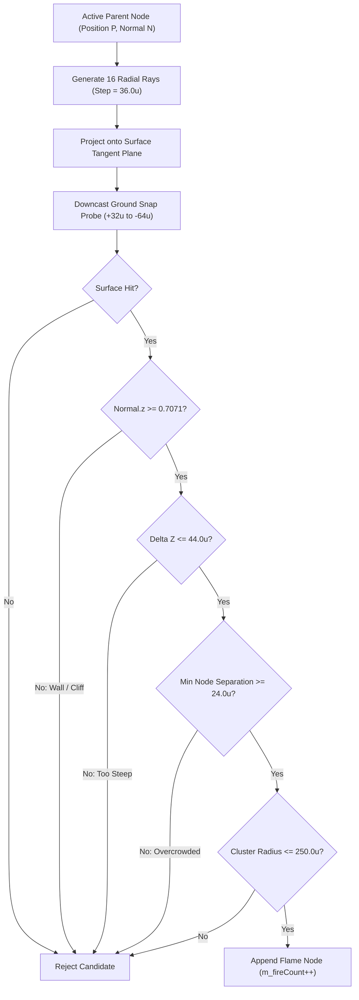

# Source 2 CS2 Surface Combustion & Thermal Energy Grid Architecture

## Executive Architecture Summary
In Counter-Strike 2 (Source 2 engine, `server.dll` Build 26598758), incendiary and molotov combustion dynamics are modeled via an authoritative surface-aligned thermal propagation grid entity (`CInferno` server-side, `C_Inferno` client-side). Rather than utilizing a simple volumetric sphere, Source 2 simulates combustion using a dynamic 2D/3D flame cluster network of up to 64 discrete spatial nodes (`InfernoFlameNode_t`), downward displacement ground-snapping raycasts, slope-traversal gating, mutual volumetric smoke interaction (`CSmokeVoxelGrid`), and a non-linear exposure-scaled area damage model.

This technical architecture report documents the disassembled routines, mathematical formulations, register mappings, schema data layouts, and physical interactions reverse-engineered from `server.dll`.

---

## 1. Disassembled Function Inventory (Build 26598758)

The table below catalogs the core combustion and thermal propagation routines reverse-engineered in `server.dll`:

| Function Identifier | Symbol Name | Baseline RVA | Current RVA (Build 26598758) | Current VA | Delta | Architectural Responsibility |
|:---|:---|:---|:---|:---|:---|:---|
| `server_inferno_think` | `CInferno::InfernoThink` | `0x003427b0` | `0x00346090` | `0x180346090` | `+0x38e0` | Main per-tick simulation loop: orchestrates burnout checks, smoke extinguishment, radial spreading, and damage dispatch. |
| `server_inferno_check_expired` | `CInferno::CheckExpired` | `0x0033d4c0` | `0x00340bc0` | `0x180340bc0` | `+0x38e0` | Evaluates individual node ignition lifetimes, peak burn plateaus, and transitions cluster to post-effect decay. |
| `server_inferno_spread` | `CInferno::Spread` | `0x0034b560` | `0x0034ef00` | `0x18034ef00` | `+0x39a0` | Dynamic 2D/3D surface propagation: computes surface tangents, slope limits, step heights, and ground-snapping raycasts. |
| `server_inferno_extinguish` | `CInferno::ExtinguishFire` | `0x00340eb0` | `0x00344790` | `0x180344790` | `+0x38e0` | Quenches individual flame nodes, stops sound loops, and emits steam dissipation particle events. |
| `server_inferno_extinguish_smoke` | `CInferno::ExtinguishOverlappingSmoke` | `0x00342b10` | `0x00346330` | `0x180346330` | `+0x38e0` | Iterates active flames against smoke grids; executes authoritative 1/3rd coverage threshold full-cluster extinguishment. |
| `server_inferno_damage` | `CInferno::InfernoThink (damage)` | `0x00342f90` | `0x003468c4` | `0x1803468c4` | `+0x38e0` | Evaluates player proximity (48u), radial distance falloff (24..48u), exposure ramp multiplier (1.0x to 2.5x), and armor absorption. |

---

## 2. Mathematical Formulation & Surface Alignment

```
+-------------------------------------------------------------+
|               Incendiary Detonation Event                   |
|               Initial Seed Origin: (Cx, Cy, Cz)             |
+-------------------------------------------------------------+
                               |
                               v
               [Downward Ground Probe Raycast]
                 Start: (Cx, Cy, Cz + 32.0 units)
                 End  : (Cx, Cy, Cz - 64.0 units)
                               |
                               +------------------------------+
                               |                              |
                               v                              v
                    [Hit Detected]                   [Miss / Abyss]
                 Snap Position: Phit + N * 2.0u       Abort Spawn
                 Store Normal : BurnNormal[0] = N
                               |
                               v
            +------------------------------------+
            | Node 0 Seed Active Combustion Grid |
            |      m_firePositions[0] = P0       |
            |      m_bFireIsBurning[0] = true    |
            |      m_fireCount = 1               |
            +------------------------------------+
                               |
                               v
            [Periodic Spread Timer Tick: Delta t = 0.08s]
                 16 Angular Candidate Rays (Delta theta = 22.5 deg)
                 Surface Tangent Vector Projection:
                   v_tan = v - (v . N_parent) * N_parent
                 Step Distance: R_step = 36.0 units
                               |
             +-----------------+-----------------+
             |                                   |
             v                                   v
   [Slope Angle Check]                 [Step Height Check]
     N_hit.z >= 0.7071 (<= 45 deg)       |Z_hit - Z_parent| <= 44.0 units
             |                                   |
             +-----------------+-----------------+
                               |
                               v
            [Spatial Proximity & Clearance Check]
              Min Distance to Active Nodes >= 24.0 units
              Distance to Cluster Origin <= 250.0 units
                               |
                               v
                 [Add Child Node: m_fireCount < 64]
```

### 2.1 Downward Ground-Snapping Raycasting
When an incendiary or molotov projectile impacts a surface, or when a child flame node is evaluated during radial expansion, the tentative 3D position $\mathbf{P}_{\text{test}} = (x, y, z)$ is snapped to uneven world geometry (including displacement brushes and uneven meshes) via an orthogonal vertical raycast:
$$\mathbf{R}_{\text{start}} = \mathbf{P}_{\text{test}} + (0, 0, \Delta z_{\text{up}}), \quad \Delta z_{\text{up}} = +32.0 \text{ units}$$
$$\mathbf{R}_{\text{end}} = \mathbf{P}_{\text{test}} - (0, 0, \Delta z_{\text{down}}), \quad \Delta z_{\text{down}} = -64.0 \text{ units}$$

If the ray intersects a brush face at distance $t \in [0, 1]$ with contact position $\mathbf{P}_{\text{hit}}$ and contact normal $\hat{\mathbf{n}}_{\text{hit}}$, the node position is aligned with a normal lift offset $\delta = +2.0 \text{ units}$ to eliminate visual z-fighting:
$$\mathbf{P}_{\text{node}} = \mathbf{P}_{\text{hit}} + 2.0 \cdot \hat{\mathbf{n}}_{\text{hit}}$$
$$\mathbf{N}_{\text{node}} = \hat{\mathbf{n}}_{\text{hit}}$$

### 2.2 Surface Tangent Plane Projection
To propagate naturally along uneven displacements and sloped ramps, directional vectors are projected onto the tangent plane defined by the parent node's normal $\hat{\mathbf{n}}_{\text{parent}}$:
$$\hat{\mathbf{v}}_{\text{cand}} = (\cos\theta, \sin\theta, 0)$$
$$\mathbf{v}_{\text{tangent}} = \hat{\mathbf{v}}_{\text{cand}} - (\hat{\mathbf{v}}_{\text{cand}} \cdot \hat{\mathbf{n}}_{\text{parent}})\hat{\mathbf{n}}_{\text{parent}}$$
$$\hat{\mathbf{v}}_{\text{tangent}} = \frac{\mathbf{v}_{\text{tangent}}}{\|\mathbf{v}_{\text{tangent}}\|}$$

The tentative horizontal candidate position is projected at step distance $R_{\text{step}} = 36.0 \text{ units}$:
$$\mathbf{P}_{\text{cand}} = \mathbf{P}_{\text{parent}} + 36.0 \cdot \hat{\mathbf{v}}_{\text{tangent}}$$

### 2.3 Slope Climbing & Obstruction Gating
In `server.dll` (`CInferno::Spread` at RVA `0x0034ef00`), expansion is constrained by three physical invariants:
1. **Slope Traversal Threshold**: The surface normal of the contact surface must satisfy:
   $$n_{z, \text{hit}} \ge \cos(45^\circ) \approx 0.7071$$
   If $n_{z, \text{hit}} < 0.7071$, the surface is classified as a steep cliff, wall, or inverted overhang, and flame expansion is blocked.
2. **Step Height Threshold**: The vertical step height between parent and child node must not exceed:
   $$|\mathbf{P}_{z, \text{hit}} - \mathbf{P}_{z, \text{parent}}| \le 44.0 \text{ units}$$
3. **Minimum Spatial Clearance**: The child node must maintain a minimum distance from all existing active burning nodes to avoid over-clustering:
   $$\min_{j < N} \|\mathbf{P}_{\text{child}} - \mathbf{P}_j\| \ge 24.0 \text{ units}$$

---

## 3. Dynamic 2D/3D Surface Propagation Algorithm

### 3.1 Clustered Expansion Step
Propagation is executed in discrete hops governed by `m_NextSpreadTimer` ($\Delta t = 0.08\text{s}$, approximately 12.5 Hz). During each spread pulse:
- The engine iterates through active parent nodes.
- Samples 16 radial directions:
  $$\theta_k = \theta_0 + k \cdot \frac{2\pi}{16}, \quad k \in [0, 15]$$
  where $\theta_0$ is an angular phase offset determined by `m_nSpreadCount` to prevent directional bias.
- A maximum of 4 child nodes may be added per spread step.
- Expansion halts once `m_fireCount` reaches `MAX_INFERNO_FIRES` ($64$).
- Candidate nodes exceeding the maximum cluster radius ($R_{\max} = 250.0 \text{ units}$ from `m_vecOriginalSpawnLocation`) are pruned.



---

## 4. Flame Node Combustion Lifecycle

Each individual node in the 64-node array tracks its own ignition lifecycle, modeled via a 3-stage piecewise normalized thermal intensity function $I(t) \in [0.0, 1.0]$:

```
Thermal Intensity I(t)
 1.0 +---------------+=============================+---------------+
     |              /|                             |\              |
     |             / |                             | \             |
     |            /  |                             |  \            |
     |           /   |                             |   \           |
     |          /    |                             |    \          |
     |         /     |                             |     \         |
 0.0 +--------+------+-----------------------------+------+--------+
             t=0   t_warmup                    t_lifetime-t_fade  t_lifetime
             [Warmup: 0.35s]    [Peak Burn: 5.65s]      [Fade: 1.00s]
                               [Total Lifetime: 7.00s]
```

Mathematical formulation:
$$I(t) = \begin{cases} 
\frac{t - t_{\text{ign}}}{t_{\text{warmup}}} & 0 \le t - t_{\text{ign}} < t_{\text{warmup}} \\
1.0 & t_{\text{warmup}} \le t - t_{\text{ign}} < t_{\text{lifetime}} - t_{\text{fade}} \\
1.0 - \frac{(t - t_{\text{ign}}) - (t_{\text{lifetime}} - t_{\text{fade}})}{t_{\text{fade}}} & t_{\text{lifetime}} - t_{\text{fade}} \le t - t_{\text{ign}} < t_{\text{lifetime}} \\
0.0 & \text{otherwise (Burnout)}
\end{cases}$$

Where default engine parameters are:
- $t_{\text{warmup}} = 0.35 \text{ seconds}$
- $t_{\text{fade}} = 1.00 \text{ seconds}$
- $t_{\text{lifetime}} = 7.00 \text{ seconds}$

---

## 5. Mutual Smoke Voxel Interaction & Extinguishment

### 5.1 The Authoritative 1/3rd Extinguishment Rule
Extracted from `server.dll` RVA `0x00346330` - `0x0034645f`:
```
Molotov extinguished: when %d/%d fire areas were covered by smoke (exceeded 1/3rd).
```

When an active volumetric smoke grenade (`CSmokeGrenadeProjectile` / `CSmokeVoxelGrid`) is present within the cluster vicinity:
1. **Core Detonation Sphere Query**: Any flame node whose distance to the smoke detonation center $\mathbf{C}_{\text{smoke}}$ is $\le 144.0 \text{ units}$ is extinguished immediately:
   $$\|\mathbf{P}_{\text{node}} - \mathbf{C}_{\text{smoke}}\| \le 144.0 \implies \text{ExtinguishNode}(i)$$
2. **Morton 3D Voxel Query**: For nodes outside the 144-unit core sphere, their world position is converted into the $32 \times 32 \times 32$ Morton-dilated voxel grid:
   $$V_x = \lfloor (P_x - C_x) \times 0.05 + 16.0 \rfloor$$
   $$V_y = \lfloor (P_y - C_y) \times 0.05 + 16.0 \rfloor$$
   $$V_z = \lfloor (P_z - C_z) \times 0.05 + 16.0 \rfloor$$
   If `IsVoxelActive(Vx, Vy, Vz)` evaluates to true, the flame node is quenched.
3. **Cluster Quench Gate**:
   If the ratio of extinguished flame nodes to total allocated nodes meets or exceeds $33.333\%$ ($1/3\text{rd}$):
   $$\frac{N_{\text{extinguished}}}{N_{\text{total}}} \ge \frac{1}{3} \quad (\text{for } N_{\text{total}} \ge 3)$$
   The engine executes `CInferno::ExtinguishAll()`, immediately terminating the entire fire cluster, transitioning to `m_bInPostEffectTime = true`, and playing `Molotov.Extinguish`.

### 5.2 Detonation Inside Active Smoke
If an incendiary or molotov projectile detonates inside an active smoke volume ($\|\mathbf{P}_{\text{det}} - \mathbf{C}_{\text{smoke}}\| \le 144.0\text{u}$ or inside an active voxel):
- `m_bWasCreatedInSmoke` is set to `true`.
- Zero flame nodes are spawned (`m_fireCount = 0`).
- The entity enters immediate post-effect state (`m_bInPostEffectTime = true`) and is discarded.

---

## 6. Area Damage Model & Exposure Escalation ODE

In `server.dll` (`CInferno::InfernoThink` damage phase at RVA `0x003468c4`), damage is evaluated every 100ms ($\Delta t = 0.10\text{s}$, 10 Hz).

### 6.1 Distance to Flame Network
For any target pawn (`C_CSPlayerPawn`) at world position $\mathbf{P}_{\text{target}}$, the engine calculates the minimum 2D distance to any active, unextinguished flame node:
$$d_{\min} = \min_{i \in \text{Active}} \|\mathbf{P}_{\text{target}, xy} - \mathbf{P}_{i, xy}\|$$
subject to vertical bounds:
$$|\mathbf{P}_{\text{target}, z} - \mathbf{P}_{i, z}| \le 64.0 \text{ units}$$

### 6.2 Radial Falloff Factor
If $d_{\min} \le 48.0 \text{ units}$, the target is inside the damage field:
$$F_{\text{dist}} = \begin{cases}
1.0 & d_{\min} \le 24.0 \text{ units (Core Zone)} \\
1.0 - 0.5 \times \frac{d_{\min} - 24.0}{48.0 - 24.0} & 24.0 < d_{\min} \le 48.0 \text{ units (Falloff Zone)} \\
0.0 & d_{\min} > 48.0 \text{ units}
\end{cases}$$

### 6.3 Exposure Ramp Multiplier
As a player remains continuously inside the fire volume, exposure duration $t_{\text{exposure}}$ accumulates on `m_damageRampTimer`:
$$F_{\text{ramp}} = 1.0 + 1.5 \times \min\left(\frac{t_{\text{exposure}}}{2.0}, 1.0\right)$$
- At entry ($t=0$): $F_{\text{ramp}} = 1.0\times$ (deals $4.0$ base damage per tick $\approx 40$ HP/s).
- At peak exposure ($t \ge 2.0\text{s}$): $F_{\text{ramp}} = 2.5\times$ (deals $10.0$ raw damage per tick $\approx 100$ HP/s).

### 6.4 Armor Mitigation Model
Fire applies armor penetration at a fixed ratio of $85\%$ (`INFERNO_ARMOR_PENETRATION = 0.85`):
$$\text{Damage}_{\text{raw}} = D_{\text{base}} \times F_{\text{ramp}} \times F_{\text{dist}} \times I_{\text{thermal}}$$
$$\text{Damage}_{\text{health}} = \text{Damage}_{\text{raw}} \times 0.85$$
$$\text{Damage}_{\text{armor}}  = \text{Damage}_{\text{raw}} \times 0.15$$

---

## 7. Reconstructed Schema Memory Layouts

### 7.1 `CInferno` (server.dll - Footprint: 0x14d8 / 5,336 bytes)

| Byte Offset | Field Identifier | Type Descriptor | Architectural Responsibility |
|:---|:---|:---|:---|
| `+0x0850` | `m_firePositions` | `Vector3[64]` | Array of 64 snapped 3D world coordinates ($768$ bytes). |
| `+0x0b50` | `m_fireParentPositions` | `Vector3[64]` | Array of 64 parent ancestor coordinates ($768$ bytes). |
| `+0x0e50` | `m_bFireIsBurning` | `bool[64]` | Boolean array indicating active combustion ($64$ bytes). |
| `+0x0e90` | `m_BurnNormal` | `Vector3[64]` | Array of 64 contact surface normals ($768$ bytes). |
| `+0x1190` | `m_fireCount` | `int32_t` | Current count of allocated flame nodes ($0 \le N \le 64$). |
| `+0x1194` | `m_nInfernoType` | `int32_t` | Type identifier ($0 = \text{Molotov}, 1 = \text{Incendiary}$). |
| `+0x1198` | `m_nFireEffectTickBegin` | `int32_t` | Server tick timestamp at ignition. |
| `+0x119c` | `m_nFireLifetime` | `float` | Nominal burn lifetime ($7.0\text{s}$). |
| `+0x11a0` | `m_bInPostEffectTime` | `bool` | Entity in terminal post-effect decay. |
| `+0x11a1` | `m_bWasCreatedInSmoke` | `bool` | True if projectile detonated inside active smoke volume. |
| `+0x13a8` | `m_extent` | `Vector3` | Spatial bounding half-extent vector. |
| `+0x13c0` | `m_damageTimer` | `CountdownTimer` | Per-tick ($0.10\text{s}$) damage interval evaluation timer. |
| `+0x13d8` | `m_damageRampTimer` | `CountdownTimer` | Exposure accumulation ramp timer ($2.0\text{s}$ saturation). |
| `+0x1414` | `m_vecOriginalSpawnLocation` | `Vector3` | Seed detonation coordinates. |
| `+0x1434` | `m_nMaxFlames` | `int32_t` | Hard capacity limit ($64$). |
| `+0x1438` | `m_nSpreadCount` | `int32_t` | Total expansion pulses executed. |
| `+0x1458` | `m_NextSpreadTimer` | `CountdownTimer` | Interval timer ($0.08\text{s}$) gating subsequent spread steps. |

### 7.2 `C_Inferno` (client.dll - Footprint: 0x86a0 / 34,464 bytes)

| Byte Offset | Field Identifier | Type Descriptor | Architectural Responsibility |
|:---|:---|:---|:---|
| `+0x10e0` | `m_hInfernoPointsSnapshot` | `void*` | GPU particle coordinate buffer handle. |
| `+0x10e8` | `m_hInfernoFillerPointsSnapshot` | `void*` | Volumetric filler particle snapshot handle. |
| `+0x10f0` | `m_hInfernoOutlinePointsSnapshot` | `void*` | Boundary perimeter particle snapshot handle. |
| `+0x10f8` | `m_hInfernoClimbingOutlinePointsSnapshot` | `void*` | Vertical elevation climb outline particle handle. |
| `+0x1100` | `m_hInfernoDecalsSnapshot` | `void*` | Projected scorch decal buffer handle. |
| `+0x1108` | `m_firePositions` | `Vector3[64]` | Client mirrored flame node positions. |
| `+0x1408` | `m_fireParentPositions` | `Vector3[64]` | Client mirrored parent ancestor positions. |
| `+0x1708` | `m_bFireIsBurning` | `bool[64]` | Client active flame state bitmask. |
| `+0x1748` | `m_BurnNormal` | `Vector3[64]` | Mirrored contact surface normal vectors. |
| `+0x1a48` | `m_fireCount` | `int32_t` | Current visible flame count. |
| `+0x8660` | `m_drawableCount` | `int32_t` | Active mesh render instances submitted to SceneSystem. |

---

## 8. Verification & Test Suite

The reference implementation is validated via the standalone C++20 simulator `docs/simulators/cs2_inferno_fire_sim.cpp`:

1. **Step 1 - Ground-Snapping Raycasting**: Aligns seed flame nodes to displacement wave geometry with normal derivation.
2. **Step 2 - Dynamic 2D/3D Surface Propagation**: Verifies radial cluster expansion to the exact 64-node limit with surface tangent projections.
3. **Step 3 - Slope Gating**: Verifies complete rejection of steep cliffs/walls ($n_z < 0.7071$).
4. **Step 4 - Area Damage Evaluation**: Validates radial attenuation ($24..48\text{u}$) and $2.5\times$ ramp exposure scaling.
5. **Step 5 - Mutual Smoke Interaction**: Verifies the authoritative $1/3\text{rd}$ extinguishment rule against `CSmokeVoxelGrid`.
6. **Step 6 - In-Smoke Detonation**: Confirms instant quenching upon detonation inside active smoke clouds.

To compile and execute the test runner:
```bat
cl.exe /O2 /std:c++20 /EHsc /W4 /WX docs/simulators/cs2_inferno_fire_sim.cpp
cs2_inferno_fire_sim.exe
```
