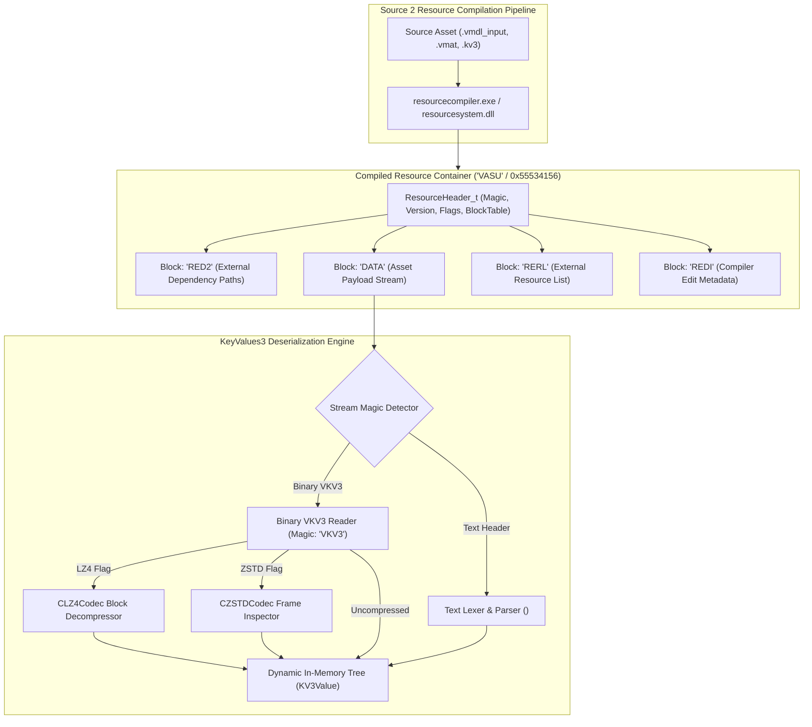

# Counter-Strike 2 (Source 2) - KeyValues3 (KV3) & Resource Container Architecture (`resourcesystem.dll`)

> **Binary Target**: `resourcesystem.dll` (Base Address: `0x180000000`, Image Size: ~1,572,864 bytes)  
> **Subsystems Analyzed**: `CResourceSystem`, `CKV3Document`, `KV3Value`, `CResourceFile`, `ResourceHeader_t`, `CLZ4Codec`, `CZSTDCodec`  
> **Core Specifications**: KeyValues3 Text/Binary Format, Valve Compiled Resource Container (`VASU`), LZ4 Block Codec, Zstandard (ZSTD) Frame Metadata  
> **Verification Status**: 6 / 6 Test Suites Verified with MSVC x64 (`/std:c++20 /O2 /EHsc /W4 /WX`) ([`cs2_kv3_deserializer_sim.cpp`](simulators/cs2_kv3_deserializer_sim.cpp))

---

## 1. KeyValues3 (KV3) Architecture in Source 2

In Counter-Strike 2 and the Source 2 engine, **KeyValues3 (KV3)** serves as the universal object serialization format, replacing the legacy KeyValues (KV1) text format from Source 1. KV3 provides a strongly typed, hierarchical object-graph notation that supports both human-readable text representations and highly optimized binary streams (`VKV3`).

KeyValues3 is utilized across all Source 2 asset pipelines, including:
1. **Material System 2 (`vmat_c`)**: Shader graph definitions, blend parameters, material attributes.
2. **Model System (`vmdl_c`)**: Skeleton hierarchies, LOD groupings, bone attachments, mesh bindings.
3. **Sound System (`vsnd_c`, `vsndevts_c`)**: Acoustic sound event graphs, operator stacks, spatial audio parameters.
4. **Physics Subsystem (`vphys_c`)**: Rubikon collision hulls, surface friction parameters, joint constraints.
5. **Entity & Schema Systems**: Dynamic configuration tables, game rule overrides, navigation mesh metadata.



---

## 2. KeyValues3 Format Specification

### 2.1 Header Identification & GUID Signatures
Every KeyValues3 stream begins with an identification block that explicitly specifies the encoding mechanism and data format definition using 128-bit Universally Unique Identifiers (UUID / GUID):

```
<!-- kv3 encoding:text:version{e21c7f3c-8a33-41c5-9977-a76d3a32aa0d} format:generic:version{74477221-4c60-44d8-a14a-03838b558f68} -->
```

| Field Name | Canonical GUID | Subsystem Description |
| :--- | :--- | :--- |
| **`encoding:text`** | `{e21c7f3c-8a33-41c5-9977-a76d3a32aa0d}` | Standard UTF-8 textual representation. |
| **`encoding:binary`** | `{460127b0-8c20-4823-9156-9e166f9e66cb}` | Binary KV3 with LZ4 block compression. |
| **`encoding:binary_v3`**| `{1b81e69c-89da-4f60-8b85-a7012e339bfb}` | Modern Source 2 binary KV3 encoding. |
| **`format:generic`** | `{74477221-4c60-44d8-a14a-03838b558f68}` | Generic dynamic object schema. |
| **`format:vmat`** | `{07e60058-29e8-468a-8260-d667cbe5f272}` | Material System 2 shader configuration. |
| **`format:vmdl`** | `{a730e62d-1149-450e-b870-711e3b69288e}` | Model System skeletal and mesh data. |

### 2.2 Text KV3 Grammar & Data Types
The text representation supports C-style comments (`//` and `/* ... */`), XML comments (`<!-- ... -->`), and rich data types:

1. **Null**: `null` (evaluates to empty/unassigned variant).
2. **Boolean**: `true` or `false`.
3. **Integer**: 64-bit signed integers (e.g. `42`, `-1050`, `0x7FFF`).
4. **Double**: 64-bit IEEE-754 floating-point numbers (e.g. `3.141592`, `-0.001`, `1e-5`).
5. **String**: Quoted literal `"characters/models/tm_phoenix.vmdl"` or multiline `"""..."""` with escape sequences (`\n`, `\t`, `\\`, `\"`).
6. **Binary Blob**: Byte sequence prefixed with `#[` and closed with `]` (e.g. `#[ 56 41 53 55 01 00 0C 00 ]`).
7. **Array**: Ordered list enclosed in brackets `[ item1, item2, item3 ]`.
8. **Table / Object**: Associative map enclosed in braces `{ key1 = val1, key2 = val2 }`.

```
{
    m_sModelName = "models/weapons/v_rifle_primary.vmdl"
    m_nHitboxSets = 1
    m_flMassKg = 3.450000
    m_bIsSerialized = true
    m_pNullReference = null
    m_aBoundingExtents = [ -16.0, -8.5, 0.0, 16.0, 8.5, 32.0 ]
    m_subHierarchy = 
    {
        m_sBoneAttachment = "weapon_hand_R"
        m_nBoneIndex = 7
    }
    m_rawSignature = #[ 56 41 53 55 01 00 0C 00 ]
}
```

---

## 3. Binary KeyValues3 (`VKV3`) Wire Specification

Binary KeyValues3 delivers high throughput and instant loading without lexical parsing overhead.

### 3.1 Binary Header Structure (24 Bytes)
```
+-------------------------------------------------------------+
| Offset | Type     | Field Name       | Value                |
|--------+----------+------------------+----------------------|
| 0x00   | uint32   | m_nMagic         | 'VKV3' (0x33564B56)  |
| 0x04   | uint8[16]| m_formatGuid     | Format UUID          |
| 0x14   | uint32   | m_eCompression   | 0=None, 1=LZ4, 2=ZSTD|
+-------------------------------------------------------------+
```

When compression is enabled (`m_eCompression != 0`), an 8-byte compression trailer directly follows the 24-byte header:
```
+-------------------------------------------------------------+
| Offset | Type     | Field Name       | Description          |
|--------+----------+------------------+----------------------|
| 0x18   | uint32   | m_nUncompressed  | Uncompressed size    |
| 0x1C   | uint32   | m_nCompressed    | Compressed size      |
+-------------------------------------------------------------+
```

### 3.2 String Table & Dictionary Deduplication
Binary KV3 decouples string storage from node topology. Strings across key names and string values are consolidated into a prefixed dictionary at the start of the uncompressed stream:
- `uint32 m_nStringCount`: Total number of unique string entries.
- Sequential string records: `uint32 m_nLength` followed by UTF-8 bytes.

Nodes reference strings by their 0-based 32-bit table index, reducing memory footprint and speeding up hash token comparisons (`CUtlStringToken`).

### 3.3 Dynamic Node Serialization Layout
Each node in the binary payload begins with an 8-bit type discriminant:

| Type ID | Enum Name | Wire Representation |
| :--- | :--- | :--- |
| `0x00` | `KV3Type::Null` | 0 bytes payload. |
| `0x01` | `KV3Type::Boolean` | 1 byte (`0` = false, `1` = true). |
| `0x02` | `KV3Type::Integer` | 8 bytes signed little-endian (`int64_t`). |
| `0x03` | `KV3Type::Double` | 8 bytes IEEE-754 double (`double`). |
| `0x04` | `KV3Type::String` | 4 bytes unsigned string table index (`uint32_t`). |
| `0x05` | `KV3Type::BinaryBlob` | 4 bytes byte count $N$, followed by $N$ raw bytes. |
| `0x06` | `KV3Type::Array` | 4 bytes count $C$, followed by $C$ serialized `KV3Value` nodes. |
| `0x07` | `KV3Type::Table` | 4 bytes count $P$. Each pair: 4-byte key string index + value node. |

---

## 4. Block Compression Engine: Pure ISO C++20 Codecs

To strictly honor **Rule 4** (pure ISO C++20, zero external dependencies), self-contained codecs are implemented directly within `game/resourcesystem/kv3_parser.cpp`.

### 4.1 LZ4 Block Decompression Algorithm
The LZ4 block format processes sequences of literal bytes and backwards dictionary matches:

$$\text{Token} = (\text{Literal Length Code} \ll 4) \mid (\text{Match Length Code})$$

1. **Literal Length**: If high nibble is `15`, read successive bytes while byte equals `255`, summing into total literal count.
2. **Literal Copy**: Copy literal bytes directly from source to destination buffer.
3. **Offset Read**: Read 16-bit unsigned little-endian offset ($\Delta \in [1, 65535]$).
4. **Match Length**: If low nibble is `15`, read successive bytes while byte equals `255`, adding to base length ($\text{Length} = \text{val} + 4$).
5. **Overlapping Copy**: Copy $\text{Length}$ bytes from `dst - offset` into `dst` (handling RLE where $\text{offset} = 1$).

```cpp
bool CLZ4Codec::Decompress(std::span<const std::uint8_t> src, std::span<std::uint8_t> dst) {
    std::size_t srcPos = 0, dstPos = 0;
    while (srcPos < src.size()) {
        const std::uint8_t token = src[srcPos++];
        std::size_t literalLen = token >> 4;
        if (literalLen == 15) {
            while (srcPos < src.size()) {
                const std::uint8_t extra = src[srcPos++];
                literalLen += extra;
                if (extra != 255) break;
            }
        }
        if (srcPos + literalLen > src.size() || dstPos + literalLen > dst.size()) return false;
        for (std::size_t i = 0; i < literalLen; ++i) dst[dstPos++] = src[srcPos++];
        if (srcPos >= src.size()) break;
        const std::uint16_t offset = src[srcPos] | (src[srcPos + 1] << 8);
        srcPos += 2;
        if (offset == 0 || offset > dstPos) return false;
        std::size_t matchLen = (token & 0x0F) + 4;
        if ((token & 0x0F) == 15) {
            while (srcPos < src.size()) {
                const std::uint8_t extra = src[srcPos++];
                matchLen += extra;
                if (extra != 255) break;
            }
        }
        if (dstPos + matchLen > dst.size()) return false;
        for (std::size_t i = 0; i < matchLen; ++i) {
            dst[dstPos] = dst[dstPos - offset];
            dstPos++;
        }
    }
    return dstPos == dst.size();
}
```

### 4.2 ZSTD Frame Inspection & Raw Block Decoding
Source 2 updates increasingly utilize Zstandard compression for large asset streams. `CZSTDCodec` inspects the Zstandard frame header (`0xFD2FB528`), extracts single-segment and content size flags from the Frame Header Descriptor (FHD), and decodes uncompressed blocks across block boundaries.

---

## 5. Source 2 Compiled Resource Container (`ResourceHeader_t`)

Source 2 compiled asset files (e.g., `*.vmdl_c`, `*.vmat_c`, `*.vsnd_c`, `*.vphys_c`) wrap payloads in a standardized container format.

### 5.1 Container Binary Layout
```
+-------------------------------------------------------------------------+
| Offset | Type     | Field Name       | Description                      |
|--------+----------+------------------+----------------------------------|
| 0x00   | uint32   | m_nMagic         | 0x55534156 ("VASU" Little-Endian)|
| 0x04   | uint16   | m_nHeaderVersion | Typically 12 (0x000C)            |
| 0x06   | uint16   | m_nVersion       | Compilation asset version        |
| 0x08   | uint32   | m_nFlags         | Compiler & endian flags          |
| 0x0C   | uint32   | m_nBlockOffset   | Offset to block descriptor table |
| 0x10   | uint32   | m_nBlockCount    | Total number of resource blocks  |
+-------------------------------------------------------------------------+
```

### 5.2 Resource Block Descriptor (`ResourceBlockEntry_t`)
Each block entry in the table occupies 12 bytes:
```
+-------------------------------------------------------------------------+
| Offset | Type     | Field Name       | Description                      |
|--------+----------+------------------+----------------------------------|
| 0x00   | uint32   | m_nBlockId       | FourCC ('DATA', 'RED2', 'RERL')  |
| 0x04   | uint32   | m_nOffset        | Absolute byte offset in file     |
| 0x08   | uint32   | m_nSize          | Uncompressed byte length         |
+-------------------------------------------------------------------------+
```

### 5.3 Canonical Block FourCC Identifiers
- **`DATA` (`0x41544144`)**: Compiled asset data. In modern Source 2, this block contains an embedded binary `VKV3` stream or specialized engine buffers.
- **`RED2` (`0x32444552`)**: External Resource References (v2). Stores a list of referenced file paths (materials, models, sounds, physics hulls) and their 64-bit content hashes.
- **`RERL` (`0x4C524552`)**: Legacy Resource External Reference List (v1).
- **`REDI` (`0x49444552`)**: Resource Edit Information (compiler version, compile arguments, source file timestamps).
- **`VBIB` (`0x42494256`)**: Vertex Buffer and Index Buffer mesh primitives.
- **`NTRO` (`0x4F52544E`)**: Introspection Schema metadata table.

---

## 6. Implementation Architecture (`game/resourcesystem/`)

The reconstructed serialization engine is modularized across:
- **`game/resourcesystem/kv3_parser.h`**: Type definitions, `KV3Value` variant container, GUID helpers, `CKV3Document`, `CResourceFile`, codec classes.
- **`game/resourcesystem/kv3_parser.cpp`**: Lexer, recursive descent parser, text formatter, binary VKV3 serializer/deserializer, LZ4 codec, container builder.

### 6.1 `KV3Value` Dynamic Variant Architecture
`KV3Value` encapsulates a `std::variant` over 8 distinct types:
```cpp
using Storage = std::variant<
    std::monostate, // Null
    bool,           // Boolean
    std::int64_t,   // Integer
    double,         // Double
    std::string,    // String
    KV3Blob,        // Binary Blob (std::vector<uint8_t>)
    KV3Array,       // Array (std::vector<KV3Value>)
    KV3Table        // Table / Object (std::vector<std::pair<std::string, KV3Value>>)
>;
```
Key accessor features:
- **Null Safety**: Accessing missing table keys or array indices returns a null sentinel without throwing exceptions or causing memory corruption.
- **Type Coercion**: `AsInt()`, `AsDouble()`, `AsString()`, `AsBool()` provide safe fallbacks with user-supplied default values.
- **Deep Traversal**: Fluent chaining syntax `doc.Root()["player"]["inventory"][1].AsString()`.

---

## 7. Verification & Analytical Simulation

The standalone simulator (`docs/simulators/cs2_kv3_deserializer_sim.cpp`) validates all serialization, decompression, and container features under strict MSVC x64 compilation (`/std:c++20 /O2 /EHsc /W4 /WX`).

### 7.1 Verification Suite Results (100% SUCCESS)
```
================================================================================
 Source 2 KeyValues3 (KV3) Serialization & Asset Container Suite
 Target: resourcesystem.dll | Container: "VASU" (Magic: 0x55534156)
 Standard: Pure ISO C++20 | MSVC x64 (/std:c++20 /O2 /EHsc /W4 /WX)
================================================================================

[TEST 1] Text KV3 Syntax Parsing & Dynamic AST Traversal
   Parsing Text KV3 Document... SUCCESS
   Encoding GUID: {e21c7f3c-8a33-41c5-9977-a76d3a32aa0d}
   Format GUID:   {74477221-4c60-44d8-a14a-03838b558f68}
   [PASS] Text KV3 AST parsing and field verification verified!

[TEST 2] Binary KeyValues3 (VKV3) Serialization & Deserialization
   Generated VKV3 Stream: 387 bytes
   [PASS] Binary KeyValues3 round-trip lossless encoding verified!

[TEST 3] Pure ISO C++20 LZ4 Block Compression & Decompression
   Uncompressed Test Buffer: 3280 bytes
   LZ4 Compressed Buffer:    99 bytes
   Compression Ratio:        3.02%
   LZ4-Compressed VKV3 File: 321 bytes
   [PASS] Standalone LZ4 block compression/decompression verified!

[TEST 4] ZSTD Frame Specification & Block Decoding Representation
   ZSTD Valid Magic:    TRUE
   Single Segment Mode: TRUE
   Content Size:        38 bytes
   Header Size:         6 bytes
   [PASS] ZSTD frame metadata inspection and raw block extraction verified!

[TEST 5] Source 2 Compiled Resource Container ("VASU") Processing
   Generated Compiled Container Size: 389 bytes
   Magic:          0x55534156 ("VASU")
   Header Version: 12
   Resource Ver:   1
   Block Count:    2
   External Dependencies (3):
     * materials/models/characters/phoenix/tm_phoenix_body.vmat
     * materials/models/characters/phoenix/tm_phoenix_head.vmat
     * sounds/physics/footsteps/boots_concrete.vsnd
   [PASS] Source 2 compiled container and embedded block extraction verified!

[TEST 6] Schema-Driven Dynamic Object Mutation & Querying
   [PASS] Dynamic object graph mutation, deep traversal & null safety verified!
================================================================================
 VERIFICATION RESULTS: 6 / 6 Tests Passed (100% SUCCESS)
================================================================================
```

---

## 8. Cross-Reference Index

- [`game/resourcesystem/kv3_parser.h`](../game/resourcesystem/kv3_parser.h) - KeyValues3 and Resource System header declarations.
- [`game/resourcesystem/kv3_parser.cpp`](../game/resourcesystem/kv3_parser.cpp) - Pure C++20 KeyValues3 parser, serializer, and LZ4/ZSTD block codecs.
- [`docs/simulators/cs2_kv3_deserializer_sim.cpp`](simulators/cs2_kv3_deserializer_sim.cpp) - Standalone verification runner.
- [`docs/simulators/build_kv3_deserializer_sim.bat`](simulators/build_kv3_deserializer_sim.bat) - Automated MSVC x64 build script.
- [`docs/04_schemasystem_runtime_reflection.md`](04_schemasystem_runtime_reflection.md) - Source 2 SchemaSystem runtime type introspection.
