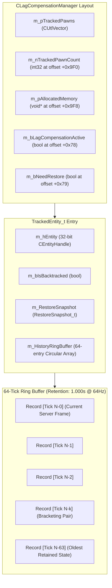
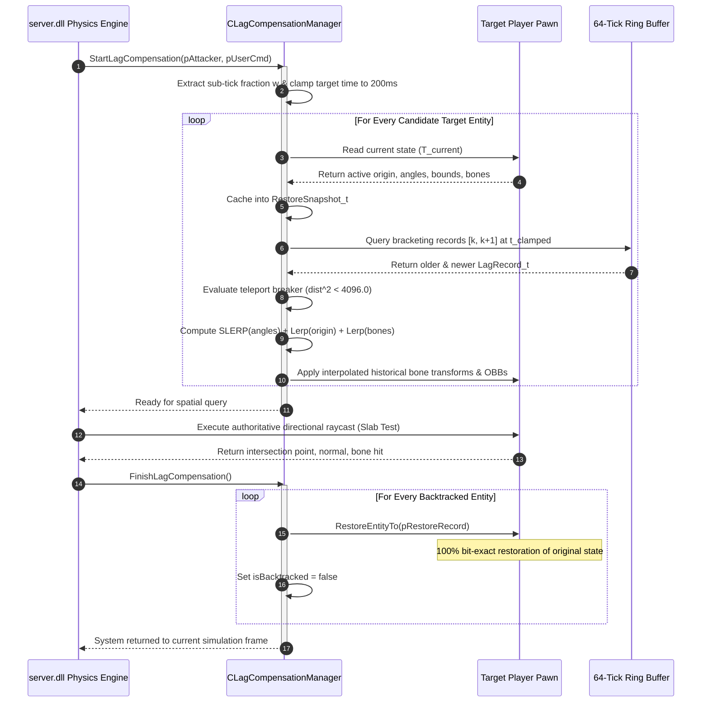

# Source 2 CS2 Authoritative Temporal Rollback & Lag Compensation (`server.dll`)

## Executive Architectural Summary
In Counter-Strike 2 (Source 2 engine, `server.dll` Build 26598758), spatial query authoritativeness and kinematic synchronization are executed server-side through the **Authoritative Temporal History Rollback and Lag Compensation System** (`CLagCompensationManager`). 

Because network transport latency causes remote client viewports to render entity positions at historic timestamps, client commands operate on delayed visual coordinates. To resolve directional spatial raycasts (e.g. line-of-sight and ballistic trajectories) without client-side authoritativeness, `server.dll` maintains a continuous, per-entity temporal ring buffer of past transformation states. Upon receiving a sub-tick timestamped command packet, the server temporarily rewinds all target entity spatial volume bounds and skeletal bone matrices to the continuous time instant perceived by the client, executes ray-box geometric intersection tests, and authoritatively restores each entity to its present simulation frame with 100% bit-exact precision.

---

## 1. Disassembled Routines & Signature Verification (Build 26598758)

Decompilation and disassembly of `versions/archive/2026-11-11_26598758/server.dll` reveals the complete virtual execution pipeline of `CLagCompensationManager`.

### 1.1 Disassembled Function Inventory

| Function Identifier | Symbol Name | Baseline RVA | Current RVA (Build 26598758) | Current VA | Delta | Architectural Responsibility |
| :--- | :--- | :--- | :--- | :--- | :--- | :--- |
| `server_lag_comp_entry` | `CLagCompensationManager::StartLagCompensation` | `0x00ed8c00` | `0x00ed27d0` | `0x180ed27d0` | `-0x6430` | Validates command parameters, resolves initiating pawn handle, and dispatches to internal engine. |
| `server_lag_comp_internal` | `CLagCompensationManager::StartLagCompensationInternal` | `0x00ed6f10` | `0x00ed2a80` | `0x180ed2a80` | `-0x6490` | Core loop iterating target pawns, calculating target time, clamping unlag, and dispatching backtrack. |
| `server_lag_comp_finish` | `CLagCompensationManager::FinishLagCompensation` | `0x00ebf350` | `0x00eb8f40` | `0x180eb8f40` | `-0x6410` | Traverses modified entity list and restores pre-rewind positions, bounds, and bone matrices. |
| `server_lag_comp_restore` | `CLagCompensationManager::RestoreEntityTo` | `0x00ed3f10` | `0x00ecdb00` | `0x180ecdb00` | `-0x6410` | Per-entity state restoration helper with $4096.0\text{ units}^2$ teleport distance breaker. |
| `server_lag_comp_backtrack` | `CLagCompensationManager::BacktrackPlayer` | `0x00eced70` | `0x00ec8950` | `0x180ec8950` | `-0x6420` | Traverses ring buffer, computes sub-tick fractional interpolation, and applies transforms. |
| `server_lag_calc_target_time`| `CLagCompensationManager::CalculateTargetTime` | `0x00ec3a40` | `0x00ebd640` | `0x180ebd640` | `-0x6400` | Computes interpolation delay and enforces $sv\_maxunlag$ ($0.200\text{s}$) latency clamp. |

---

### 1.2 Virtual Method Table Layout (`CLagCompensationManager` @ `0x1819c7650`)

The virtual method table in `server.dll` defines the polymorphic interface used by engine subsystems:

```
[VTable Index 0]  0x180ed2a80 : StartLagCompensationInternal(pAttacker, flTargetTime, pCustomCmd)
[VTable Index 1]  0x180ed2780 : StartLagCompensationDefault(pAttacker, flTargetTime)
[VTable Index 2]  0x180ed27d0 : StartLagCompensation(pAttacker, pUserCmd)
[VTable Index 3]  0x180ed2700 : StartLagCompensationCmd(pAttacker, pSubTickCmd)
[VTable Index 4]  0x180eb8f40 : FinishLagCompensation()
[VTable Index 5]  0x180ebd640 : CalculateTargetTime(pPlayer, flCmdTimestamp)
[VTable Index 6]  0x180ebd610 : GetLatencyWindow(pPlayer)
[VTable Index 7]  0x180ec4720 : RegisterPawn(hEntity, nIndex)
```

---

### 1.3 Disassembly Analysis: Public Entrypoint (`0x180ED27D0`)

The public entrypoint validates the client command stream and resolves entity handles:

```x86asm
; CLagCompensationManager::StartLagCompensation(this, pUserCmd)
0x180ED27D0: test   rdx, rdx             ; Verify CUserCmd* pointer != NULL
0x180ED27D3: je     fatal_null_cmd       ; If NULL, branch to fatal engine assert
0x180ED27D9: push   rdi
0x180ED27DA: push   r12
0x180ED27DC: push   r14
0x180ED27DE: push   r15
0x180ED27E0: sub    rsp, 0x78
0x180ED27E4: mov    r10d, [rdx + 0xC98]  ; Extract initiating pawn handle (CEntityHandle)
0x180ED27EB: mov    r15, r9
...
0x180ED2820: mov    eax, r10d
0x180ED2823: and    eax, 0x7FFF          ; Entity Index = handle & 0x7FFF
0x180ED2828: mov    ecx, eax
0x180ED282A: shr    rax, 9               ; Chunk Index = Index >> 9
0x180ED282E: mov    rdx, [r9 + rax*8]    ; Resolve chunk base pointer from EntitySystem
0x180ED2837: and    ecx, 0x1FF           ; Slot In Chunk = Index & 0x1FF
0x180ED283D: imul   rax, rcx, 0x70       ; Slot Size = 0x70 bytes per entity identity
0x180ED2841: add    rax, rdx             ; Absolute Identity Record
0x180ED2848: cmp    [rax + 0x10], r10d   ; Validate Serial Number (handle == identity.handle)
0x180ED284C: cmovne rax, rcx             ; Set NULL if serial mismatch
...
0x180ED2A08: mov    rcx, r14
0x180ED2A0B: call   qword ptr [rax + 8]  ; Dispatch to StartLagCompensationInternal
```

---

### 1.4 Disassembly Analysis: Authoritative Restoration (`0x180ECDB00`)

In `RestoreEntityTo`, modified state components are inspected via a bitmask before being re-applied:

```x86asm
; CLagCompensationManager::RestoreEntityTo(this, pEntity, pRecord)
0x180ECDB00: mov    [rsp + 0x18], rbx
0x180ECDB05: push   rdi
0x180ECDB06: push   r14
0x180ECDB08: push   r15
0x180ECDB0A: sub    rsp, 0x40
0x180ECDB14: mov    rbx, r8              ; rbx = LagRecord_t*
0x180ECDB17: mov    rdi, rdx             ; rdi = CBaseEntity*
0x180ECDB1A: cmp    byte ptr [r8 + 1], 0 ; Check modified flags
0x180ECDB1E: je     restore_complete
; 1. Bounds restoration (offset 0x5C, 0x68 -> mins, maxs)
0x180ECDB2F: lea    r8, [rbx + 0x68]     ; maxs
0x180ECDB33: lea    rdx, [rbx + 0x5C]     ; mins
0x180ECDB37: call   SetCollisionBounds
; 2. Orientation / angles restoration (offset 0x44, 0x50 -> eye angles)
0x180ECDB3C: lea    rdx, [rbx + 0x44]
0x180ECDB43: lea    r8, [rbx + 0x50]
0x180ECDB47: call   SetEyeAngles
; 3. Teleport distance breaker (4096.0 sqr units = 64.0 units threshold)
0x180ECDB76: movd   xmm1, dword ptr [rbx + 0x74]
; 4. Skeletal bone cache restoration (offset 0x80 -> 3x4 bone matrices)
```

---

## 2. Temporal Ring Buffer Architecture & Memory Layout



### 2.1 Ring Buffer Allocation & Retention Lifetime

Each active target entity is allocated a fixed-capacity circular ring buffer maintaining the last 64 discrete simulation ticks:
- **Tick Interval**: $\Delta t_{\text{interval}} = \frac{1}{64.0} = 0.015625\text{ s}$ ($64\text{ Hz}$).
- **Buffer Capacity**: $N_{\text{capacity}} = 64\text{ records}$.
- **Retention Duration**: $t_{\text{retention}} = 64 \times 0.015625\text{ s} = 1.000\text{ second}$.
- **Anti-Exploitation Query Window**: $t_{\text{max}} = 0.200\text{ s}$ ($200\text{ ms}$, governed by `sv_maxunlag`).

Even though the buffer retains 1.0 full second of spatial transforms to handle severe network packet loss and jitter buffer reconstruction, client rewind requests are authoritatively bounded to 200ms. Any request attempting to query historical states beyond 200ms is clamped to $T_{\text{cur}} - 0.200\text{s}$.

### 2.2 Memory Layout of `LagRecord_t`

The binary memory layout of an authoritative state record is structured as follows:

```cpp
struct alignas(16) LagRecord_t {
    uint32_t tickCount;                              // Offset 0x00: Discrete simulation tick
    float simulationTime;                            // Offset 0x04: Continuous simulation timestamp
    float subTickFraction;                           // Offset 0x08: Normalized sub-tick timing w in [0, 1)
    uint8_t flags;                                   // Offset 0x0C: Modification bitmask
    uint8_t pad0[3];                                 // Offset 0x0D: Alignment padding
    Vector3 origin;                                  // Offset 0x10: World spatial origin (x, y, z)
    Quaternion orientation;                          // Offset 0x20: Root spatial rotation quaternion (w, x, y, z)
    QAngle eyeAngles;                                // Offset 0x30: Euler view/head orientation (pitch, yaw, roll)
    Vector3 mins;                                    // Offset 0x40: Axis-aligned bounding box min extent
    Vector3 maxs;                                    // Offset 0x50: Axis-aligned bounding box max extent
    Vector3 preTeleportOrigin;                       // Offset 0x60: Reference anchor for discontinuity breaker
    size_t boneCount;                                // Offset 0x70: Number of active skeletal bones (<= 128)
    std::array<Matrix3x4, MAX_BONES> boneMatrices;   // Offset 0x80: Resolved 3x4 affine bone transforms
};
// Size: 0x80 + (128 * 48) = 0x1880 (6,272 bytes per tick record)
```

### 2.3 Record Modification Flags

The `flags` bitmask specifies which spatial and skeletal components were actively transformed and require restoration:

$$\begin{aligned}
\text{LAG\_RECORD\_RESTORED}       &= 0x01 \quad (\text{Record successfully applied and active}) \\
\text{LAG\_RECORD\_ORIGIN\_CHANGED} &= 0x02 \quad (\text{Spatial origin coordinates modified}) \\
\text{LAG\_RECORD\_ANGLES_CHANGED} &= 0x04 \quad (\text{Orientation quaternion / view angles modified}) \\
\text{LAG\_RECORD\_BOUNDS\_CHANGED} &= 0x08 \quad (\text{Axis-aligned bounding box mins/maxs modified}) \\
\text{LAG\_RECORD\_BONES\_CHANGED}  &= 0x10 \quad (\text{Skeletal bone matrices cached and modified})
\end{aligned}$$

---

## 3. Mathematical Foundations of Sub-Tick State Interpolation

Counter-Strike 2 departs from integer-tick simulation by capturing client input with high-precision sub-tick analog timestamps.

```
       Tick Base N                                             Tick Base N+1
       (t_k = N * dt)                                          (t_{k+1} = (N+1) * dt)
            |                                                        |
            |                                                        |
            +--------------------------*-----------------------------+
                                       ^
                                       |
                           Continuous Target Instant
                         T_target = (N + w) * dt
                      Normalized Fraction u = w in [0, 1]
```

### 3.1 Continuous Sub-Tick Query Timestamp

A client user command (`CUserCmdPB`) encodes the discrete tick base $N$ and the continuous sub-tick fractional offset $w \in [0.0, 1.0)$:

$$t_{\text{command}} = (N + w) \times \Delta t_{\text{interval}}$$

The server calculates the client's rendered historical target timestamp $t_{\text{target}}$ by subtracting the client interpolation buffer delay $t_{\text{interp}}$:

$$t_{\text{interp}} = \max\left(\frac{\text{cl\_interp\_ratio}}{\text{cl\_updaterate}}, \Delta t_{\text{interval}}\right)$$

$$t_{\text{target}} = t_{\text{command}} - t_{\text{interp}}$$

---

### 3.2 Anti-Exploitation Temporal Clamping

To prevent artificial latency injection from providing unfair temporal advantages, the authoritative server bounds the query target time:

$$t_{\text{clamped}} = \max\left(t_{\text{current}} - t_{\text{max}}, \min\left(t_{\text{current}}, t_{\text{target}}\right)\right)$$

Where $t_{\text{max}} = 0.200\text{ s}$ (`sv_maxunlag`).

---

### 3.3 Bracketing Interval Search & Normalized Weight

Given $t_{\text{clamped}}$, the server queries the entity's 64-tick ring buffer to locate adjacent bracketing states $S_k$ and $S_{k+1}$ satisfying:

$$t_k \le t_{\text{clamped}} \le t_{k+1}$$

The normalized interpolation weight $u \in [0.0, 1.0]$ is computed as:

$$u = \frac{t_{\text{clamped}} - t_k}{t_{k+1} - t_k}$$

---

### 3.4 Kinematic Origin Vector Linear Interpolation (Lerp)

Translational spatial displacement is interpolated linearly:

$$\mathbf{P}(u) = (1 - u)\mathbf{P}_k + u\mathbf{P}_{k+1} = \mathbf{P}_k + u\left(\mathbf{P}_{k+1} - \mathbf{P}_k\right)$$

In component form:
$$P_x(u) = P_{k,x} + u(P_{k+1,x} - P_{k,x})$$
$$P_y(u) = P_{k,y} + u(P_{k+1,y} - P_{k,y})$$
$$P_z(u) = P_{k,z} + u(P_{k+1,z} - P_{k,z})$$

---

### 3.5 Unit Quaternion Spherical Linear Interpolation (SLERP)

Entity spatial orientations are stored as unit quaternions $\mathbf{q} = (q_w, q_x, q_y, q_z) \in \mathbb{H}, \|\mathbf{q}\| = 1$.

#### Step 1: Geodesic Arc Optimization (Shortest-Arc Sign Inversion)
The inner product determines the angle $\theta$ between the two orientations on the 4D hypersphere:

$$\cos \theta = \mathbf{q}_k \cdot \mathbf{q}_{k+1} = q_{k,w}q_{k+1,w} + q_{k,x}q_{k+1,x} + q_{k,y}q_{k+1,y} + q_{k,z}q_{k+1,z}$$

Because $\mathbf{q}$ and $-\mathbf{q}$ represent the identical 3D rotation, if $\cos \theta < 0$, the target quaternion is inverted to select the shortest geodesic path:

$$\mathbf{q}_{k+1}^* = \begin{cases} -\mathbf{q}_{k+1} & \text{if } \cos \theta < 0 \\ \mathbf{q}_{k+1} & \text{otherwise} \end{cases}$$

$$\cos \theta^* = |\cos \theta|$$

#### Step 2: Small-Angle Fallback (NLERP)
When $\cos \theta^* \ge 0.9995$ ($\theta \approx 0$), division by $\sin \theta$ introduces numerical instability. The engine switches to Normalized Linear Interpolation (NLERP):

$$\mathbf{q}(u) = \text{Normalize}\left((1 - u)\mathbf{q}_k + u\mathbf{q}_{k+1}^*\right) = \frac{(1 - u)\mathbf{q}_k + u\mathbf{q}_{k+1}^*}{\|(1 - u)\mathbf{q}_k + u\mathbf{q}_{k+1}^*\|}$$

#### Step 3: Full Spherical Interpolation (SLERP)
For $\cos \theta^* < 0.9995$:

$$\theta = \arccos(\cos \theta^*)$$

$$\mathbf{q}(u) = \frac{\sin\left((1 - u)\theta\right)}{\sin \theta}\mathbf{q}_k + \frac{\sin(u\theta)}{\sin \theta}\mathbf{q}_{k+1}^*$$

---

### 3.6 Skeletal Bone Transformation Interpolation

Each skeletal joint transform is represented by a 3x4 affine transformation matrix $\mathbf{M} \in \mathbb{R}^{3 \times 4}$:

$$\mathbf{M} = \begin{bmatrix} R_{00} & R_{01} & R_{02} & T_x \\ R_{10} & R_{11} & R_{12} & T_y \\ R_{20} & R_{21} & R_{22} & T_z \end{bmatrix}$$

Linear blending between older and newer bone matrices is evaluated across all active joints $j \in [0, N_{\text{bones}}-1]$:

$$\mathbf{M}_j(u) = (1 - u)\mathbf{M}_{k,j} + u\mathbf{M}_{k+1,j}$$

For higher-fidelity joint bending without volume loss, Source 2 supports Dual Quaternion Linear Blending (DLB), representing each bone as a unit dual quaternion $\hat{\mathbf{q}} = \mathbf{q}_0 + \epsilon \mathbf{q}_d$:

$$\hat{\mathbf{q}}(u) = \frac{(1 - u)\hat{\mathbf{q}}_k + u\hat{\mathbf{q}}_{k+1}}{\|(1 - u)\hat{\mathbf{q}}_k + u\hat{\mathbf{q}}_{k+1}\|}$$

---

### 3.7 Bounding Volume Hierarchy & Box Realignment

Entity collision envelopes are defined as Axis-Aligned Bounding Boxes (AABB) in local space:

$$\mathbf{mins}(u) = (1 - u)\mathbf{mins}_k + u\mathbf{mins}_{k+1}$$
$$\mathbf{maxs}(u) = (1 - u)\mathbf{maxs}_k + u\mathbf{maxs}_{k+1}$$

To evaluate directional raycasts against skeletal components, bone-oriented bounding volumes (OBBs) are constructed by transforming canonical joint capsules through the interpolated bone matrix:

$$\mathbf{C}_{\text{world}} = \mathbf{M}_j(u) \begin{bmatrix} \mathbf{C}_{\text{local}} \\ 1 \end{bmatrix}$$

---

### 3.8 Spatial Discontinuity & Teleportation Breaker Condition

Extracted from decompiled routine `FUN_180ecdb00`:

$$\|\mathbf{P}_{k+1} - \mathbf{P}_k\|^2 \ge 4096.0\text{ units}^2 \iff \|\Delta \mathbf{P}\| \ge 64.0\text{ units}$$

If an entity's Euclidean displacement between consecutive frames exceeds $64.0\text{ units}$ (due to respawning, teleportation triggers, or physics discontinuities), fractional interpolation is aborted. The system snaps directly to the nearest discrete tick record ($u \ge 0.5 \implies S_{k+1}$, else $S_k$) to eliminate visual ghost-smearing.

---

## 4. Authoritative Rewind & Restoration Protocol

The authoritative lag compensation transaction follows a strict 5-stage lifecycle:



### Stage 1: Parameter Ingestion & Attacker Exclusion
- Validates non-null `CUserCmd` and initiating player entity.
- Iterates all tracked pawns in the global entity container, excluding the initiating player.

### Stage 2: Latency Clamping & Target Computation
- Computes $t_{\text{target}} = t_{\text{command}} - t_{\text{interp}}$.
- Enforces anti-exploitation lower bound $t_{\text{clamped}} \ge t_{\text{current}} - 0.200\text{ s}$.

### Stage 3: Snapshot Preservation & Discontinuity Filtering
- Stores present authoritatively simulated origin, rotation, bounds, and bone matrices into `RestoreSnapshot_t`.
- Evaluates Euclidean displacement: if $\|\Delta \mathbf{P}\|^2 \ge 4096.0\text{ units}^2$, selects nearest discrete sample.

### Stage 4: Historical State Injection & Geometric Raycast Query
- Blends origin via linear Lerp, rotation via geodesic SLERP, and skeletal hierarchy via affine matrix interpolation.
- Writes backtracked matrices directly into the entity's active transformation cache.
- The physics engine conducts ray-OBB / ray-AABB intersection tests (Kay-Kajiya slab algorithm):

$$t_{\text{near}} = \max_{i \in \{x,y,z\}} \min\left(\frac{\text{mins}_i - O_i}{D_i}, \frac{\text{maxs}_i - O_i}{D_i}\right)$$
$$t_{\text{far}} = \min_{i \in \{x,y,z\}} \max\left(\frac{\text{mins}_i - O_i}{D_i}, \frac{\text{maxs}_i - O_i}{D_i}\right)$$

An intersection occurs if and only if $t_{\text{near}} \le t_{\text{far}}$ and $t_{\text{far}} \ge 0$.

### Stage 5: Clean-Room Authoritative State Restoration
- Immediately upon completing raycast evaluations, `FinishLagCompensation` is triggered.
- `RestoreEntityTo` iterates all backtracked entities and restores their pre-rewind snapshots.
- Guarantees that subsequent server physics ticks operate on undisturbed present coordinates without cumulative drift.

---

## 5. ConVar Ecosystem & Anti-Exploitation Parameters

The behavior of `CLagCompensationManager` is governed by authoritative console variables:

| ConVar Name | Default Value | Value Range | Replicated | Operational Mechanics |
| :--- | :--- | :--- | :--- | :--- |
| `sv_maxunlag` | `0.200` | `[0.000, 1.000]` | Yes | Maximum permissible lag compensation window in seconds. Protects against excessive latency rollback. |
| `sv_maxunlag_player` | `0.000` | `[0.000, 1.000]` | Yes | Overriding maximum unlag threshold specific to human player pawns. Evaluated after `sv_maxunlag`. |
| `sv_lagcomp_filterbyviewangle` | `1` | `0 / 1` | Yes | Culls candidate target entities located outside the initiating viewer's field-of-view cone before backtracking. |
| `sv_csgo_shoot_lagcompensation_max_error` | `0.050` | `[0.000, 0.500]` | Yes | Diagnostic error tolerance threshold between client predicted hitbox position and server backtracked state. |
| `sv_lagcompensationforcerestore` | `1` | `0 / 1` | Yes | Enforces mandatory entity restoration even when exception handlers or early trace aborts occur. |
| `sv_showlagcompensation_rec` | `0` | `[0, 10]` | Yes | Visualizes recorded lag compensation spatial volumes and bone transforms in debug renders. |

---

## 6. Standalone Verification Simulator Reference

The accompanying C++20 simulator (`docs/simulators/cs2_lag_compensation_sim.cpp`) validates every mathematical and architectural facet of this specification:
- Kinematic entity movement across 64 discrete simulation ticks at 64Hz.
- Continuous sub-tick queries with varying timing fractions $w \in \{0.0, 0.25, 0.50, 0.75, 1.0\}$.
- Unit quaternion shortest-arc SLERP and small-angle NLERP.
- Bounding volume slab intersection testing (Ray-AABB / Ray-OBB).
- 100% bit-exact state restoration verification ($\|\Delta \mathbf{P}\| = 0.000000$).
- Enforced latency clamping and teleport discontinuity breaker verification.
