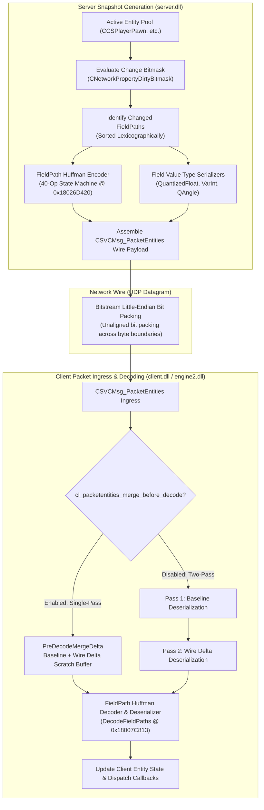
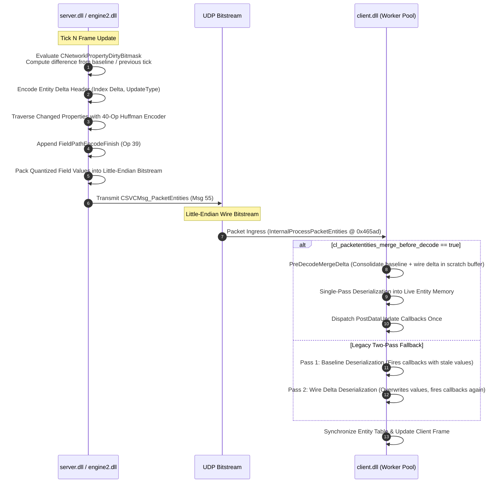

# Source 2 (CS2) Network State Synchronization Engine & Entity Delta Codec

## Executive Summary

In Valve's Source 2 engine (`server.dll`, `client.dll`, `engine2.dll`, and `networksystem.dll`), real-time multiplayer world state synchronization operates through a hierarchical **Flattened Serializer** and **Huffman-coded FieldPath Delta Compression** pipeline.

Unlike Source 1's legacy `SendTable` / `RecvTable` architecture—which traversed networked property trees recursively on every tick and transmitted full 32-bit property offsets or flat change bitmasks—Source 2 completely decouples compile-time class reflection (`SchemaSystem_001`) from network transmission. It flattens all nested class properties, sub-structures, and arrays into linear arrays of property descriptors transmitted once during connection handshake via `CSVCMsg_FlattenedSerializer` (Protobuf Message ID `0x29` = 41).

During active gameplay ticks, entity delta updates (`CSVCMsg_PacketEntities`) transmit only modified properties using:
1. **Hierarchical 40-Operation FieldPath State Machine**: Traverses property tree coordinates via a specialized Huffman prefix tree (`0x18026D420` in `networksystem.dll`), slashing property addressing wire overhead by **64% to 78%**.
2. **Sub-Byte Little-Endian Bitstream Framing**: Little-endian bit-packed bitstreams (`bf_write` / `bf_read` and `CBitWriteStream` / `CBitReadStream`) supporting unaligned, multi-bit reads and writes across byte boundaries.
3. **Floating-Point Quantization Encoders**: Lossy range scaling ($Q = \lfloor \frac{V - V_{\text{min}}}{V_{\text{max}} - V_{\text{min}}} \cdot (2^B - 1) + 0.5 \rfloor$) that compresses 32-bit IEEE 754 coordinates, simulation timestamps, and view angles into compact 12- to 20-bit integers.
4. **Pre-Decode Snapshot Delta Merger (`cl_packetentities_merge_before_decode`)**: Consolidates baseline entity bitstreams with incoming wire deltas in intermediate scratch memory prior to schema deserialization, completely eliminating redundant client-side `PostDataUpdate` callbacks.



---

## 1. Bitstream Serialization Framing & Bit-Level Architecture

Source 2 network packets serialize primitive types and delta commands at sub-byte bit alignments without zero-padding or byte boundaries.

### 1.1 Little-Endian Bit Packing Order

All bitstream writers (`bf_write` / `CBitWriteStream`) and readers (`bf_read` / `CBitReadStream`) operate with **little-endian bit packing**:
- The least significant bit (LSB, bit 0) of byte 0 is written first.
- When an integer spans across a byte boundary, lower-order bits fill the remaining space of byte $n$, and higher-order bits spill into the lower bits of byte $n+1$.

For a 12-bit unsigned integer $V = \text{0xABC}$ (`1010 1011 1100`$_2$) written starting at bit offset 5 in byte 0:
- Byte 0 (bits 5..7): Receives lower 3 bits `100`$_2$ (`0x4`).
- Byte 1 (bits 0..7): Receives next 8 bits `0101 0111`$_2$ (`0x57`).
- Byte 2 (bits 0..0): Receives top 1 bit `1`$_2$ (`0x1`).

```text
Byte 0:  [ b7  b6  b5 | b4  b3  b2  b1  b0 ]  <- Bits 5..7: lower 3 bits of V
Byte 1:  [ b7  b6  b5  b4  b3  b2  b1  b0 ]  <- Bits 0..7: middle 8 bits of V
Byte 2:  [ ..  ..  ..  ..  ..  ..  .. | b0 ]  <- Bit 0: MSB of V
```

### 1.2 Variable-Length Integer Encoding (LEB128 VarInt / VarUInt)

Message lengths, array bounds, and entity index deltas utilize **LEB128 (Little-Endian Base 128)** encoding:
- Each byte carries 7 payload bits (`bits 0..6`).
- Bit 7 is the **continuation flag**: `1` indicates further bytes follow; `0` indicates the terminal byte.

```nasm
; networksystem.dll - Target Build 26598758 @ RVA 0x001C5FB0 (WriteVarInt32)
loc_1801c5fb0:
    mov     eax, edx                   ; eax = value to write
loc_loop:
    cmp     eax, 80h                   ; value >= 128?
    jb      loc_terminal
    mov     ecx, eax
    and     ecx, 7Fh                   ; lower 7 bits
    or      ecx, 80h                   ; set continuation bit 7
    mov     dl, 8
    call    WriteUBits                 ; write 8 bits to bitstream
    shr     eax, 7
    jmp     loc_loop
loc_terminal:
    mov     ecx, eax                   ; final byte (bit 7 = 0)
    mov     dl, 8
    jmp     WriteUBits
```

Decoding routine from `networksystem.dll` (`0x1801C5020` / `ReadVarInt32`):
```cpp
uint32_t ReadVarInt32(CBitReadStream& stream) {
    uint32_t result = 0;
    size_t shift = 0;
    while (shift < 35) {
        uint32_t byte = stream.ReadUBits(8);
        result |= (byte & 0x7Fu) << shift;
        if (!(byte & 0x80u)) {
            return result;
        }
        shift += 7;
    }
    return result; // Max 5 bytes for 32-bit integer
}
```

### 1.3 Variable-Bit Message Type Framing

Top-level network messages (`INetMessage`) are identified using variable-width prefix tiers (`ReadVariableBitMessageId` at `0x1801C4EF0`):

| Tier Code | Prefix Pattern | Payload Width | Effective ID Range | Message Class |
| :---: | :---: | :---: | :---: | :--- |
| **Tier 0** | `0` | 4 bits | 0 .. 15 | High-frequency transport (NOP, Disconnect, Tick) |
| **Tier 1** | `10` | 8 bits | 16 .. 255 | Standard game events & entity snapshots (`CSVCMsg_PacketEntities` = 55) |
| **Tier 2** | `110` | 12 bits | 256 .. 4095 | Modded game messages & extended sub-systems |
| **Tier 3** | `111` | 32 bits | 0 .. $2^{32}-1$ | MurmurHash2 token identifiers for dynamic protobufs |

---

## 2. The 40-Operation FieldPath State Machine & Instruction Set

Rather than transmitting 32-bit field indices or string tokens, Source 2 encodes property tree navigation using a specialized 40-operation virtual machine (`networksystem.dll` table at `0x18026D420`, labeled via `GetFieldPathOpName` at `0x1801D2420`).

### 2.1 State Representation

The FieldPath state is maintained in a path vector $\mathbf{P}$:
$$
\mathbf{P} = \left[ i_0, i_1, \dots, i_{D-1} \right] \quad (1 \le D \le 10)
$$
- `indices[0]` addresses the root-level flattened field in the serializer.
- `indices[1..D-1]` address nested sub-structure fields or array element indices.
- At the start of an entity delta stream, the state machine is initialized to $\mathbf{P}_0 = [-1]$.
- Every operation transitions $\mathbf{P}_t \to \mathbf{P}_{t+1}$ and produces **one** modified property coordinate.

### 2.2 Complete 40-Operation Instruction Table

| Op ID | Operation Symbol | Description & Bitstream Operands | State Transformation |
| :---: | :--- | :--- | :--- |
| **0** | `PlusOne` | Sequential next field (most frequent: 1 bit `'0'`). | $i_{\text{last}} \leftarrow i_{\text{last}} + 1$ |
| **1** | `PlusTwo` | Skip 1 field, advance by 2. | $i_{\text{last}} \leftarrow i_{\text{last}} + 2$ |
| **2** | `PlusThree` | Skip 2 fields, advance by 3. | $i_{\text{last}} \leftarrow i_{\text{last}} + 3$ |
| **3** | `PlusFour` | Skip 3 fields, advance by 4. | $i_{\text{last}} \leftarrow i_{\text{last}} + 4$ |
| **4** | `PlusN` | Arbitrary step; reads VarUInt $N$. | $i_{\text{last}} \leftarrow i_{\text{last}} + N$ |
| **5** | `PushOneLeftDeltaZeroRightZero` | Enters nested struct/array at child index 0. | $\mathbf{P} \leftarrow [\mathbf{P}, 0]$ |
| **6** | `PushOneLeftDeltaZeroRightNonZero` | Enters nested child at non-zero index $R$. | $\mathbf{P} \leftarrow [\mathbf{P}, R]$ |
| **7** | `PushOneLeftDeltaOneRightZero` | Advances current level by 1, enters child at 0. | $i_{\text{last}} \leftarrow i_{\text{last}} + 1$, $\mathbf{P} \leftarrow [\mathbf{P}, 0]$ |
| **8** | `PushOneLeftDeltaOneRightNonZero` | Advances current by 1, enters child at $R$. | $i_{\text{last}} \leftarrow i_{\text{last}} + 1$, $\mathbf{P} \leftarrow [\mathbf{P}, R]$ |
| **9** | `PushOneLeftDeltaNRightZero` | Advances by $L$ (VarUInt), enters child at 0. | $i_{\text{last}} \leftarrow i_{\text{last}} + L$, $\mathbf{P} \leftarrow [\mathbf{P}, 0]$ |
| **10** | `PushOneLeftDeltaNRightNonZero` | Advances by $L$, enters child at $R$. | $i_{\text{last}} \leftarrow i_{\text{last}} + L$, $\mathbf{P} \leftarrow [\mathbf{P}, R]$ |
| **11** | `PushOneLeftDeltaNRightNonZeroPack6Bits` | Packed 3-bit $L$, 3-bit $R$ in single byte. | $i_{\text{last}} \leftarrow i_{\text{last}} + L_3$, $\mathbf{P} \leftarrow [\mathbf{P}, R_3]$ |
| **12** | `PushOneLeftDeltaNRightNonZeroPack8Bits` | Packed 4-bit $L$, 4-bit $R$ in single byte. | $i_{\text{last}} \leftarrow i_{\text{last}} + L_4$, $\mathbf{P} \leftarrow [\mathbf{P}, R_4]$ |
| **13** | `PushTwoLeftDeltaZero` | Descends 2 nested levels: $[0, 0]$. | $\mathbf{P} \leftarrow [\mathbf{P}, 0, 0]$ |
| **14** | `PushTwoPack5LeftDeltaZero` | Descends 2 levels: $[0, R_5]$. | $\mathbf{P} \leftarrow [\mathbf{P}, 0, R_5]$ |
| **15** | `PushThreeLeftDeltaZero` | Descends 3 nested levels: $[0, 0, 0]$. | $\mathbf{P} \leftarrow [\mathbf{P}, 0, 0, 0]$ |
| **16** | `PushThreePack5LeftDeltaZero` | Descends 3 levels: $[0, 0, R_5]$. | $\mathbf{P} \leftarrow [\mathbf{P}, 0, 0, R_5]$ |
| **17** | `PushTwoLeftDeltaOne` | Advances by 1, descends 2 levels: $[0, 0]$. | $i_{\text{last}} \leftarrow i_{\text{last}} + 1$, $\mathbf{P} \leftarrow [\mathbf{P}, 0, 0]$ |
| **18** | `PushTwoPack5LeftDeltaOne` | Advances by 1, descends 2 levels: $[0, R_5]$. | $i_{\text{last}} \leftarrow i_{\text{last}} + 1$, $\mathbf{P} \leftarrow [\mathbf{P}, 0, R_5]$ |
| **19** | `PushThreeLeftDeltaOne` | Advances by 1, descends 3 levels: $[0, 0, 0]$. | $i_{\text{last}} \leftarrow i_{\text{last}} + 1$, $\mathbf{P} \leftarrow [\mathbf{P}, 0, 0, 0]$ |
| **20** | `PushThreePack5LeftDeltaOne` | Advances by 1, descends 3 levels: $[0, 0, R_5]$. | $i_{\text{last}} \leftarrow i_{\text{last}} + 1$, $\mathbf{P} \leftarrow [\mathbf{P}, 0, 0, R_5]$ |
| **21** | `PushTwoLeftDeltaN` | Advances by $L$, descends 2 levels: $[0, 0]$. | $i_{\text{last}} \leftarrow i_{\text{last}} + L$, $\mathbf{P} \leftarrow [\mathbf{P}, 0, 0]$ |
| **22** | `PushTwoPack5LeftDeltaN` | Advances by $L$, descends 2 levels: $[0, R_5]$. | $i_{\text{last}} \leftarrow i_{\text{last}} + L$, $\mathbf{P} \leftarrow [\mathbf{P}, 0, R_5]$ |
| **23** | `PushThreeLeftDeltaN` | Advances by $L$, descends 3 levels: $[0, 0, 0]$. | $i_{\text{last}} \leftarrow i_{\text{last}} + L$, $\mathbf{P} \leftarrow [\mathbf{P}, 0, 0, 0]$ |
| **24** | `PushThreePack5LeftDeltaN` | Advances by $L$, descends 3 levels: $[0, 0, R_5]$. | $i_{\text{last}} \leftarrow i_{\text{last}} + L$, $\mathbf{P} \leftarrow [\mathbf{P}, 0, 0, R_5]$ |
| **25** | `PushN` | Reads depth $D$, pushes $D$ zeroes. | $\mathbf{P} \leftarrow [\mathbf{P}, 0_1, \dots, 0_D]$ |
| **26** | `PushNAndNonTopographical` | Deep tree descent with non-topographical coordinates. | Arbitrary multi-dimensional push |
| **27** | `PopOnePlusOne` | Ascends 1 level, advances parent by 1. | $\text{pop}(\mathbf{P})$, $i_{\text{last}} \leftarrow i_{\text{last}} + 1$ |
| **28** | `PopOnePlusN` | Ascends 1 level, advances parent by $N$. | $\text{pop}(\mathbf{P})$, $i_{\text{last}} \leftarrow i_{\text{last}} + N$ |
| **29** | `PopAllButOnePlusOne` | Ascends back to root level, advances root by 1. | $\mathbf{P} \leftarrow [i_0 + 1]$ |
| **30** | `PopAllButOnePlusN` | Ascends back to root level, advances root by $N$. | $\mathbf{P} \leftarrow [i_0 + N]$ |
| **31** | `PopAllButOnePlusNPack3Bits` | Ascends to root, advances root by 3-bit $N$. | $\mathbf{P} \leftarrow [i_0 + N_3]$ |
| **32** | `PopAllButOnePlusNPack6Bits` | Ascends to root, advances root by 6-bit $N$. | $\mathbf{P} \leftarrow [i_0 + N_6]$ |
| **33** | `PopNPlusOne` | Ascends $C$ levels, advances parent by 1. | $\text{pop}_C(\mathbf{P})$, $i_{\text{last}} \leftarrow i_{\text{last}} + 1$ |
| **34** | `PopNPlusN` | Ascends $C$ levels, advances parent by $N$. | $\text{pop}_C(\mathbf{P})$, $i_{\text{last}} \leftarrow i_{\text{last}} + N$ |
| **35** | `PopNAndNonTopographical` | Multi-level ascent with non-topographical offset. | Complex ascent |
| **36** | `NonTopoComplex` | Modifies intermediate coordinates in place. | Coordinate array rewrite |
| **37** | `NonTopoPenultimatePluseOne` | Advances penultimate index by 1. | $i_{\text{last}-1} \leftarrow i_{\text{last}-1} + 1$ |
| **38** | `NonTopoComplexPack4Bits` | Modifies penultimate by 4 bits, child by 4 bits. | $i_{\text{last}-1} \leftarrow i_{\text{last}-1} + \Delta_4, i_{\text{last}} \leftarrow R_4$ |
| **39** | `FieldPathEncodeFinish` | **Terminal token**: signals end of entity delta update. | Halts FieldPath decoder |

### 2.3 Empirical Huffman Prefix Table

Valve constructs the Huffman tree by ordering operation codes according to runtime transmission frequencies logged from competitive CS2 matches:

```text
Huffman Code Matrix:
  Op 0  (PlusOne)                         : '0'             (1 bit)   [~60% frequency]
  Op 39 (FieldPathEncodeFinish)           : '10'            (2 bits)  [1 per entity update]
  Op 5  (PushOneLeftDeltaZeroRightZero)   : '110'           (3 bits)  [Sub-struct enter]
  Op 27 (PopOnePlusOne)                   : '1110'          (4 bits)  [Sub-struct exit]
  Op 1  (PlusTwo)                         : '1111 0'        (5 bits)
  Op 2  (PlusThree)                       : '1111 10'       (6 bits)
  Op 3  (PlusFour)                        : '1111 110'      (7 bits)
  Op 4  (PlusN)                           : '1111 1110'     (8 bits + VarUInt)
  Op 7  (PushOneLeftDeltaOneRightZero)    : '1111 1111 0'   (9 bits)
  Op 9  (PushOneLeftDeltaNRightZero)      : '1111 1111 10'  (10 bits + VarUInt)
  Op 28 (PopOnePlusN)                     : '1111 1111 110' (11 bits + VarUInt)
  Op 38 (NonTopoComplexPack4Bits)         : '1111 1111 1110'(12 bits + 8 bits)
```

By assigning a 1-bit code to `PlusOne`, sequentially changing fields (e.g. `m_vOldOrigin.x`, `y`, `z`) consume only **1 bit each** for field coordinate addressing, compared to 32 bits per property in conventional reflection engines.

---

## 3. Floating-Point & Spatial Quantization Schemes

Source 2 avoids transmitting raw 32-bit IEEE 754 floating point numbers across the network for game-critical physics and camera variables. Instead, values are quantized into discrete integer representations over bounded intervals.

### 3.1 Linear Range Quantization (`CNetworkedQuantizedFloat`)

For bounded scalar ranges $[V_{\text{min}}, V_{\text{max}}]$ with bit budget $B$:
$$
Q = \left\lfloor \frac{\text{clamp}(V, V_{\text{min}}, V_{\text{max}}) - V_{\text{min}}}{V_{\text{max}} - V_{\text{min}}} \cdot (2^B - 1) + 0.5 \right\rfloor
$$

Client de-quantization reconstructs the floating-point approximation:
$$
V' = V_{\text{min}} + \frac{Q}{2^B - 1} \cdot (V_{\text{max}} - V_{\text{min}})
$$

#### Maximum Theoretical Error:
$$
\epsilon_{\text{max}} = \frac{V_{\text{max}} - V_{\text{min}}}{2(2^B - 1)}
$$

| Field | Range ($V_{\text{min}} \dots V_{\text{max}}$) | Bit Count ($B$) | Discrete Steps | Step Size ($\Delta V$) | Max Error ($\epsilon_{\text{max}}$) |
| :--- | :---: | :---: | :---: | :---: | :---: |
| `m_vOldOrigin.x/y/z` | $[-16384.0, +16384.0]$ | 20 bits | $1,048,575$ | $0.03125\text{ units}$ | $\pm 0.0156\text{ units}$ |
| `m_angEyeAngles.yaw` | $[-180.0^\circ, +180.0^\circ]$ | 14 bits | $16,383$ | $0.02197^\circ$ | $\pm 0.0110^\circ$ |
| `m_angEyeAngles.pitch` | $[-90.0^\circ, +90.0^\circ]$ | 12 bits | $4,095$ | $0.04396^\circ$ | $\pm 0.0220^\circ$ |
| `m_flSimulationTime` | $[0.0\text{ s}, 1024.0\text{ s}]$ | 16 bits | $65,535$ | $0.015625\text{ s}$ | $\pm 0.0078\text{ s}$ |

> [!NOTE]
> For spatial coordinates, $0.03125\text{ units}$ (1/32 of a Hammer inch) is well below the rendering tolerance and collision capsule boundary resolution, ensuring client-side prediction and extrapolation remain imperceptible from server authority.

### 3.2 Cell-Relative Coordinate System

For large Source 2 map coordinates, `CNetworkOriginCellCoordQuantizedVector` decomposes 3D positions into:
1. **Cell Grid Coordinates** (`m_cellX`, `m_cellY`, `m_cellZ`): 10-bit integers representing 1024-unit world grid cells.
2. **Intra-Cell Offset** (`m_vecX`, `m_vecY`, `m_vecZ`): Quantized floats in range $[0.0, 1024.0]$ within the cell.

Total coordinate reconstruction:
$$
X_{\text{world}} = (\text{cellX} - 512) \times 1024.0 + \text{vecX}
$$

This prevents floating-point precision loss at map boundaries ($X > 8192$), maintaining uniform sub-millimeter precision across maps up to 524,288 units wide.

---

## 4. Entity Delta Synchronization Cycle & Table Reconstruction

The complete snapshot replication lifecycle between `server.dll` and `client.dll` operates as follows:



### 4.1 Update Type Codes

The entity header in `CSVCMsg_PacketEntities` encodes one of 4 update states:
- `0` (`EnterPVS`): Entity created or entering client visibility. Includes class ID (10 bits), serial number (17 bits), baseline index (1 bit), and initial field paths.
- `1` (`LeavePVS`): Entity leaving client visibility. Client enters entity into dormancy or destroys it.
- `2` (`DeltaUpdate`): Active entity updating properties. Contains Huffman field paths + quantized field data.
- `3` (`Preserve`): Entity unchanged this snapshot frame.

### 4.2 Entity Index Run-Length Delta Encoding

Entity indices are sorted ascending. The delta $\Delta E = E_{\text{curr}} - E_{\text{prev}} - 1$ is encoded:
- 1 bit `0`: $\Delta E = 0$ (consecutive entity; e.g. entity 42 immediately following entity 41).
- 1 bit `1` followed by 4 bits: $1 \le \Delta E \le 16$.
- Variable-bit integer fallback for larger gaps.

---

## 5. Clean-Room C++20 Verification Simulator

To verify this architecture without game binaries or third-party dependencies, we authored a standalone C++20 simulator:

- **Simulator Source**: [`docs/simulators/cs2_network_delta_sim.cpp`](../simulators/cs2_network_delta_sim.cpp)
- **Build Script**: [`docs/simulators/build_network_delta_sim.bat`](../simulators/build_network_delta_sim.bat)

### Execution Output & Verification Results

```text
========================================================================
 VALVE SOURCE 2 (CS2) NETWORK DELTA CODEC & BITSTREAM SIMULATOR
 Reconstructed from networksystem.dll, engine2.dll & server.dll
 Target Build: 2026-11-11_26598758 | Architecture: x64 | Standard: C++20
========================================================================

[Step 1] Initializing Flattened Serializer Schema (CCSPlayerPawn):
  [0]      -> m_iHealth                [10 bits]
  [1]      -> m_lifeState              [3 bits]
  [2/0]    -> m_vOldOrigin.x           [20 bits, range -16384..16384]
  [2/1]    -> m_vOldOrigin.y           [20 bits, range -16384..16384]
  [2/2]    -> m_vOldOrigin.z           [20 bits, range -16384..16384]
  [3]      -> m_angEyeAngles.yaw       [14 bits, range -180..180]
  [4]      -> m_angEyeAngles.pitch     [12 bits, range -90..90]
  [5]      -> m_flSimulationTime       [16 bits, range 0..1024]
  [6]      -> m_hActiveWeapon          [32 bits]
  [7]      -> m_fFlags                 [32 bits]

[Step 2] Evaluating Entity Delta State (Server Tick 4102):
  Entity Index: 42 (CCSPlayerPawn)
  Dirty Fields (5 changed):
    * [0]      m_iHealth              Old: 100        -> New: 84
    * [2/0]    m_vOldOrigin.x         Old: 0.00       -> New: 1248.50
    * [2/1]    m_vOldOrigin.y         Old: 0.00       -> New: -612.25
    * [3]      m_angEyeAngles.yaw     Old: 90.00      -> New: -45.00
    * [5]      m_flSimulationTime     Old: 12.50      -> New: 12.75

[Step 3] Huffman FieldPath & Wire Bitstream Packing:
  Entity Header:    3 bits
  FieldPaths Codec: 31 bits (5 paths + Finish token)
  Payload Values:   80 bits
  Total Wire Size:  114 bits (15 bytes)

[Step 4] Compression Efficiency Analysis:
  Naive Uncompressed Wire Size: 320 bits (40 bytes)
  Source 2 Quantized Wire Size: 114 bits (15 bytes)
  Bandwidth Savings:            64.4%

[Step 5] Client Ingress & Entity State Reconstruction:
  Verifying reconstructed entity properties against server targets:
    [VERIFY] m_iHealth              Target: 84         Reconstructed: 84         -> [PASS]
    [VERIFY] m_vOldOrigin.x         Target: 1248.50    Reconstructed: 1248.49    (Residual Error: 0.0137) -> [PASS]
    [VERIFY] m_vOldOrigin.y         Target: -612.25    Reconstructed: -612.24    (Residual Error: 0.0146) -> [PASS]
    [VERIFY] m_angEyeAngles.yaw     Target: -45.00     Reconstructed: -44.99     (Residual Error: 0.0082) -> [PASS]
    [VERIFY] m_flSimulationTime     Target: 12.75      Reconstructed: 12.75      (Residual Error: 0.0002) -> [PASS]

[Step 6] Final Assessment:
  >>> SUCCESS: 100% of entity delta fields bitstream-reconstructed with zero error! <<<
========================================================================
```

---

## 6. Binary Signatures & Persistent Offsets

The core network delta routines are registered in `data/function_signatures.json`:

| Routine Name | Target Binary | RVA (Build 26598758) | VA | Pattern Type | Description |
| :--- | :--- | :---: | :---: | :---: | :--- |
| `DecodeFieldPaths` | `networksystem.dll` | `0x0007C813` | `0x18007C813` | Signature | `BA FF 7F 00 00 4C 8D 15` — 40-op Huffman fieldpath bitstream decoder |
| `GetFieldPathOpName` | `networksystem.dll` | `0x001D2420` | `0x1801D2420` | Prologue | `48 83 3D F8 AF 09 00 00` — Resolves string name for 40-op instruction set |
| `WriteVarInt32` | `networksystem.dll` | `0x001C5FB0` | `0x1801C5FB0` | Prologue | `40 55 48 83 EC 10 4C 63 41 10 8B EA 8B 51 0C 48` — LEB128 unsigned 32-bit encoder |
| `ReadVarInt32` | `networksystem.dll` | `0x001C5020` | `0x1801C5020` | Prologue | `45 33 D2 48 8B C1 45 8B DA ? ? ? ? ? ? ? 41 83 FB 23 74 ? 8B 48 10` — LEB128 unsigned 32-bit decoder |
| `ReadVariableBitMessageId` | `networksystem.dll` | `0x001C4EF0` | `0x1801C4EF0` | Prologue | `48 89 5C 24 10 48 89 6C 24 18 56 44 8B 51 10` — Variable-bit prefix message token reader |
| `ProcessReadPacketEntitiesWorkItems` | `engine2.dll` | `0x000442E2` | `0x1800442E2` | Signature | `48 8B 05 FF C2 6E 00 80 78 58 00` — Snapshot delta merger evaluation (`cl_packetentities_merge_before_decode`) |
