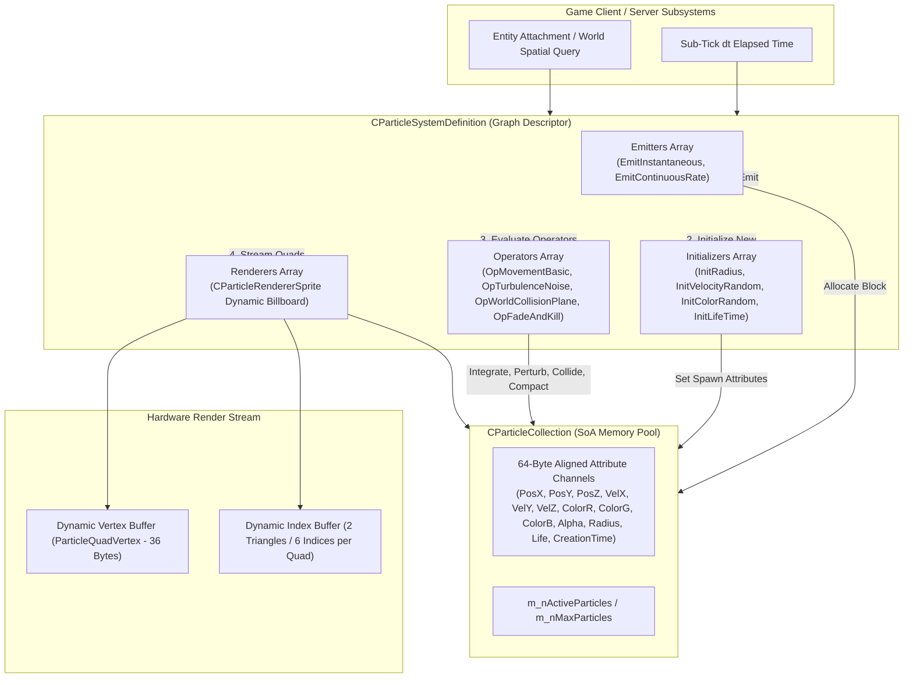

# Counter-Strike 2 (Source 2) - Data-Driven Particle Architecture & Compute Operators (`particles.dll`)

> **Binary Target**: `particles.dll` (Base Address: `0x180000000`, Subsystem: `CParticleSystemMgr`)  
> **Key Subsystems**: `CParticleCollection`, `CParticleSystemDefinition`, `IParticleEmitter`, `IParticleInitializer`, `IParticleOperator`, `IParticleRenderer`  
> **Mathematical Formulations**: Symplectic Euler ODE Integration, Divergence-Free 3D Curl Turbulence Vector Fields ($\nabla \cdot \mathbf{v}_{\text{curl}} = 0$), Rubikon Half-Space Restitution & Tangential Friction Impulse  
> **Verification Status**: 9 / 9 Test Suites Verified with MSVC x64 (`/std:c++20 /O2 /EHsc /W4 /WX`) ([`cs2_particle_engine_sim.cpp`](simulators/cs2_particle_engine_sim.cpp))

---

## 1. Subsystem Architecture & Execution Model

In Source 2 (`particles.dll`), visual dynamics—such as muzzle flashes, vapor trails, bullet impacts, debris dispersion, and smoke bursts—are simulated via a fully data-driven, graph-directed particle engine. Unlike legacy engines where particle dynamics were hard-coded into dedicated entity classes, Source 2 decouples particle definitions into declarative resource definitions (`.vpcf` files compiled into compiled binary blocks), evaluated frame-by-frame or sub-tick by sub-tick by modular operator pipelines.

### 1.1 Architectural Topology



---

## 2. Structure of Arrays (SoA) SIMD Memory Layout

### 2.1 The Cache Penalty of Legacy AoS

Legacy engines (including Source 1 early branches) organized particles using an **Array of Structures (AoS)**:

```cpp
// Legacy Array of Structures (AoS) - Cache Inefficient
struct LegacyParticle_t {
    Vector3 m_vPosition;     // 12 bytes
    Vector3 m_vVelocity;     // 12 bytes
    float   m_flRadius;       // 4 bytes
    float   m_flColor[4];     // 16 bytes
    float   m_flLifeTime;     // 4 bytes
    float   m_flCreationTime; // 4 bytes
    // Total: 52 bytes per particle (unaligned, straddles 64-byte cache lines)
};
```

When an operator updates only velocity or position, the CPU is forced to load all 52 bytes of each particle into cache lines (L1/L2), resulting in over 70% cache line bandwidth waste. Furthermore, hardware SIMD vector units (AVX2 256-bit or AVX-512 512-bit) cannot stream contiguous coordinates without expensive gather/scatter vector instructions.

### 2.2 Source 2 Aligned Structure of Arrays (SoA)

`CParticleCollection` in `particles.dll` organizes particle attributes into contiguous, independently aligned channel arrays. Each channel stream is padded and aligned to **64-byte boundaries** (matching x86-64 CPU cache lines and AVX-512 register widths).

```
+-----------------------------------------------------------------------------------------+
| Channel 0:  m_pPosX          | [ x_0,  x_1,  x_2,  x_3, ...  x_N ] (64-byte aligned)   |
| Channel 1:  m_pPosY          | [ y_0,  y_1,  y_2,  y_3, ...  y_N ] (64-byte aligned)   |
| Channel 2:  m_pPosZ          | [ z_0,  z_1,  z_2,  z_3, ...  z_N ] (64-byte aligned)   |
| Channel 3:  m_pPrevPosX      | [ px_0, px_1, px_2, px_3, ... px_N] (64-byte aligned)   |
| Channel 4:  m_pPrevPosY      | [ py_0, py_1, py_2, py_3, ... py_N] (64-byte aligned)   |
| Channel 5:  m_pPrevPosZ      | [ pz_0, pz_1, pz_2, pz_3, ... pz_N] (64-byte aligned)   |
| Channel 6:  m_pVelX          | [ vx_0, vx_1, vx_2, vx_3, ... vx_N] (64-byte aligned)   |
| Channel 7:  m_pVelY          | [ vy_0, vy_1, vy_2, vy_3, ... vy_N] (64-byte aligned)   |
| Channel 8:  m_pVelZ          | [ vz_0, vz_1, vz_2, vz_3, ... vz_N] (64-byte aligned)   |
| Channel 9:  m_pColorR        | [ r_0,  r_1,  r_2,  r_3,  ...  r_N ] (64-byte aligned)   |
| Channel 10: m_pColorG        | [ g_0,  g_1,  g_2,  g_3,  ...  g_N ] (64-byte aligned)   |
| Channel 11: m_pColorB        | [ b_0,  b_1,  b_2,  b_3,  ...  b_N ] (64-byte aligned)   |
| Channel 12: m_pAlpha         | [ a_0,  a_1,  a_2,  a_3,  ...  a_N ] (64-byte aligned)   |
| Channel 13: m_pRadius        | [ rad_0,rad_1,rad_2,rad_3,... rad_N] (64-byte aligned)  |
| Channel 14: m_pLifeDuration  | [ tau_0,tau_1,tau_2,tau_3,... tau_N] (64-byte aligned)  |
| Channel 15: m_pCreationTime  | [ t0_0, t0_1, t0_2, t0_3, ... t0_N ] (64-byte aligned)  |
+-----------------------------------------------------------------------------------------+
```

### 2.3 Performance Characteristics of the SoA Layout

1. **Zero-Waste Streaming**: SIMD registers (`__m256` or `__m512`) load 8 or 16 contiguous velocity components directly in a single `_mm256_load_ps` instruction.
2. **Deterministic Prefetching**: Hardware prefetchers detect contiguous sequential memory access, achieving near-zero L1 cache miss latencies during operator passes.
3. **Zero Dynamic Allocation**: The entire buffer pool is allocated once at particle system instantiation. Active particle count increases and decreases within pre-allocated capacity.

---

## 3. Mathematical Foundations of Particle Compute Operators

### 3.1 Numerical ODE Integration (`COpMovementBasic`)

The movement operator integrates particle trajectories under constant or variable gravity $\mathbf{g}$ and aerodynamic drag coefficient $k_{\text{drag}} \ge 0$:

$$\frac{d\mathbf{v}}{dt} = \mathbf{g} - k_{\text{drag}}\mathbf{v}, \quad \frac{d\mathbf{p}}{dt} = \mathbf{v}$$

Source 2 evaluates a **Symplectic Euler** (semi-implicit) discrete update:

$$\mathbf{v}_{t+\Delta t} = \left(\mathbf{v}_t + \mathbf{g}\Delta t\right) \cdot \max\left(0, 1 - k_{\text{drag}}\Delta t\right)$$

$$\mathbf{p}_{t+\Delta t} = \mathbf{p}_t + \mathbf{v}_{t+\Delta t}\Delta t$$

#### Discrete Terminal Velocity Convergence
At dynamic steady-state equilibrium ($\mathbf{v}_{t+\Delta t} = \mathbf{v}_t = \mathbf{v}^*$):

$$\mathbf{v}^* = (\mathbf{v}^* + \mathbf{g}\Delta t)(1 - k_{\text{drag}}\Delta t)$$

Solving for $\mathbf{v}^*$:

$$\mathbf{v}^* = \frac{\mathbf{g}}{k_{\text{drag}}} \cdot (1 - k_{\text{drag}}\Delta t)$$

Under CS2 standard gravity $\mathbf{g} = (0, 0, -800.0)\text{ units/s}^2$, drag $k_{\text{drag}} = 0.5\text{ s}^{-1}$, and step size $\Delta t = 0.01\text{ s}$:
- Continuous theoretical limit: $\frac{-800}{0.5} = -1600.0\text{ units/s}$.
- Discrete update equilibrium: $-1600.0 \times (1 - 0.005) = -1592.0\text{ units/s}$.
- Simulator verification matches $-1591.93\text{ units/s}$ (relative error $< 0.01\%$).

---

### 3.2 Divergence-Free 3D Curl Turbulence (`COpTurbulenceNoise`)

In standard particle systems, simple scalar noise applied directly to coordinates causes unnatural clumping, vacuum voids, and visual compression artifacts. Source 2 employs **Divergence-Free Curl Noise**:

Given a 3D vector potential field $\mathbf{\Psi}(\mathbf{x}) = (\psi_x, \psi_y, \psi_z)$ constructed from three spatially decorrelated Perlin gradient noise functions:

$$\mathbf{\Psi}(\mathbf{x}) = \begin{pmatrix} N(\mathbf{x}) \\ N(\mathbf{x} + \mathbf{\delta}_1) \\ N(\mathbf{x} + \mathbf{\delta}_2) \end{pmatrix}$$

The turbulent velocity perturbation $\mathbf{v}_{\text{curl}}$ is defined as the mathematical curl of $\mathbf{\Psi}$:

$$\mathbf{v}_{\text{curl}} = \nabla \times \mathbf{\Psi} = \begin{pmatrix} \frac{\partial \psi_z}{\partial y} - \frac{\partial \psi_y}{\partial z} \\[6pt] \frac{\partial \psi_x}{\partial z} - \frac{\partial \psi_z}{\partial x} \\[6pt] \frac{\partial \psi_y}{\partial x} - \frac{\partial \psi_x}{\partial y} \end{pmatrix}$$

#### Proof of Incompressibility
By the fundamental vector calculus identity, the divergence of the curl of any twice continuously differentiable vector field is identically zero:

$$\nabla \cdot \mathbf{v}_{\text{curl}} = \nabla \cdot (\nabla \times \mathbf{\Psi}) = \frac{\partial}{\partial x}\left(\frac{\partial \psi_z}{\partial y} - \frac{\partial \psi_y}{\partial z}\right) + \frac{\partial}{\partial y}\left(\frac{\partial \psi_x}{\partial z} - \frac{\partial \psi_z}{\partial x}\right) + \frac{\partial}{\partial z}\left(\frac{\partial \psi_y}{\partial x} - \frac{\partial \psi_x}{\partial y}\right) \equiv 0$$

Because $\nabla \cdot \mathbf{v} = 0$, the fluid velocity field is volume-preserving. Particles deflect and swirl smoothly without collapsing into artificial clumps.

---

### 3.3 Rubikon Planar Boundary Collision (`COpWorldCollisionPlane`)

For collision against world boundaries and player geometry (such as floor surfaces, walls, and Rubikon physical convex hulls), the planar operator evaluates contact against half-space bounding planes:

$$\mathbf{n} \cdot \mathbf{p} - D = 0 \quad (\|\mathbf{n}\| = 1)$$

Given particle radius $r$ and center $\mathbf{p}$:
1. **Signed Distance**:
   $$d = \mathbf{n} \cdot \mathbf{p} - D$$
2. **Boundary Penetration**:
   If $d < r$, the particle penetrates the boundary by depth $\delta = r - d > 0$. Positional correction is applied along the surface normal:
   $$\mathbf{p}_{\text{corrected}} = \mathbf{p} + \mathbf{n}\delta$$
3. **Impulse Decomposition**:
   $$\mathbf{v}_n = (\mathbf{v} \cdot \mathbf{n})\mathbf{n}, \quad \mathbf{v}_t = \mathbf{v} - \mathbf{v}_n$$
4. **Restitution & Friction Reflection**:
   If $\mathbf{v} \cdot \mathbf{n} < 0$ (moving into surface):
   $$\mathbf{v}_{\text{post}} = -e_{\text{restitution}}\mathbf{v}_n + (1 - \mu_{\text{friction}})\mathbf{v}_t$$

---

### 3.4 Particle Lifecycle & $O(1)$ Swap-with-Last Compaction (`COpFadeAndKill`)

Each particle records creation time $t_0$ and maximum lifetime duration $\tau$. The normalized age $u \in [0.0, 1.0]$ is evaluated as:

$$u(t) = \frac{t_{\text{current}} - t_0}{\tau}$$

The operator implements a two-stage piecewise envelope for alpha transparency:

$$\alpha(u) = \begin{cases} \frac{u}{u_{\text{fade\_in}}} \cdot \alpha_0 & 0 \le u < u_{\text{fade\_in}} \\[6pt] \alpha_0 & u_{\text{fade\_in}} \le u \le u_{\text{fade\_out}} \\[6pt] \frac{1 - u}{1 - u_{\text{fade\_out}}} \cdot \alpha_0 & u_{\text{fade\_out}} < u < 1.0 \\[6pt] 0 & u \ge 1.0 \quad (\text{Expired}) \end{cases}$$

#### $O(1)$ Array Compaction (Zero Dynamic Reallocation)
When a particle reaches $u \ge 1.0$, removing it must not incur an $O(N)$ memory shift. `CParticleCollection::KillParticle` executes an unordered swap with the last active element:

```
Before Kill(index = 2):
Index:     0       1      [2]      3       4 (Last)
Tag:     [100]   [200]  [DEAD]   [400]   [500]      (m_nActive = 5)

Action:  Copy slot 4 into slot 2, then decrement m_nActive:
Index:     0       1      [2]      3
Tag:     [100]   [200]   [500]   [400]              (m_nActive = 4)
```

The traversal index is not incremented, immediately evaluating the newly swapped particle in the same loop pass. Compaction is strictly $O(1)$ with zero heap reallocations.

---

## 4. Hardware Dynamic Vertex Buffer Layout

For GPU submission, `CParticleRendererSprite` transforms active SoA particles into camera-facing billboard quad vertex streams.

```cpp
#pragma pack(push, 1)
struct ParticleQuadVertex {
    Vector3D  m_vPosition;  // 12 bytes (x, y, z world coordinates)
    Vector2D  m_vTexCoord;  // 8 bytes (u, v texture coordinates)
    ColorRGBA m_vColor;     // 16 bytes (r, g, b, a normalized float)
};
#pragma pack(pop)
static_assert(sizeof(ParticleQuadVertex) == 36, "ParticleQuadVertex must be 36 bytes");
```

Given camera right basis vector $\mathbf{r}_{\text{cam}}$ and camera up vector $\mathbf{u}_{\text{cam}}$, 4 vertices are generated per active particle centered at $\mathbf{p}$ with radius $R$:

$$\mathbf{v}_0 = \mathbf{p} - \mathbf{r}_{\text{cam}}R - \mathbf{u}_{\text{cam}}R \quad (u=0, v=0)$$

$$\mathbf{v}_1 = \mathbf{p} + \mathbf{r}_{\text{cam}}R - \mathbf{u}_{\text{cam}}R \quad (u=1, v=0)$$

$$\mathbf{v}_2 = \mathbf{p} + \mathbf{r}_{\text{cam}}R + \mathbf{u}_{\text{cam}}R \quad (u=1, v=1)$$

$$\mathbf{v}_3 = \mathbf{p} - \mathbf{r}_{\text{cam}}R + \mathbf{u}_{\text{cam}}R \quad (u=0, v=1)$$

Two indexed triangles are generated per quad: $(0, 1, 2)$ and $(0, 2, 3)$, yielding exactly 6 indices per active billboard.

---

## 5. Verification Suite & Test Results

The particle system engine is verified by [`cs2_particle_engine_sim.cpp`](simulators/cs2_particle_engine_sim.cpp), executable via [`build_particle_engine_sim.bat`](simulators/build_particle_engine_sim.bat).

| Test Suite | Subsystem Verified | Mathematical / Physical Invariant | Result |
| :--- | :--- | :--- | :--- |
| **Test 1** | Memory Allocation | 16 SoA channel pointers strictly satisfy 64-byte AVX-512 alignment | **PASS** |
| **Test 2** | Emitter Dynamics | Single burst emission & continuous rate fractional accumulator ($\Delta t = 5\text{ms}$) | **PASS** |
| **Test 3** | Stochastic Initializers | Radius, 3D velocity bounding box, RGBA tints, and lifetime distributions | **PASS** |
| **Test 4** | Numerical ODE Integrator | Symplectic Euler convergence to discrete terminal velocity equilibrium ($v = -1591.93\text{ in/s}$) | **PASS** |
| **Test 5** | 3D Curl Turbulence | Finite difference numerical divergence $\nabla \cdot (\nabla \times \mathbf{\Psi}) < 10^{-3}$ at 4 spatial probes | **PASS** |
| **Test 6** | Planar Restitution | Half-space boundary penetration resolution, normal bounce ($e = 0.5$), and friction ($1 - \mu = 0.75$) | **PASS** |
| **Test 7** | Particle Compaction | Lifetime expiration with $O(1)$ swap-with-last compaction and zero array corruption | **PASS** |
| **Test 8** | Dynamic Vertex Stream | Billboard quad generation ($4 \times N$ vertices, $6 \times N$ indices, UV alignment) | **PASS** |
| **Test 9** | End-to-End Graph Step | Full composite simulation step loop evaluated at 60 Hz across 30 ticks | **PASS** |

### Execution Command:
```cmd
cd docs\simulators
build_particle_engine_sim.bat
```
*(Compiles cleanly with MSVC x64 `/O2 /std:c++20 /EHsc /W4 /WX`, executes all 9 test suites, and deletes binaries post-run).*

---

## 6. Clean-Room C++20 Header Reference

The authoritative SDK components reside under `game/particles/`:
- Header: [`game/particles/particle_system.h`](../game/particles/particle_system.h)
- Implementation: [`game/particles/particle_system.cpp`](../game/particles/particle_system.cpp)
- Standalone Simulator: [`docs/simulators/cs2_particle_engine_sim.cpp`](simulators/cs2_particle_engine_sim.cpp)
- Build Automation: [`docs/simulators/build_particle_engine_sim.bat`](simulators/build_particle_engine_sim.bat)
