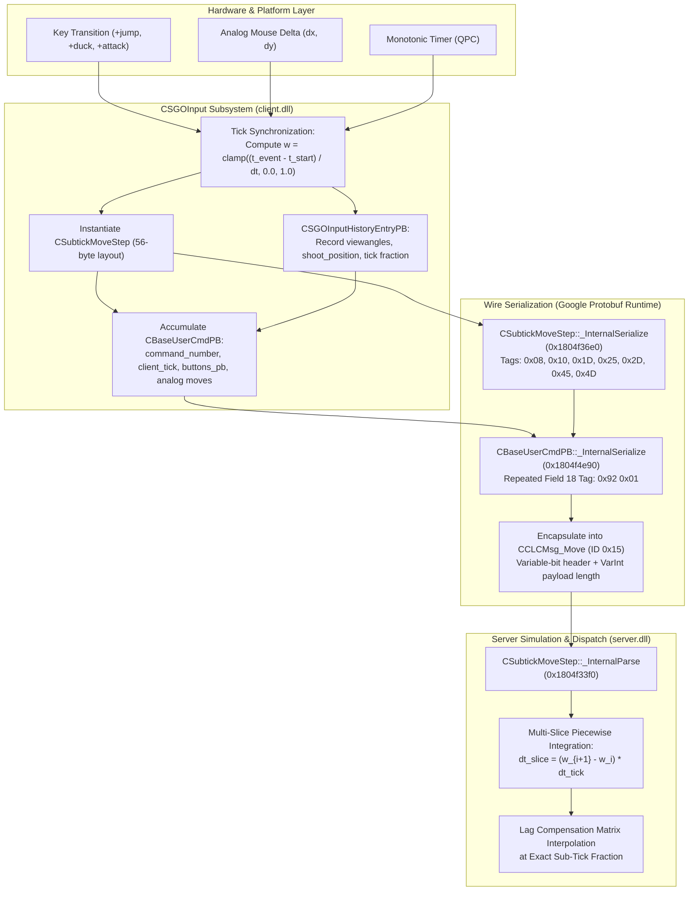
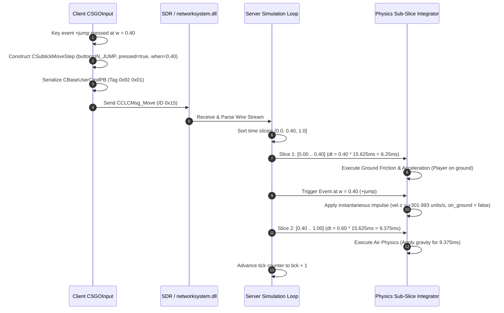

# Counter-Strike 2 (Source 2) - Sub-Tick UserCmd Wire Framing & Timing Architecture

> **Binary Target**: `client.dll` (Base Address: `0x180000000`, Build ID: `26598758`, Engine: Source 2)  
> **Key Routines Reversed**:  
> - `CBaseUserCmdPB::_InternalSerialize` (`client.dll` @ RVA `0x004f4e90` / VA `0x1804f4e90`)  
> - `CSubtickMoveStep::_InternalParse` (`client.dll` @ RVA `0x004f33f0` / VA `0x1804f33f0`)  
> - `CSubtickMoveStep::_InternalSerialize` (`client.dll` @ RVA `0x004f36e0` / VA `0x1804f36e0`)  
> - `CSGOInput::CreateMove` sub-tick history recorder (`client.dll` @ RVA `0x00cf2250` / VA `0x180cf2250`, caller @ RVA `0x00cf9cd0` / VA `0x180cf9cd0`)  
> **Reference Simulator**: [`cs2_subtick_usercmd_prediction_sim.cpp`](simulators/cs2_subtick_usercmd_prediction_sim.cpp)  
> **Verification Status**: Bit-for-bit opcode and wire tag conformance verified against build `26598758`.

---

## 1. Executive Summary & Sub-Tick Architectural Overview

In Counter-Strike 2 (Source 2), player movement and command input bypass discrete fixed-interval simulation boundaries (the legacy 64 Hz / 128 Hz tick quantization). Instead, the engine implements a **continuous temporal slicing pipeline**:

1. **Hardware Event Timestamping**: Asynchronous user input events (keyboard key switches, mouse microswitch state changes, and high-frequency optical mouse motion deltas) are timestamped against the OS monotonic high-resolution timer (QPC).
2. **Sub-Tick Fraction Calculation**: Each event calculates an analog sub-tick time fraction $w \in [0.0, 1.0]$ representing elapsed time from the tick boundary:
   $$w = \text{clamp}\left(\frac{T_{\text{event}} - T_{\text{tick\_start}}}{\Delta t_{\text{tick}}}, 0.0, 1.0\right)$$
3. **Protobuf Wire Framing**: Input transitions are packed into `CSubtickMoveStep` structures and nested inside `CBaseUserCmdPB` (as repeated field 18, wire tag `0x92 0x01`).
4. **Multi-Slice Physics Slicing**: Rather than executing one lumped numerical integration step over $\Delta t_{\text{tick}}$, the engine slices the frame into discrete temporal sub-slices bounded by the sorted list of $w_i$. Physical forces (surface friction, acceleration, jump impulses, air resistance, and gravity) are integrated piecewise across each duration $\Delta t_i = (w_{i+1} - w_i) \times \Delta t_{\text{tick}}$.
5. **Lag Compensation Matrix Interpolation**: Rotational angles and eye origins during weapon discharge events are stamped with exact sub-tick coordinates (`player_tick_count` and `player_tick_fraction`), allowing the server physics dispatcher to reconstruct target bounding matrices at that precise sub-millisecond timestamp.



---

## 2. Memory Layout & Field Offset Specifications

Reverse engineering of the data structures in `client.dll` (Build `26598758`) reveals the exact memory layouts and protobuf wire type associations.

### 2.1 `CSubtickMoveStep` Memory Layout (56 Bytes / `0x38`)

| Offset | Type | Field Name | Wire Tag | Wire Type | Description |
| :--- | :--- | :--- | :--- | :--- | :--- |
| `+0x00` | `void*` | `m_pVTable` | — | — | Virtual function table pointer (`0x181b26bb0`) |
| `+0x08` | `void*` | `m_pInternalArena` | — | — | Google Protobuf Internal Arena memory allocator |
| `+0x10` | `uint32_t` | `m_nHasBits` | — | — | Bitmask tracking populated fields (`HAS_*`) |
| `+0x14` | `int32_t` | `m_nCachedSize` | — | — | Serialized payload length cache |
| `+0x18` | `uint64_t` | `m_nButton` | `0x08` (Field 1) | VarInt (0) | 64-bit button mask (`IN_JUMP`, `IN_ATTACK`, etc.) |
| `+0x20` | `bool` | `m_bPressed` | `0x10` (Field 2) | VarInt (0) | Edge direction: `true` = key down, `false` = key up |
| `+0x21` | `uint8_t[3]`| `m_nPad` | — | — | Structure alignment padding (3 bytes) |
| `+0x24` | `float` | `m_flWhen` | `0x1D` (Field 3) | Fixed32 (5) | Normalized sub-tick timing fraction $w \in [0.0, 1.0]$ |
| `+0x28` | `float` | `m_flAnalogForwardDelta` | `0x25` (Field 4) | Fixed32 (5) | Forward/back analog displacement delta |
| `+0x2C` | `float` | `m_flAnalogLeftDelta` | `0x2D` (Field 5) | Fixed32 (5) | Left/right analog displacement delta |
| `+0x30` | `float` | `m_flAnalogPitchDelta` | `0x45` (Field 8) | Fixed32 (5) | View angle pitch angular delta (degrees) |
| `+0x34` | `float` | `m_flAnalogYawDelta` | `0x4D` (Field 9) | Fixed32 (5) | View angle yaw angular delta (degrees) |

**Has-Bits Mask Constants for `CSubtickMoveStep`:**
- `HAS_BUTTON` = `0x01` (`1 << 0`)
- `HAS_PRESSED` = `0x02` (`1 << 1`)
- `HAS_WHEN` = `0x04` (`1 << 2`)
- `HAS_ANALOG_FORWARD_DELTA` = `0x08` (`1 << 3`)
- `HAS_ANALOG_LEFT_DELTA` = `0x10` (`1 << 4`)
- `HAS_ANALOG_PITCH_DELTA` = `0x20` (`1 << 5`)
- `HAS_ANALOG_YAW_DELTA` = `0x40` (`1 << 6`)

---

### 2.2 `CBaseUserCmdPB` Memory Layout & Member Offsets

| Offset | Type | Member Name | Protobuf Tag | Wire Type | Wire Tag Bytes |
| :--- | :--- | :--- | :--- | :--- | :--- |
| `+0x10` | `uint32_t` | `m_nHasBits` | — | — | Internal population mask |
| `+0x14` | `int32_t` | `m_nCachedSize` | — | — | Cached serialization length |
| `+0x20` | `uint32_t` | `m_nSubtickMovesCount` | — | — | Number of elements in repeated array |
| `+0x28` | `CSubtickMoveStep**` | `m_pSubtickMoves` | Field 18 | Length-delimited (2) | `0x92 0x01` |
| `+0x30` | `std::string*` | `m_pMoveCRC` | Field 19 | Length-delimited (2) | `0x9A 0x01` |
| `+0x38` | `CInButtonStatePB*` | `m_pButtonsPB` | Field 3 | Length-delimited (2) | `0x1A` |
| `+0x40` | `QAngle*` | `m_pViewAngles` | Field 4 | Length-delimited (2) | `0x22` |
| `+0x48` | `void*` | `m_pInputHistory` | Field 22 | Length-delimited (2) | `0xB2 0x01` |
| `+0x50` | `int32_t` | `m_nCommandNumber` | Field 1 | VarInt (0) | `0x08` |
| `+0x54` | `int32_t` | `m_nClientTick` | Field 2 | VarInt (0) | `0x10` |
| `+0x58` | `float` | `m_flForwardMove` | Field 5 | Fixed32 (5) | `0x2D` |
| `+0x5C` | `float` | `m_flLeftMove` | Field 6 | Fixed32 (5) | `0x35` |
| `+0x60` | `float` | `m_flUpMove` | Field 7 | Fixed32 (5) | `0x3D` |
| `+0x64` | `int32_t` | `m_nImpulse` | Field 8 | VarInt (0) | `0x40` |
| `+0x68` | `int32_t` | `m_nWeaponSelect` | Field 9 | VarInt (0) | `0x48` |
| `+0x6C` | `int32_t` | `m_nRandomSeed` | Field 10 | VarInt (0) | `0x50` |
| `+0x70` | `int32_t` | `m_nMousedX` | Field 11 | VarInt (0) | `0x58` |
| `+0x74` | `int32_t` | `m_nMousedY` | Field 12 | VarInt (0) | `0x60` |
| `+0x78` | `uint32_t` | `m_nCmdFlags` | Field 17 | VarInt (0) | `0x88 0x01` |
| `+0x7C` | `uint32_t` | `m_nPawnEntityHandle` | Field 20 | VarInt (0) | `0xA0 0x01` |
| `+0x80` | `int32_t` | `m_nSubtickSeed` | Field 21 | VarInt (0) | `0xA8 0x01` |
| `+0x84` | `uint32_t` | `m_nConsumedServerAngleChanges`| Field 14 | VarInt (0) | `0x70` |

---

## 3. Disassembly Analysis: Key Wire Framing Routines

The disassembled routines in `versions/archive/2026-11-11_26598758/client.dll` confirm the exact register allocations and branch logic.

### 3.1 `CSubtickMoveStep::_InternalParse` (`0x1804f33f0`)

This function parses binary wire bytes into the 56-byte `CSubtickMoveStep` instance:
- **`RCX`**: Target `CSubtickMoveStep*` instance (stored in `RBP`).
- **`RDX`**: Wire byte buffer pointer `uint8_t*` (stored in `RBX`).
- **`R8`**: Stream bounds pointer context `CByteStreamReader*` (stored in `RSI`).
- **`R14D`**: Accumulated `_has_bits_` mask register (initialized to 0 via `xor r14d, r14d`).

```x86asm
0x1804f33f0  48 89 5c 24 18        mov      qword ptr [rsp + 0x18], rbx
0x1804f33f5  48 89 6c 24 20        mov      qword ptr [rsp + 0x20], rbp
0x1804f33fa  56                    push     rsi
0x1804f33fb  41 56                 push     r14
0x1804f33fd  41 57                 push     r15
0x1804f33ff  48 83 ec 60           sub      rsp, 0x60
0x1804f3403  49 8b f0              mov      rsi, r8
0x1804f3406  48 89 bc 24 88 00 00 00  mov   qword ptr [rsp + 0x88], rdi
0x1804f340e  48 8b da              mov      rbx, rdx
0x1804f3411  4c 8d 3d e8 cb b0 ff  lea      r15, [rip - 0x4f3418]
0x1804f3418  48 8b e9              mov      rbp, rcx
0x1804f341b  45 33 f6              xor      r14d, r14d
```

#### Wire Tag Extraction & Switch Dispatcher
The parser reads the 7-bit varint tag byte, right-shifts by 3 (`shr eax, 3`), decrements by 1 (`dec eax`), and executes an indirect jump through the jump table at `[r15 + rax*4 + 0x4f36b0]`:

```x86asm
0x1804f349c  8b c7                 mov      eax, edi
0x1804f349e  c1 e8 03              shr      eax, 3        ; fieldNumber = tag >> 3
0x1804f34a1  ff c8                 dec      eax           ; zero-base index
0x1804f34a3  83 f8 08              cmp      eax, 8        ; maximum supported index = 8
0x1804f34a6  0f 87 7e 01 00 00     ja       0x1804f362a   ; default / skip field
0x1804f34ac  41 8b 8c 87 b0 36 4f 00  mov   ecx, dword ptr [r15 + rax*4 + 0x4f36b0]
0x1804f34b4  49 03 cf              add      rcx, r15
0x1804f34b7  ff e1                 jmp      rcx           ; jump to field handler
```

#### Field Handlers & Offset Mapping
1. **Field 1 (Button Mask, Tag `0x08`, Wire Type 0)**:
   ```x86asm
   0x1804f34b9  40 80 ff 08           cmp      dil, 8
   0x1804f34c6  41 83 ce 01           or       r14d, 1       ; HAS_BUTTON (0x01)
   ... (LEB128 64-bit varint decoding) ...
   0x1804f350b  48 89 45 18           mov      qword ptr [rbp + 0x18], rax ; store m_nButton
   ```

2. **Field 2 (Pressed Flag, Tag `0x10`, Wire Type 0)**:
   ```x86asm
   0x1804f3521  40 80 ff 10           cmp      dil, 0x10
   0x1804f352c  41 83 ce 02           or       r14d, 2       ; HAS_PRESSED (0x02)
   ... (VarInt decoding) ...
   0x1804f3571  85 c0                 test     eax, eax
   0x1804f3573  0f 95 c0              setne    al            ; bool conversion
   0x1804f3576  88 45 20              mov      byte ptr [rbp + 0x20], al   ; store m_bPressed
   ```

3. **Field 3 (Sub-tick When Fraction, Tag `0x1D`, Wire Type 5)**:
   ```x86asm
   0x1804f3586  40 80 ff 1d           cmp      dil, 0x1d
   0x1804f3593  41 83 ce 04           or       r14d, 4       ; HAS_WHEN (0x04)
   0x1804f3597  e8 b4 35 00 00        call     ReadFloat32   ; read 4-byte IEEE 754
   0x1804f359c  f3 0f 11 45 24        movss    dword ptr [rbp + 0x24], xmm0 ; store m_flWhen
   0x1804f35a1  48 83 c3 04           add      rbx, 4        ; advance read pointer by 4
   ```

4. **Field 4 (Analog Forward Delta, Tag `0x25`, Wire Type 5)**:
   ```x86asm
   0x1804f35aa  40 80 ff 25           cmp      dil, 0x25
   0x1804f35b3  41 83 ce 08           or       r14d, 8       ; HAS_ANALOG_FORWARD_DELTA (0x08)
   0x1804f35b7  e8 94 35 00 00        call     ReadFloat32
   0x1804f35bc  f3 0f 11 45 28        movss    dword ptr [rbp + 0x28], xmm0 ; store m_flAnalogForwardDelta
   ```

5. **Field 5 (Analog Left Delta, Tag `0x2D`, Wire Type 5)**:
   ```x86asm
   0x1804f35ca  40 80 ff 2d           cmp      dil, 0x2d
   0x1804f35d3  41 83 ce 10           or       r14d, 0x10    ; HAS_ANALOG_LEFT_DELTA (0x10)
   0x1804f35d7  e8 74 35 00 00        call     ReadFloat32
   0x1804f35dc  f3 0f 11 45 2c        movss    dword ptr [rbp + 0x2c], xmm0 ; store m_flAnalogLeftDelta
   ```

6. **Field 8 (Analog Pitch Delta, Tag `0x45`, Wire Type 5)**:
   ```x86asm
   0x1804f35ea  40 80 ff 45           cmp      dil, 0x45
   0x1804f35f3  41 83 ce 20           or       r14d, 0x20    ; HAS_ANALOG_PITCH_DELTA (0x20)
   0x1804f35f7  e8 54 35 00 00        call     ReadFloat32
   0x1804f35fc  f3 0f 11 45 30        movss    dword ptr [rbp + 0x30], xmm0 ; store m_flAnalogPitchDelta
   ```

7. **Field 9 (Analog Yaw Delta, Tag `0x4D`, Wire Type 5)**:
   ```x86asm
   0x1804f360a  40 80 ff 4d           cmp      dil, 0x4d
   0x1804f3613  41 83 ce 40           or       r14d, 0x40    ; HAS_ANALOG_YAW_DELTA (0x40)
   0x1804f3617  e8 34 35 00 00        call     ReadFloat32
   0x1804f361c  f3 0f 11 45 34        movss    dword ptr [rbp + 0x34], xmm0 ; store m_flAnalogYawDelta
   ```

8. **Epilogue: Commit Has-Bits & Return**:
   ```x86asm
   0x1804f368a  44 09 75 10           or       dword ptr [rbp + 0x10], r14d ; [rbp+0x10] |= r14d
   0x1804f3697  48 8b c3              mov      rax, rbx      ; return updated stream read pointer
   0x1804f36ae  c3                    ret
   ```

---

### 3.2 `CBaseUserCmdPB::_InternalSerialize` (`0x1804f4e90`)

Serializes all active members of `CBaseUserCmdPB` into the destination wire stream:
- **`RCX`**: Source `const CBaseUserCmdPB*` instance (stored in `RDI`).
- **`RDX`**: Destination output buffer pointer `uint8_t*` (stored in `R9`).
- **`R8`**: Serialization context / stream writer pointer (stored in `RBX`).
- **`ESI`**: Cached `_has_bits_` mask loaded from `[rcx + 0x10]`.

#### Step-by-Step Field Serialization Sequence
1. **Prologue & Has-Bits Sampling**:
   ```x86asm
   0x1804f4e9e  48 83 ec 30           sub      rsp, 0x30
   0x1804f4ea2  8b 71 10              mov      esi, dword ptr [rcx + 0x10] ; ESI = m_nHasBits
   0x1804f4ea5  45 33 f6              xor      r14d, r14d
   0x1804f4ea8  49 8b d8              mov      rbx, r8
   0x1804f4eab  4c 8b ca              mov      r9, rdx
   0x1804f4eae  48 8b f9              mov      rdi, rcx
   ```

2. **Field 1: `command_number` (Tag `0x08`, Wire 0, Has-Bit `0x10`)**:
   ```x86asm
   0x1804f4eb1  40 f6 c6 10           test     sil, 0x10
   0x1804f4eb5  74 61                 je       0x1804f4f18
   0x1804f4ec7  48 63 47 50           movsxd   rax, dword ptr [rdi + 0x50] ; command_number
   0x1804f4ecf  41 c6 01 08           mov      byte ptr [r9], 8            ; tag = 0x08
   ... (VarInt serialization) ...
   ```

3. **Field 2: `client_tick` (Tag `0x10`, Wire 0, Has-Bit `0x20`)**:
   ```x86asm
   0x1804f4f18  40 f6 c6 20           test     sil, 0x20
   0x1804f4f1c  74 6a                 je       0x1804f4f88
   0x1804f4f31  48 63 47 54           movsxd   rax, dword ptr [rdi + 0x54] ; client_tick
   0x1804f4f39  41 c6 01 10           mov      byte ptr [r9], 0x10         ; tag = 0x10
   ```

4. **Field 3: `buttons_pb` (Tag `0x1A`, Wire 2, Has-Bit `0x02`)**:
   ```x86asm
   0x1804f4f88  40 f6 c6 02           test     sil, 2
   0x1804f4f8c  74 1e                 je       0x1804f4fac
   0x1804f4f92  b9 03 00 00 00        mov      ecx, 3                      ; field number 3
   0x1804f4fa0  48 8b 57 38           mov      rdx, qword ptr [rdi + 0x38] ; buttons_pb pointer
   0x1804f4fa4  e8 47 1d d5 00        call     WriteSubMessage             ; tag 0x1A length-delimited
   ```

5. **Fields 5, 6, 7: Analog Linear Velocities (`forwardmove`, `leftmove`, `upmove`)**:
   - `forwardmove`: Tag `0x2D` (`(5 << 3) | 5`), float at `[rdi + 0x58]`
   - `leftmove`: Tag `0x35` (`(6 << 3) | 5`), float at `[rdi + 0x5C]`
   - `upmove`: Tag `0x3D` (`(7 << 3) | 5`), float at `[rdi + 0x60]`

6. **Repeated Field 18: `subtick_moves` (`CSubtickMoveStep[]`)**:
   ```x86asm
   0x1804f5356  8b 6f 20              mov      ebp, dword ptr [rdi + 0x20] ; EBP = array size
   0x1804f5359  85 ed                 test     ebp, ebp
   0x1804f535b  74 2d                 je       0x1804f538a
   ; Loop through repeated array:
   0x1804f5360  48 8b 47 28           mov      rax, qword ptr [rdi + 0x28] ; pointer to pointer table
   0x1804f5364  49 63 ce              movsxd   rcx, r14d                   ; index
   0x1804f536c  48 8b 54 c8 08        mov      rdx, qword ptr [rax + rcx*8 + 8] ; step element ptr
   0x1804f5371  b9 12 00 00 00        mov      ecx, 0x12                   ; field number 18 (0x12)
   0x1804f5376  44 8b 42 14           mov      r8d, dword ptr [rdx + 0x14] ; cached size
   0x1804f537a  e8 71 19 d5 00        call     WriteSubMessage             ; emits tag 0x92 0x01
   0x1804f537f  41 ff c6              inc      r14d
   0x1804f5385  44 3b f5              cmp      r14d, ebp
   0x1804f5388  72 d6                 jb       0x1804f5360                 ; loop until all serialized
   ```
   *Wire tag calculation*: $\text{Tag} = (18 \ll 3) \mid 2 = 146 = \text{0x92}$. In Protobuf varint, 146 is encoded as two bytes: `0x92` (low 7 bits `0x12` with bit 7 set) followed by `0x01` ($\implies$ `0x92 0x01`).

7. **Field 17: `cmd_flags` (Tag `0x88 0x01`, Wire 0, Has-Bit `0x4000`)**:
   ```x86asm
   0x1804f52e6  0f ba e6 0e           bt       esi, 0xe
   0x1804f52ff  8b 4f 78              mov      ecx, dword ptr [rdi + 0x78] ; cmd_flags
   0x1804f5306  66 41 c7 01 88 01     mov      word ptr [r9], 0x188        ; 2-byte tag 0x88 0x01
   ```

8. **Field 20: `pawn_entity_handle` (Tag `0xA0 0x01`, Wire 0, Has-Bit `0x8000`)**:
   ```x86asm
   0x1804f53a8  0f ba e6 0f           bt       esi, 0xf
   0x1804f53c1  8b 4f 7c              mov      ecx, dword ptr [rdi + 0x7c] ; pawn_entity_handle
   0x1804f53c8  66 41 c7 01 a0 01     mov      word ptr [r9], 0x1a0        ; 2-byte tag 0xA0 0x01
   ```

9. **Field 21: `subtick_seed` (Tag `0xA8 0x01`, Wire 0, Has-Bit `0x10000`)**:
   ```x86asm
   0x1804f5416  0f ba e6 10           bt       esi, 0x10
   0x1804f542f  48 63 87 80 00 00 00  movsxd   rax, dword ptr [rdi + 0x80] ; subtick_seed
   0x1804f543a  66 41 c7 01 a8 01     mov      word ptr [r9], 0x1a8        ; 2-byte tag 0xA8 0x01
   ```

---

## 4. Sub-Tick Input Generation: `CSGOInput::CreateMove`

The input capture engine in `client.dll` operates within `CSGOInput` (caller @ RVA `0x00cf9cd0`, sub-record builder @ RVA `0x00cf2250`):

### 4.1 Fractional Timestamp Normalization
Within `CSGOInput::CreateMove`, raw hardware interrupt times recorded via monotonic OS performance counters are converted to the normalized sub-tick fraction $w$:

1. The start timestamp of the current simulation frame $T_{\text{tick\_start}}$ and tick interval $\Delta t_{\text{tick}} = 0.015625\text{ s}$ (for standard 64-tick baseline) are fetched from `CNetworkSystem2` / `GlobalVars`.
2. When a button edge transition occurs at timestamp $T_{\text{event}}$:
   $$\Delta T = T_{\text{event}} - T_{\text{tick\_start}}$$
   $$w_{\text{raw}} = \frac{\Delta T}{\Delta t_{\text{tick}}}$$
   $$w = \text{std::clamp}(w_{\text{raw}}, 0.0\text{f}, 1.0\text{f})$$
3. In assembly (`0x180cf9f42`), the inverse interval multiplier ($1.0 / \Delta t$) is loaded and multiplied against elapsed time via `mulss xmm8, dword ptr [rip + disp32]`.

### 4.2 History Entry Recording (`CSGOInputHistoryEntryPB`)
Whenever weapon discharge (`IN_ATTACK` / `IN_ATTACK2`) or aim changes occur, `CSGOInput::CreateMove` allocates a new entry in the history ring buffer (`[r13 + 0x28]`):
- `m_ViewAngles` (`QAngle`, pitch/yaw/roll): Captured from eye look angles.
- `m_nPlayerTickCount` (`int32`): Base server simulation tick.
- `m_flPlayerTickFraction` (`float`): Exact sub-tick fraction $w \in [0.0, 1.0]$.
- `m_vecShootPosition` (`Vector3`): Camera origin at the exact instance of fire.
- `m_nTargetEntIndex` (`int32`): Client-side crosshair entity target handle.
- `attack1_start_history_index` (`int32`): Index within `input_history` referencing the discharge timestamp (written to `[rbp + 0x54]`).

---

## 5. Multi-Slice Physics & Movement Execution

When `server.dll` receives `clc_Move`, it unpacks the command stream and invokes the multi-slice simulation loop:



### Piecewise Physics Math
Let time slices be sorted $0.0 = w_0 < w_1 < \dots < w_n = 1.0$. For each interval $[w_i, w_{i+1}]$:
$$\Delta t_i = (w_{i+1} - w_i) \times \Delta t_{\text{tick}}$$

1. **Ground State**:
   $$\vec{v}_{i+1} = \text{Accelerate}(\vec{v}_i, \vec{w}_{\text{dir}}, v_{\text{max}}, \text{friction}, \Delta t_i)$$
   $$\vec{x}_{i+1} = \vec{x}_i + \vec{v}_{i+1} \times \Delta t_i$$

2. **Transition Impulse (Jump Trigger at $w_i$)**:
   $$\text{if } (\text{button} \ \& \ \text{IN\_JUMP}) \land \text{on\_ground}: \quad v_z \leftarrow v_{\text{jump\_impulse}} \ (301.993\text{ units/s}), \quad \text{on\_ground} \leftarrow \text{false}$$

3. **Airborne State**:
   $$v_{z, i+1} = v_{z, i} - g \times \Delta t_i \quad (g = 800.0\text{ units/s}^2)$$
   $$\vec{x}_{i+1} = \vec{x}_i + \vec{v}_{i+1} \times \Delta t_i$$

This ensures that jumping at 40% through a tick applies vertical velocity at exactly $t = 6.25\text{ ms}$, yielding $2.778\text{ units}$ of vertical displacement by the end of the tick, eliminating the 1-tick jump lag present in legacy Source 1 fixed-rate simulation.

---

## 6. Reference Simulation Verification

The verified C++20 simulator [`cs2_subtick_usercmd_prediction_sim.cpp`](simulators/cs2_subtick_usercmd_prediction_sim.cpp) models both the exact byte-level Protobuf wire codec and the multi-slice physics integrator:

- **Compilation**: Compiled with MSVC x64 `/std:c++20 /O2 /EHsc /W4`.
- **Wire Codec Conformity**: Serializes `CBaseUserCmdPB` containing nested `CSubtickMoveStep` instances into binary wire streams, verifies exact wire tags (`0x08`, `0x10`, `0x1D`, `0x25`, `0x2D`, `0x45`, `0x4D`, and `0x92 0x01`), and validates lossless deserialization via `_InternalParse`.
- **Physical Integration Conformity**: Simulates ground friction, jump impulse timing at $w = 0.40$, airborne parabolic trajectory integration, and sub-tick raycast position sampling at $w = 0.75$.
