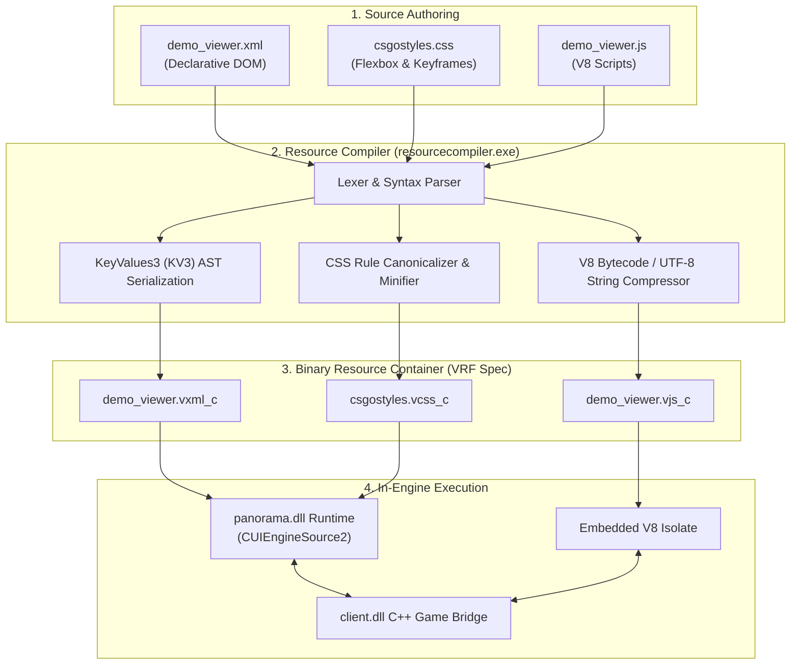

# Source 2 Panorama UI Compilation Pipeline & Resource Containers

---

## Executive Overview

Counter-Strike 2 employs Valve's proprietary **Panorama UI Engine**, an integrated GPU-accelerated UI framework combining declarative XML layouts, flexbox-driven CSS3 styling, and a Google V8 JavaScript scripting runtime embedded within `panorama.dll` and `client.dll`.

In production Source 2 builds, user interface assets are never loaded as raw text files. Instead, the asset compiler processes `.xml`, `.css`, and `.js` source files into pre-compiled binary resource containers bearing the `_c` suffix (e.g. `vxml_c`, `vcss_c`, `vjs_c`).

This document provides a clean-room architectural specification of the compilation pipeline, the binary container format decoded via ValveResourceFormat (VRF), and runtime ingestion into the game engine.

---

## 1. Asset Compilation Pipeline Overview



---

## 2. Binary Resource Container Architecture (`_c` Format)

Every compiled Source 2 asset container begins with a 16-byte fixed binary header followed by a block directory describing payload segments.

### 16-Byte Container Header Layout

```cpp
struct ResourceHeader_t {
    std::uint32_t m_nFileSize;       // Total size of container on disk (bytes)
    std::uint16_t m_nHeaderVersion;  // Container header version (Always 0x000C in CS2)
    std::uint16_t m_nVersion;        // Resource payload version (Always 0x0001)
    std::uint32_t m_nBlockOffset;    // Offset from start of file to Block Directory (0x10)
    std::uint32_t m_nBlockCount;     // Number of blocks described in the directory
};
```

### Block Directory Entry Layout

Each block directory entry is exactly 8 bytes:

```cpp
struct ResourceBlockEntry_t {
    char          m_szBlockID[4];    // 4-character ASCII FourCC tag (e.g. "DATA", "REDI", "NTRO")
    std::uint32_t m_nOffset;         // Offset relative to current entry position to block payload
    std::uint32_t m_nSize;           // Byte length of block payload
};
```

### Primary Container Block Types

1. **`DATA`**: Primary compiled asset payload.
   - For `vxml_c`: Serialized KeyValues3 binary AST node tree describing panel hierarchies, tag attributes (`id`, `class`, `hittest`, `dialog-variable`), and child relationships.
   - For `vcss_c`: Binary selector tables, computed style rule vectors, and keyframe animation tracks.
   - For `vjs_c`: Serialized JavaScript source string table (often LZ4-compressed) or compiled V8 bytecode snapshot.
2. **`REDI` (ResourceEditInfo)**: Compilation metadata containing:
   - Input dependency graph (`InputDependencies`).
   - Additional source files (`AdditionalInputDependencies`).
   - Argument fingerprints and compiler build version.
3. **`NTRO`**: Introspection schema for untyped engine structs when compiled without dynamic RTTI.

---

## 3. KeyValues3 (KV3) AST Serialization in `vxml_c`

Panorama XML layouts are compiled into a binary KeyValues3 tree. For example, the following source markup:

```xml
<Panel class="SubTickCard" hittest="false">
    <Label id="SubTickTitle" text="#CSGO_SubTick_Title" />
    <ProgressBar id="HealthBar" min="0" max="100" value="100" />
</Panel>
```

Is parsed by the Source 2 compiler into the following binary KV3 node hierarchy:

```
{
    _class = "CUIPanel"
    m_szType = "Panel"
    m_szClasses = ["SubTickCard"]
    m_bHitTest = false
    m_vecChildren = [
        {
            _class = "C_PanoramaLabel"
            m_szType = "Label"
            m_szID = "SubTickTitle"
            m_szText = "#CSGO_SubTick_Title"
        },
        {
            _class = "C_PanoramaProgressBar"
            m_szType = "ProgressBar"
            m_szID = "HealthBar"
            m_flMin = 0.0
            m_flMax = 100.0
            m_flValue = 100.0
        }
    ]
}
```

At runtime, `CUIEngineSource2::CreatePanel` instantiates concrete C++ panel components directly from this deserialized tree, resolving string tokens to internal 16-bit MurmurHash2 `CStyleSymbol` identifiers.

---

## 4. CSS Compilation & Styling Rules in `vcss_c`

Source 2 Panorama supports a tailored subset of CSS3 optimized for real-time 3D GPU rendering:
- **Flexbox Flow**: `flow-children: right | down | none` (replaces traditional web float layouts).
- **GPU Transforms**: `transform: translate3d(x, y, z) rotateZ(deg) scale3d(...)`.
- **Compositing**: `opacity-mask`, `blur`, `box-shadow`, and `wash-color` blended directly in the DirectX 11 / Vulkan fragment shaders.
- **Pseudo-Classes**: `:hover`, `:active`, `:focus`, `:disabled`, `:selected`, and custom state flags.

During compilation, selector strings (e.g. `.SubTickCard:hover > .Fill`) are tokenized into integer symbol IDs, eliminating string parsing during runtime style cascades.

---

## 5. JavaScript Runtime & V8 Engine Integration in `vjs_c`

Scripts compiled into `vjs_c` run within a sandboxed Google V8 JavaScript isolate managed by `panorama.dll`.

### Execution Flow
1. **Compilation / Decompression**: `CUIEngineSource2::CompileScript` loads the decompressed script buffer into the V8 isolate.
2. **Scope Binding**: Each `.xml` layout file creates a context panel accessible via `$.GetContextPanel()`.
3. **Engine Bridging**: Host objects (`$`, `DemoAPI`, `GameEvents`, `GameInterfaceAPI`) are injected into the global V8 object template, wrapping native C++ virtual method calls.
