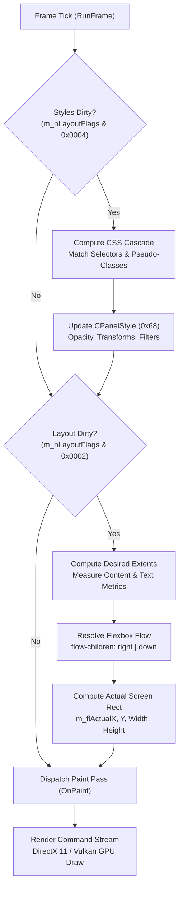

# Source 2 Panorama UI VTable Layouts & Component Dispatch

---

## Executive Overview

The Source 2 Panorama UI framework operates through an object-oriented C++ virtual method table (VTable) architecture defined primarily in `panorama.dll`. Client code in `client.dll` interacts with Panorama through exported abstract interfaces (`IUIEngine`, `IUIPanel`, `IPanoramaUIEngine`).

This document provides a clean-room technical specification of the virtual method layouts, concrete binary member offsets, and runtime component dispatchers verified against CS2 build `2026-10-25_26144732`.

---

## 1. Engine Virtual Method Tables (VTable)

### A. `IPanoramaUIEngine` ("PanoramaUIEngine001")
- **Binary**: `panorama.dll`
- **VTable RVA**: `0x4C22E0`
- **Method Count**: 18 bounded virtual methods
- **RTTI Symbol**: `.?AVIPanoramaUIEngine@@`

| Slot | Method Name | Parameters | Purpose |
| :--- | :--- | :--- | :--- |
| `0` | `~IPanoramaUIEngine` | `()` | Virtual destructor |
| `1` | `SetupUIEngine` | `()` | Initializes DirectX/Vulkan render context and V8 isolate |
| `2` | `Shutdown` | `()` | Tears down all windows, panels, and script contexts |
| `3` | `AccessUIEngine` | `() -> IUIEngine*` | Returns the active internal `IUIEngine` instance |
| `4` | `RunFrame` | `(double curtime, float frametime)` | Ticks animation, physics, and layout passes |
| `5` | `SetScaleFactor` | `(float flScale)` | Updates global DPI scaling factor |
| `6` | `GetScaleFactor` | `() -> float` | Retrieves active DPI scaling factor |
| `7` | `SetScreenSize` | `(int w, int h)` | Notifies engine of display resolution changes |
| `8` | `GetScreenSize` | `(int& w, int& h)` | Queries backbuffer dimensions |
| `9` | `OnDeviceReset` | `(void* pDevice)` | Handles GPU swapchain recreate |
| `10` | `OnDeviceLost` | `()` | Halts GPU painting during mode switches |
| `11` | `HasFocus` | `() -> bool` | Checks if any Panorama window holds OS input focus |
| `12` | `SetFocus` | `(bool bFocus)` | Claims or releases OS input focus |
| `13` | `GetDesktopWindow`| `() -> void*` | Root desktop viewport window |
| `14` | `GetDesktopPanel` | `() -> void*` | Root desktop DOM container |
| `15` | `CreateTopLevelWindow` | `(char* title, int x, int y, int w, int h)` | Creates isolated top-level UI window |
| `16` | `DestroyTopLevelWindow` | `(void* pWindow)` | Destroys top-level UI window |
| `17` | `GetTopLevelWindow` | `(int nIndex) -> void*` | Queries top-level window by index |

---

### B. `IUIEngine` / `CUIEngineSource2`
- **Binary**: `panorama.dll`
- **`IUIEngine` VTable**: `0x4C9010` (149 methods)
- **`CUIEngineSource2` VTable**: `0x4C3740` (150 methods)

```cpp
class IUIEngine {
public:
    virtual ~IUIEngine() = default;                                                 // Slot 0
    virtual CUIPanel* CreatePanel(const char* type, const char* id, CUIPanel* parent) = 0; // Slot 1
    virtual void RegisterEventHandler(CUIEventID_t evt, CUIPanel* target, void* fn) = 0; // Slot 2
    virtual void UnregisterEventHandler(CUIEventID_t evt, CUIPanel* target, void* fn) = 0; // Slot 3
    virtual void RegisterForUnhandledEvent(CUIEventID_t evt, void* fn) = 0;        // Slot 4
    virtual void UnregisterForUnhandledEvent(CUIEventID_t evt, void* fn) = 0;      // Slot 5
    virtual void DispatchEvent(CUIEvent* pEvent) = 0;                              // Slot 6
    virtual void LayoutAndPaintWindows() = 0;                                      // Slot 7
    virtual void* CompileScript(const char* ctx, const char* src, const char* file, int line) = 0; // Slot 8
    virtual bool RunScript(CUIPanel* panel, const char* src, const char* file) = 0; // Slot 9
    virtual void* GetContextForPanel(CUIPanel* panel) = 0;                         // Slot 10
    virtual void* GetIsolate() const noexcept = 0;                                 // Slot 11
    virtual void RunFrame() = 0;                                                   // Slot 12
    virtual void Shutdown() = 0;                                                   // Slot 13
    virtual bool HasFocus() const noexcept = 0;                                    // Slot 14
    virtual void SetFocus(CUIPanel* panel) = 0;                                    // Slot 15
    virtual void ClearFocus() = 0;                                                 // Slot 16
    virtual CUIPanel* GetFocusPanel() const noexcept = 0;                          // Slot 17
};
```

---

## 2. `CUIPanel` Binary Layout & Byte Alignment (0x300 / 768 Bytes)

Every DOM element in Source 2 is backed by an instance of `CUIPanel` (or a subclass thereof). The concrete struct size is verified at exactly **`0x300` bytes** (`768` bytes) under the x86-64 MSVC ABI.

```
+0x000: [ VTable Pointer (IUIPanel) - 8 bytes ]
+0x008: [ IUIPanelClient* m_pClient - 8 bytes ]
+0x010: [ const char* m_pszID (DOM ID string) - 8 bytes ]
+0x018: [ CUIPanel* m_pParent - 8 bytes ]
+0x020: [ CUIWindow* m_pWindow - 8 bytes ]
+0x028: [ CUtlVector<CUIPanel*> m_vecChildren (count: +0x28, ptr: +0x30) - 24 bytes ]
+0x040: [ Padding / Internal flags - 40 bytes ]
+0x068: [ CPanelStyle m_Style (Inlined Style Engine Subsystem) - 204 bytes (0xCC) ]
+0x134: [ Layout Extents & Constraint Metrics - 36 bytes (0x24) ]
+0x158: [ CUtlVector<CStyleSymbol> m_vecClasses (count: +0x158, ptr: +0x160) - 24 bytes ]
+0x170: [ Render Matrix & Shader Constants Cache - 64 bytes (0x40) ]
+0x1B0: [ float m_flActualX (4B) | m_flActualY (4B) | m_flActualWidth (4B) | m_flActualHeight (4B) ]
+0x1C0: [ float m_flDesiredWidth (4B) | m_flDesiredHeight (4B) | Bounds Pad (8B) ]
+0x1D0: [ float m_flPositionX (4B) | m_flPositionY (4B) | Transform Matrix Pad (24B) ]
+0x1F0: [ float m_flContentWidth (4B) | m_flContentHeight (4B) | float m_flScrollY (4B) ]
+0x220: [ EStyleFlags m_nStyleFlags (uint16) | Pad (6B) ]
+0x228: [ EPanelLayoutFlags m_nLayoutFlags (uint16) | uint8 m_bVisibilityFlags (0x22A) ]
+0x238: [ CUtlVector<CUIEventHandler> m_vecEventHandlers - 24 bytes ]
+0x250: [ Tail padding / Animation tracks - 176 bytes (0xB0) ]
Total Size: 0x300 (768 bytes)
```

### Static Offset Invariants

```cpp
static_assert(sizeof(CUIPanel) == 0x300, "CUIPanel size must match CS2 native 0x300 layout");
static_assert(offsetof(CUIPanel, m_pClient) == 0x08, "m_pClient offset mismatch");
static_assert(offsetof(CUIPanel, m_pszID) == 0x10, "m_pszID offset mismatch");
static_assert(offsetof(CUIPanel, m_pParent) == 0x18, "m_pParent offset mismatch");
static_assert(offsetof(CUIPanel, m_pWindow) == 0x20, "m_pWindow offset mismatch");
static_assert(offsetof(CUIPanel, m_nChildCount) == 0x28, "m_nChildCount offset mismatch");
static_assert(offsetof(CUIPanel, m_pChildren) == 0x30, "m_pChildren offset mismatch");
static_assert(offsetof(CUIPanel, m_Style) == 0x68, "m_Style offset mismatch");
static_assert(offsetof(CUIPanel, m_nClassCount) == 0x158, "m_nClassCount offset mismatch");
static_assert(offsetof(CUIPanel, m_pClasses) == 0x160, "m_pClasses offset mismatch");
static_assert(offsetof(CUIPanel, m_flActualX) == 0x1B0, "m_flActualX offset mismatch");
static_assert(offsetof(CUIPanel, m_flActualY) == 0x1B4, "m_flActualY offset mismatch");
static_assert(offsetof(CUIPanel, m_flActualWidth) == 0x1B8, "m_flActualWidth offset mismatch");
static_assert(offsetof(CUIPanel, m_flActualHeight) == 0x1BC, "m_flActualHeight offset mismatch");
static_assert(offsetof(CUIPanel, m_nStyleFlags) == 0x220, "m_nStyleFlags offset mismatch");
static_assert(offsetof(CUIPanel, m_nLayoutFlags) == 0x228, "m_nLayoutFlags offset mismatch");
static_assert(offsetof(CUIPanel, m_bVisibilityFlags) == 0x22A, "m_bVisibilityFlags offset mismatch");
static_assert(offsetof(CUIPanel, m_nEventHandlerCount) == 0x238, "m_nEventHandlerCount offset mismatch");
```

---

## 3. Style Cascade & Layout Calculation Pass

Every frame, the Panorama engine performs a two-pass layout and render cycle:



1. **Cascade Resolution (`ApplyStyles`)**: Traverses inherited properties (e.g. `font-family`, `color`), matches active pseudo-class bits (`:hover`, `:active`, `:disabled`), and computes resolved style property blocks.
2. **Measure Pass (`OnLayout`)**: Children compute their desired dimensions (`m_flDesiredWidth`, `m_flDesiredHeight`) based on text glyph extents or intrinsic image aspect ratios.
3. **Arrange Pass**: Parents position and size children according to their `flow-children` mode, writing final computed screen coordinates into `m_flActualX`, `m_flActualY`, `m_flActualWidth`, and `m_flActualHeight`.
