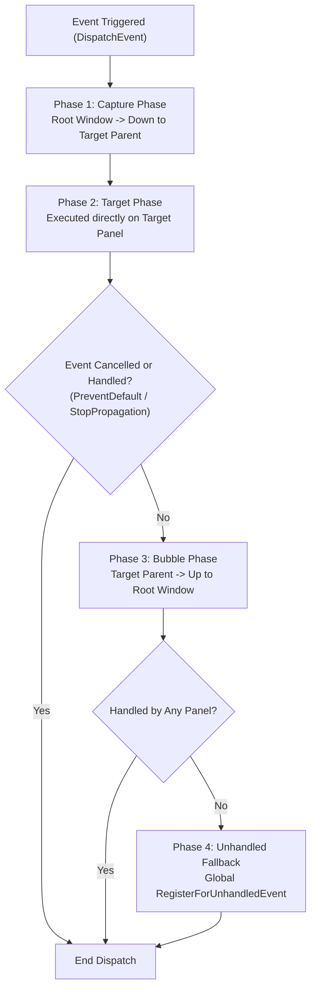

# Source 2 Panorama UI Event Dispatch Pipeline & Networking

---

## Executive Overview

The event handling subsystem in Source 2 Panorama provides bi-directional event routing between native C++ engine subsystems (`engine2.dll`, `client.dll`), the Google V8 JavaScript scripting runtime, and the hierarchical DOM tree.

This document details the complete event dispatch lifecycle, including capture/bubble phases, unhandled event fallbacks, game event subscriptions (`GameEvents.Subscribe`), and custom client-to-server network dispatching (`GameEvents.SendCustomGameEventToServer`).

---

## 1. Event Propagation Lifecycle

When an input event (e.g. mouse click, keypress) or a synthetic event is dispatched via `IUIEngine::DispatchEvent` or `$.DispatchEvent`, it traverses a 4-phase lifecycle:



### The 4 Routing Phases

1. **Capture Phase**: Traverses downward from the root desktop panel down through the ancestor chain to the target panel's immediate parent. Used for intercepting hotkeys or global focus traps.
2. **Target Phase**: The event reaches the intended receiver panel. Event handlers registered via `$.RegisterEventHandler` or native `CUIEventHandler` attached to this panel are executed.
3. **Bubble Phase**: If `CanBubble()` returns `true` and the target did not call `StopPropagation()`, the event ascends up the DOM hierarchy parent-by-parent until it reaches the root container.
4. **Unhandled Fallback**: If no panel along the capture, target, or bubble paths marked the event as handled (`Handled` or `StopPropagation`), the event is dispatched to listeners registered via `$.RegisterForUnhandledEvent`.

---

## 2. Event Handler Registration Interfaces

Panorama provides three distinct mechanisms for binding to events depending on scope and source:

### Comparison of Event Registration APIs

| API | Registration Scope | Traversal Mechanism | Primary Use Case |
| :--- | :--- | :--- | :--- |
| `$.RegisterEventHandler(event, panel, callback)` | Specific DOM panel | Target & Bubble | Button clicks (`Activated`), input changes, text entry |
| `$.RegisterForUnhandledEvent(event, callback)` | Global UI Engine | Unhandled fallback | Escape key, global cancel, window focus loss |
| `GameEvents.Subscribe(eventName, callback)` | Network / Server Event Bus | Direct broadcast | Combat damage (`player_hurt`), bomb timers, weapon fire |

### A. Panel Event Binding (`$.RegisterEventHandler`)
```javascript
// Registering an activation click handler on a specific button
$.RegisterEventHandler('Activated', $('#ScrubForwardBtn'), function() {
    let currentTick = DemoAPI.GetPlaybackTick();
    DemoAPI.SetPlaybackTick(currentTick + 64); // Skip 1 second forward (64Hz)
    $.Msg("[DEMO] Scrubbed forward 64 ticks.");
});
```

### B. Global Fallback Handling (`$.RegisterForUnhandledEvent`)
```javascript
// Catching unhandled keyboard shortcuts across the entire UI
$.RegisterForUnhandledEvent('CSGOSaveSettings', function() {
    GameInterfaceAPI.ConsoleExec("host_writeconfig");
    $.Msg("[CONFIG] Configuration saved to disk.");
});
```

---

## 3. Game Events Subsystem (`GameEvents`)

The `GameEvents` host object connects Panorama client scripts directly to Source 2's authoritative gameplay event bus (`IGameEventManager2`).

### Subscribing to Server Gameplay Events
```javascript
let playerHurtListener = GameEvents.Subscribe("player_hurt", function(eventData) {
    let victimId   = eventData.userid;
    let attackerId = eventData.attacker;
    let damage     = eventData.dmg_health;
    let hitgroup   = eventData.hitgroup; // 1 = Headshot

    // Update custom HUD indicator
    let label = $('#DamageNotice');
    if (label) {
        label.text = `HIT: ${damage} HP (HitGroup: ${hitgroup})`;
        label.SetHasClass('Headshot', hitgroup === 1);
    }
});

// Clean-up on panel teardown
$.GetContextPanel().RegisterForUnhandledEvent('PanelDestroyed', function() {
    GameEvents.Unsubscribe(playerHurtListener);
});
```

---

## 4. Custom Client-to-Server Event Networking (`SendCustomGameEventToServer`)

Panorama scripts can emit structured custom events to the game server using `GameEvents.SendCustomGameEventToServer`.

### JavaScript Invocation
```javascript
GameEvents.SendCustomGameEventToServer("custom_hud_command", {
    cmd_type: "telemetry_request",
    target_tick: DemoAPI.GetPlaybackTick(),
    sample_rate: 64
});
```

### Wire Format & NetMessage Serialization

Under the Source 2 wire protocol, this call packages the event into **NetMessage 304 (`svc_CustomGameEvent`)**:

```
+-------------------------------------------------------------+
| Byte Offset | Field Type      | Description                 |
| :---------- | :-------------- | :-------------------------- |
| +0x00       | uint16 (LE)     | NetMessage ID (304)         |
| +0x02       | uint8           | Length of Event Name (N)    |
| +0x03       | char[N]         | Event Name ASCII string     |
| +0x03+N     | uint16 (LE)     | Field Count (K)             |
| ...         | KeyValue Stream | Serialized payload fields   |
+-------------------------------------------------------------+
```

Each payload field is serialized with a 1-byte key length, the ASCII key name, a 1-byte type tag (`0 = String, 1 = Float, 2 = Int32, 3 = UInt64, 4 = Bool`), and the little-endian data payload.
On the dedicated server, `server.dll` deserializes this packet and dispatches it through the registered `IGameEventListener2` callbacks.
