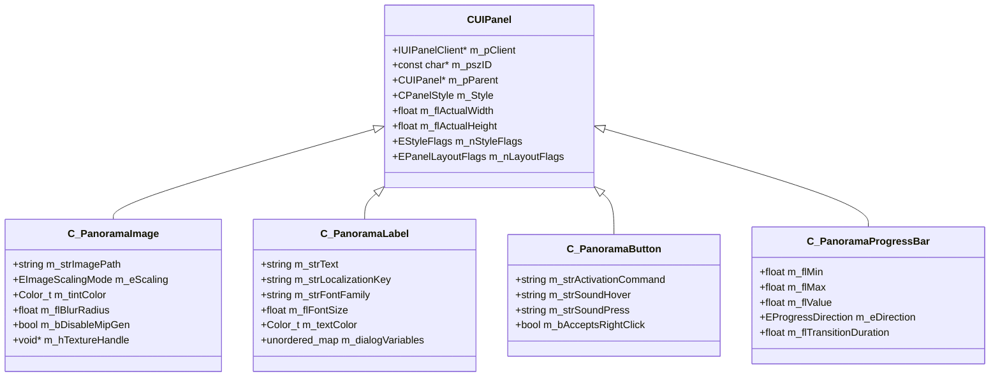

# Source 2 Panorama UI Component Schemas & Entity Integration

---

## Executive Overview

Source 2 exposes native user interface elements through both the **Panorama DOM Subsystem** (in `panorama.dll`) and reflected **SchemaSystem Classes** (in `client.dll` and `server.dll`).

This document details the concrete field layouts, data alignments, and memory offsets for core UI components (`C_PanoramaImage`, `C_PanoramaLabel`, `C_PanoramaButton`, `C_PanoramaProgressBar`), along with client-side UI entities that project Panorama panels into 3D game worlds (`C_PointClientUIHUD`, `C_PointClientUIWorldPanel`).

---

## 1. Core Component Schema Definitions



---

## 2. Component Specifications

### A. `C_PanoramaImage`
Corresponds to `<Image>` tags and `CCSGO_BackbufferImagePanel` / `CCSGO_AvatarImage`:
- **Image Resource Path (`m_strImagePath`)**: Supports `s2r://` compiled resource protocols, `file://` local paths, and Steam avatar URLs.
- **Scaling Modes (`m_eScaling`)**:
  - `0 = Stretch`: Distorts image to fill exact panel bounds.
  - `1 = None`: Native pixel resolution without scaling.
  - `2 = Cover`: Uniform scaling preserving aspect ratio to completely cover the container (clipping excess).
  - `3 = Contain`: Uniform scaling preserving aspect ratio so the entire image fits within container.
- **Texture Binding**: Linked to DirectX 11 / Vulkan 2D texture shader resource views (`SRV`).

### B. `C_PanoramaLabel`
Corresponds to `<Label>` tags and `CCSGO_GameTimeLabel` / `CCSGORetakeBombSiteAnimLabel`:
- **Typography**: Supports `Stratum2`, `Stratum2 Bold`, and system sans-serif fonts.
- **Localization Binding**: If `m_strLocalizationKey` begins with `#` (e.g. `#CSGO_Scoreboard_Title`), the string is resolved at runtime through `localize.dll` (`ILocalize`).
- **Dialog Variables (`m_dialogVariables`)**: Dynamic variable interpolation tokens such as `{s:player_name}` and `{d:health}` updated reactively by game state.

### C. `C_PanoramaButton`
Corresponds to `<Button>` tags:
- **Interactive State Machine**: Automatically transitions `EStyleFlags` bits between `Hover` (`0x0001`), `Active` (`0x0002`), and `Disabled` (`0x0008`).
- **Audio Feedback**: Invokes engine sound events upon interaction (e.g. `panorama.sound_focus` on cursor enter, `panorama.sound_click` on mouse down).

### D. `C_PanoramaProgressBar`
Corresponds to `<ProgressBar>` tags and `CCSGO_HudProgressBar`:
- **Range & Value**: Clamps `m_flValue` between `m_flMin` and `m_flMax`.
- **Fill Fraction**: Computed as `(m_flValue - m_flMin) / (m_flMax - m_flMin)`.
- **Directional Fill**: Supports horizontal (left-to-right, right-to-left), vertical, and radial sweep animations.

---

## 3. Client-Side Entity UI Integration

Source 2 allows 2D Panorama layouts to be projected into 3D scene worlds or attached to player camera views via specialized SchemaSystem entities in `client.dll`:

### `C_BaseClientUIEntity` (Size: 4296 Bytes)
Base class for all UI projection entities:
- `+0x10A0` (`4256`): `bool m_bEnabled` - Visibility toggle.
- `+0x10A8` (`4264`): `uint64_t m_DialogXMLName` - Symbol name of source `.vxml_c` layout.
- `+0x10B0` (`4272`): `uint64_t m_PanelClassName` - Target panel class.
- `+0x10B8` (`4280`): `Vector4D m_PanelID` - Unique panel identification token.

### `C_PointClientUIHUD` (Size: 4752 Bytes)
Full-screen viewport HUD entity hosting game indicators:
- `+0x10D0` (`4304`): `bool m_bCheckCSSClasses` - Forces class re-evaluation.
- `+0x1248` (`4680`): `bool m_bIgnoreInput` - Disables mouse/keyboard interception.
- `+0x124C` (`4684`): `float m_flWidth` (Default `1920.0f`).
- `+0x1250` (`4688`): `float m_flHeight` (Default `1080.0f`).
- `+0x1254` (`4692`): `float m_flDPI` (Default `96.0f`).
- `+0x1260` (`4704`): `uint32_t m_unOwnerContext`.

### `C_PointClientUIWorldPanel` (Size: 4864 Bytes)
3D in-world interactive panel entity (e.g. defuse kits, buy zone monitors, bomb timer panels):
- `+0x10D0` (`4304`): `bool m_bForceRecreateNextUpdate`.
- `+0x129C` (`4764`): `float m_flWidth` - Physical 3D plane width in game units.
- `+0x12A0` (`4768`): `float m_flHeight` - Physical 3D plane height in game units.
- `+0x12AC` (`4780`): `float m_flInteractDistance` (Default `150.0f`).
- `+0x12E0` (`4832`): `bool m_bOpaque` - Alpha blending mode.
- `+0x12E7` (`4839`): `bool m_bOnlyRenderToTexture` - Binds output to offscreen render target.

---

## 4. Dynamic Data Binding Structures

Source 2 server code synchronizes state to client Panorama panels through two compact network structures:

### `HUDPanelDialogVariableString_t` (Size: 32 Bytes)
```cpp
struct HUDPanelDialogVariableString_t {
    uint8_t   pad00[8];
    uint16_t  m_nPanelIdIndex;        // +0x08: Index to target panel in UI dictionary
    int32_t   m_nDialogVariableIndex; // +0x0A: Key hash for variable (e.g. hash of "player_name")
    uint8_t   pad0E[2];
    uint64_t  m_sValue;               // +0x10: Pointer or CUtlSymbolLarge to string value
    bool      m_bIsSet;               // +0x18: Validity flag
    uint8_t   pad19[7];
};
```

### `HUDPanelHasClass_t` (Size: 8 Bytes)
```cpp
struct HUDPanelHasClass_t {
    uint16_t  m_nPanelIdIndex;        // +0x00: Index to target panel
    uint16_t  m_nClassNameIndex;      // +0x02: Symbol index of CSS class (e.g. "LowHealth")
    uint32_t  m_eClassStatus;         // +0x04: 1 = Add Class, 0 = Remove Class
};
```
These structures allow the server to toggle visual states (e.g. flashing red bomb alert, low ammo warning) with minimal network bandwidth.
