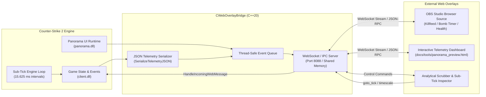

# Source 2 Panorama Web Overlay Bridge Architecture

---

## Executive Overview

While native Panorama provides GPU-accelerated in-engine UI rendering within Counter-Strike 2, esports production, tournament broadcasts, external coaching suites, and live streaming setups frequently require **external web overlays** rendered via browser sources (e.g. OBS Studio, CEF browser docks, or web telemetry dashboards).

The **Web Overlay Bridge** is a high-throughput, clean-room synchronization architecture designed to bridge the gap between Source 2's internal sub-tick execution pipeline (`client.dll` / `panorama.dll`) and standard modern web technologies (HTML5, CSS3, ES2022).

---

## 1. Architectural Topology



---

## 2. Telemetry Packet Specification (Wire Protocol)

The bridge packages real-time game state at discrete sub-tick intervals into standardized JSON frames:

### Sub-Tick Telemetry Frame Example
```json
{
  "type": "telemetry",
  "tick": 27703,
  "subtick_fraction": 0.780,
  "latency_ms": 14.2,
  "health": 85,
  "armor": 100,
  "weapon": "weapon_ak47",
  "clip": 27,
  "reserve": 90,
  "score_ct": 7,
  "score_t": 5,
  "round_time": 84.5,
  "bomb_planted": false,
  "bomb_time": 40.0
}
```

### Game Event Notification Packet
When combat actions occur, the bridge broadcasts discrete event packets mirroring Source 2's `GameEvents` bus:

```json
{
  "type": "game_event",
  "event": "player_hurt",
  "data": {
    "userid": 3,
    "attacker": 1,
    "dmg_health": 109,
    "dmg_armor": 0,
    "hitgroup": 1,
    "weapon": "weapon_ak47"
  }
}
```

---

## 3. Bi-Directional Scrubber & Playback Control

In addition to egress telemetry, the Web Overlay Bridge ingests real-time ingress control commands from web clients to control demo playback, camera perspective, and timescale without requiring access to the CS2 developer console:

| Action Token | JSON Command Schema | Engine Target |
| :--- | :--- | :--- |
| `goto_tick` | `{"action": "goto_tick", "tick": 27703}` | `DemoAPI.SetPlaybackTick(27703)` |
| `pause` | `{"action": "pause"}` | `DemoAPI.PausePlayback()` |
| `resume` | `{"action": "resume"}` | `DemoAPI.ResumePlayback()` |
| `timescale` | `{"action": "timescale", "scale": 0.25}` | `DemoAPI.SetTimescale(0.25)` |
| `con_command` | `{"action": "con_command", "cmd": "mirv_panorama panelstyle..."}` | `GameInterfaceAPI.ConsoleExec(...)` |

---

## 4. Sub-Tick Actuation Visualization

A primary application of the Web Overlay Bridge is visualizing discrete sub-tick timing differences:
- A traditional 64-tick tickrate provides snapshot boundaries every **15.625 ms**.
- In CS2, actuation commands carry an exact floating-point fraction `w ∈ [0.0, 1.0)`.
- The Web Overlay Bridge calculates:
  $$\Delta t_{\text{subtick}} = w \times 15.625\text{ ms}$$
- Web renderers draw a sub-tick timeline needle directly inside the preview HUD card, allowing broadcast analysts and viewers to inspect whether a flick shot occurred early or late within the physical frame window.
