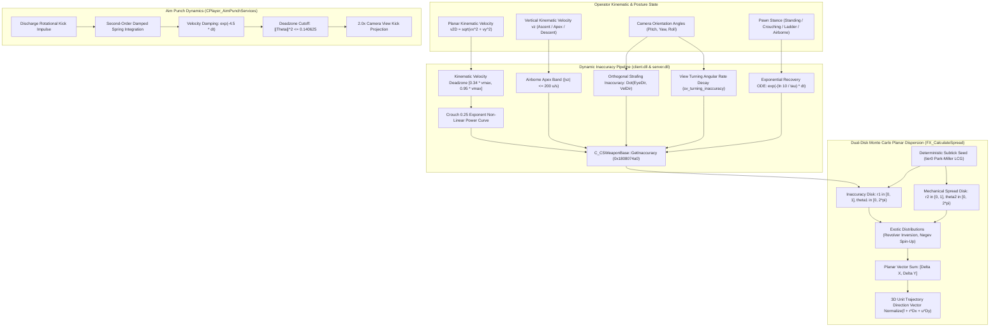

# Counter-Strike 2 (Source 2) - Weapon Inaccuracy, Recoil Punch Decay & Dual-Disk Dispersion Physics (`client.dll` & `server.dll`)

> **Binary Targets**: `client.dll` & `server.dll` (Build `26598758`, Version Archive `2026-11-11_26598758`, Base Address: `0x180000000`)  
> **Key Reverse-Engineered Routines**:
> - `C_CSWeaponBase::GetInaccuracy` (Curr RVA `0x008074a0` / Curr VA `0x1808074a0`, Base RVA `0x0080c1a0`)
> - `FX_CalculateSpread` (Curr RVA `0x00d1bc20` / Curr VA `0x180d1bc20`, Base RVA `0x00d23fe0`)
> - `C_CSWeaponBase::UpdateAccuracyPenalty` (Curr RVA `0x008230d0` / Curr VA `0x1808230d0`, Base RVA `0x00828a10`)
> - `CPlayer_AimPunchServices::SimulateAimPunchDecay` (Curr RVA `0x008594e0` / Curr VA `0x1808594e0`, Base RVA `0x0085dc60`)
> - `GetRecoveryTime` (RVA `0x0080cef0` / VA `0x18080cef0`)
> - `CalculateStrafingInaccuracy` (RVA `0x0080d4c0` / VA `0x18080d4c0`)
> - `UpdateTurningInaccuracy` (RVA `0x00828d90` / VA `0x180828d90`)  
> **Reconstructed Source**: [`game/client/weapon_accuracy.h`](../game/client/weapon_accuracy.h), [`game/client/weapon_accuracy.cpp`](../game/client/weapon_accuracy.cpp)  
> **Reference Simulator Suite**: [`docs/simulators/cs2_weapon_spread_recoil_sim.cpp`](../docs/simulators/cs2_weapon_spread_recoil_sim.cpp), [`docs/simulators/build_weapon_sim.bat`](../docs/simulators/build_weapon_sim.bat)  
> **Target Platform**: Windows x64 ABI (`__fastcall`), SSE/AVX Floating-Point Registers (`XMM0`-`XMM8`), Pure C++20 Standard Library

---

## 1. Architectural Overview: Ballistic Dispersion & Damped Spring Topology

In Counter-Strike 2, projectile launch trajectories are governed by a multi-layered stochastic dispersion model combined with a second-order damped harmonic oscillator for camera kick displacement. The system decouples **mechanical barrel cone dispersion** (`m_flSpread`) from **dynamic operator state inaccuracy** (`m_fAccuracyPenalty`).

When a discrete spatial raycast is initiated during a weapon discharge event, the trajectory vector does not travel along the direct camera line-of-sight. Instead, the ray direction is perturbed via **dual-disk Monte Carlo circular sampling**: an independent disk for dynamic operator inaccuracy $(r_1, \theta_1)$ and an independent disk for intrinsic mechanical dispersion $(r_2, \theta_2)$. These two planar deflections are evaluated on the 2D view-projection plane and converted into a 3D unit raycast vector.

Simultaneously, weapon discharge exerts a rotational impulse on the player pawn's camera view. The camera kick displacement is governed by the aim punch spring-damper Ordinary Differential Equation (ODE) inside `CPlayer_AimPunchServices`, scaled by an authoritative $2.0\times$ view punch coefficient.



---

## 2. Mathematical Formulations & Ordinary Differential Equations (ODEs)

### 2.1 Baseline Stance Inaccuracy Resolution
Every weapon configuration asset (`CCSWeaponBaseVData`) specifies stance-dependent inaccuracy constants. The baseline inaccuracy penalty target $I_{\text{target}}$ is resolved according to the operator's physical interaction state:

$$I_{\text{target}} = \begin{cases}
\text{m\_flInaccuracyLadder} & \text{if on ladder} \\
\text{m\_flInaccuracyStand} + \text{m\_flInaccuracyJump} & \text{if airborne} \\
2.0 \times \text{m\_flInaccuracyLadder} & \text{if operator stack count} \ge \text{weapon\_accuracy\_stack\_boost\_limit} \\
\text{m\_flInaccuracyCrouch} & \text{if crouching / ducking} \\
\text{m\_flInaccuracyStand} & \text{if standing on solid ground}
\end{cases}$$

If the entity is currently executing a reload animation (`m_bInReload == true`), an additional additive penalty is superimposed:

$$I_{\text{target}} \leftarrow I_{\text{target}} + \text{m\_flInaccuracyReload}$$

---

### 2.2 Kinematic Velocity Scaling & Deadzone Function

In Source 2, horizontal movement does not immediately degrade weapon precision. A non-linear deadzone threshold protects low-velocity counter-strafing.

Let planar velocity magnitude be:

$$v_{\text{2D}} = \sqrt{v_x^2 + v_y^2}$$

The velocity scaling boundaries are defined relative to the weapon's maximum running speed $v_{\max} = \text{m\_flMaxSpeed}$:

$$v_{\text{low}} = 0.34 \times v_{\max}, \quad v_{\text{high}} = 0.95 \times v_{\max}$$

The normalized velocity fraction $\xi_{\text{vel}} \in [0.0, 1.0]$ is evaluated as:

$$\xi_{\text{vel}} = \text{clamp}\left(\frac{v_{\text{2D}} - v_{\text{low}}}{v_{\text{high}} - v_{\text{low}}}, 0.0, 1.0\right)$$

When crouching (`FL_DUCKING`), the velocity fraction is modulated by a steep $0.25$ power curve ($x \mapsto x^{1/4}$), accelerating the onset of movement penalty at modest velocities:

$$\xi_{\text{move}} = \begin{cases}
\xi_{\text{vel}} & \text{if standing or airborne} \\
(\xi_{\text{vel}})^{0.25} & \text{if crouching}
\end{cases}$$

The resultant kinematic movement inaccuracy contribution is:

$$I_{\text{move}} = \xi_{\text{move}} \times \text{m\_flInaccuracyMove}$$

#### Exemplar Table: AK-47 ($v_{\max} = 215.0 \text{ u/s}$, $\text{m\_flInaccuracyMove} = 0.13400$)
| Kinematic Speed $v_{\text{2D}}$ | Posture State | $\xi_{\text{vel}}$ | Effective Scaling $\xi_{\text{move}}$ | Inaccuracy Penalty $I_{\text{move}}$ |
| :--- | :--- | :--- | :--- | :--- |
| $0.0 \text{ u/s}$ (Resting) | Standing | $0.0000$ | $0.0000$ | $0.00000$ |
| $50.0 \text{ u/s}$ (Deadzone) | Standing | $0.0000$ | $0.0000$ | $0.00000$ |
| $73.1 \text{ u/s}$ ($v_{\text{low}}$ boundary) | Standing / Crouching | $0.0000$ | $0.0000$ | $0.00000$ |
| $100.0 \text{ u/s}$ | Standing | $0.2051$ | $0.2051$ | $0.02748$ |
| $100.0 \text{ u/s}$ | Crouching | $0.2051$ | $(0.2051)^{0.25} = 0.6730$ | $0.09018$ |
| $130.0 \text{ u/s}$ (Walking) | Standing | $0.4339$ | $0.4339$ | $0.05814$ |
| $130.0 \text{ u/s}$ (Walking) | Crouching | $0.4339$ | $(0.4339)^{0.25} = 0.8116$ | $0.10875$ |
| $204.25 \text{ u/s}$ ($v_{\text{high}}$ saturation) | Standing / Crouching | $1.0000$ | $1.0000$ | $0.13400$ |
| $215.0 \text{ u/s}$ (Full Sprint) | Standing | $1.0000$ | $1.0000$ | $0.13400$ |

---

### 2.3 Airborne Vertical Trajectory & Jump Apex Interpolation

When the player pawn is airborne (`!(flags & FL_ONGROUND)`), inaccuracy is modulated dynamically across the jump arc according to absolute vertical speed $|v_z|$:

1. **Jump Apex Band**: If $|v_z| \le 200.0 \text{ u/s}$, the projectile experiences minimum airborne dispersion:
   $$I_{\text{jump}} = \text{m\_flInaccuracyJumpApex}$$

2. **Ascent / Descent Interpolation**: If $|v_z| > 200.0 \text{ u/s}$, dispersion scales linearly towards terminal vertical speed ($800.0 \text{ u/s}$):
   $$\xi_{\text{jump}} = \text{clamp}\left(\frac{|v_z| - 200.0}{800.0 - 200.0}, 0.0, 1.0\right)$$
   $$I_{\text{jump}} = \text{m\_flInaccuracyJumpApex} + \xi_{\text{jump}} \times (\text{m\_flInaccuracyJumpInitial} - \text{m\_flInaccuracyJumpApex})$$

Upon ground contact impact, a discrete landing penalty impulse (`m_flInaccuracyLand`) is directly accumulated into `m_fAccuracyPenalty`.

---

### 2.4 Orthogonal Counter-Strafing Inaccuracy (`CalculateStrafingInaccuracy`)

Reversed from `client.dll` @ `0x18080d4c0`, Source 2 penalizes velocity vectors orthogonal to the line of sight:

Let the normalized velocity direction vector be $\hat{\mathbf{v}} = \frac{\mathbf{v}}{\|\mathbf{v}\|}$, and let the camera forward gaze vector be $\hat{\mathbf{f}}$.

$$\cos \phi = \hat{\mathbf{f}} \cdot \hat{\mathbf{v}}$$

The orthogonal transverse fraction $\eta_{\perp} \in [0.0, 1.0]$ is:

$$\eta_{\perp} = 1.0 - |\cos \phi|$$

Applying the non-linear bias power transformation from ConVar `sv_strafing_inaccuracy_bias`:

$$\eta_{\text{biased}} = (\eta_{\perp})^{\text{sv\_strafing\_inaccuracy\_bias}}$$

The resulting strafing inaccuracy contribution is:

$$I_{\text{strafe}} = \left(\frac{\|\mathbf{v}\|}{250.0}\right) \times \eta_{\text{biased}} \times \text{sv\_strafing\_inaccuracy\_scale}$$

---

### 2.5 Angular View Turning Decay (`UpdateTurningInaccuracy`)

Rapid angular camera rotation induces rotational barrel dispersion. Reversed from `client.dll` @ `0x180828d90`:

Let $\hat{\mathbf{d}}_t$ and $\hat{\mathbf{d}}_{t - \Delta t}$ be the normalized forward gaze directions at successive frames. The angular deflection in degrees is:

$$\Delta \theta = \arccos\left(\text{clamp}(\hat{\mathbf{d}}_t \cdot \hat{\mathbf{d}}_{t - \Delta t}, -1.0, 1.0)\right) \times \frac{180^\circ}{\pi}$$

The persistent turning state decays exponentially per tick:

$$I_{\text{turn}} \leftarrow I_{\text{turn}} \times \text{sv\_turning\_inaccuracy\_decay}$$

If $\Delta \theta$ exceeds the minimum threshold $\theta_{\min} = \text{sv\_turning\_inaccuracy\_angle\_min}$:

$$I_{\text{turn}} \leftarrow I_{\text{turn}} + \text{clamp}\left(\frac{\Delta \theta - \theta_{\min}}{180^\circ - \theta_{\min}}, 0.0, 1.0\right)$$

Clamped to $[0.0, 1.0]$.

---

### 2.6 Weapon Firing Impulse & Exponential Recovery ODE

When a projectile is discharged, an instantaneous penalty impulse is accumulated:

$$I(t^+) = I(t^-) + \text{m\_flInaccuracyFire}$$
$$R(t^+) = R(t^-) + 1.0$$

Where $R$ is the continuous rapid-fire recoil index (`m_flRecoilIndex`).

#### 2.6.1 Characteristic Recovery Time $\tau_{\text{recovery}}$ (`GetRecoveryTime` @ `0x18080cef0`)
The recovery time $\tau$ dictates how rapidly the weapon resets to its baseline resting accuracy:
- **Airborne**: $\tau = 4.0 \times \text{m\_flRecoveryTimeCrouch}$ ($4\times$ penalty factor).
- **Ladder**: $\tau = \text{m\_flRecoveryTimeStand}$.
- **Ground Stance**: Linearly transitions between $\tau_{\text{base}}$ and $\tau_{\text{final}}$ based on current integer recoil index $i_{\text{recoil}}$:
  $$\xi_{\text{recoil}} = \text{clamp}\left(\frac{i_{\text{recoil}} - \text{m\_nRecoveryTransitionStartBullet}}{\text{m\_nRecoveryTransitionEndBullet} - \text{m\_nRecoveryTransitionStartBullet}}, 0.0, 1.0\right)$$
  $$\tau = \tau_{\text{base}} + \xi_{\text{recoil}} \times (\tau_{\text{final}} - \tau_{\text{base}})$$

#### 2.6.2 Accuracy Penalty Exponential Decay ODE
The decay of accumulated accuracy penalty towards target baseline $I_{\text{target}}$ is formulated as a first-order Ordinary Differential Equation:

$$\frac{d I(t)}{dt} = -\frac{\ln(10)}{\tau_{\text{recovery}}} \left(I(t) - I_{\text{target}}\right)$$

Integrating over a discrete engine tick $\Delta t = \frac{1}{64.0} \text{ s} = 0.015625 \text{ s}$:

$$I(t + \Delta t) = I_{\text{target}} + \left(I(t) - I_{\text{target}}\right) \times \exp\left(-\frac{\ln(10)}{\tau_{\text{recovery}}} \Delta t\right)$$

> [!NOTE]
> The appearance of $\ln(10) \approx 2.302585$ ensures that after exactly $t = \tau_{\text{recovery}}$ seconds, the excess penalty has decayed by exactly **one full order of magnitude** ($90\%$ reduction):
> $$\frac{I(\tau) - I_{\text{target}}}{I(0) - I_{\text{target}}} = \exp(-\ln(10)) = \frac{1}{10} = 0.10$$

#### 2.6.3 Recoil Index Exponential Decay ODE
When firing ceases ($t - t_{\text{last\_shot}} > \text{m\_flCycleTime} + \Delta t$), the continuous recoil index decays under a steep ODE:

$$\frac{d R(t)}{dt} = -2 \ln(10) \times R(t)$$

$$R(t + \Delta t) = R(t) \times \exp(-2 \ln(10) \Delta t)$$

**Deadzone Cutoff**: When $R(t) \le 0.10$, it snaps immediately to zero:
$$R(t) \le 0.10 \implies R(t) \leftarrow 0.0, \quad i_{\text{recoil}} \leftarrow 0$$

---

## 3. Dual-Disk Monte Carlo Spread Distribution (`FX_CalculateSpread`)

Reversed from `client.dll` @ `0x180d1bc20` (`FUN_180d23fe0`), Source 2 evaluates projectile deflection using **two independent uniform circular disks**:

```
                  DISK 1: Inaccuracy Disk                 DISK 2: Spread Disk
               [Dynamic Operator Inaccuracy]          [Mechanical Barrel Spread]
                     (r1, theta1)                           (r2, theta2)
                          \                                      /
                           \                                    /
                            \                                  /
                             v                                v
                        Delta X = r1 * I * cos(theta1) + r2 * S * cos(theta2)
                        Delta Y = r1 * I * sin(theta1) + r2 * S * sin(theta2)
                                                |
                                                v
                              Planar Deflection Vector [Delta X, Delta Y]
```

### 3.1 Random Variate Generation
Let the pseudo-random generator produce uniform variates $u_1, u_2, u_3, u_4 \sim \mathcal{U}(0, 1)$:

1. **Inaccuracy Disk**:
   - Radial scaling variate: $r_1 = u_1$
   - Azimuthal angle: $\theta_1 = 2\pi u_2$
   - Scaled radius: $R_{\text{inacc}} = r_1 \times I_{\text{total}}$

2. **Mechanical Spread Disk**:
   - Radial scaling variate: $r_2 = u_3$
   - Azimuthal angle: $\theta_2 = 2\pi u_4$
   - Scaled radius: $R_{\text{spread}} = r_2 \times S_{\text{barrel}}$

### 3.2 Exotic Weapon Distribution Transformations

Source 2 modifies the uniform radial density function for specific weapon types:

#### R8 Revolver Secondary (Fan-the-Hammer, `itemDefIndex == 64 && weaponMode == 1`):
$$r_1 \leftarrow 1.0 - r_1^2, \quad r_2 \leftarrow 1.0 - r_2^2$$
This non-linear quadratic inversion pushes probability density away from the center towards the outer perimeter, creating an irregular annular dispersion ring.

#### Negev Continuous Fire Convergence (`itemDefIndex == 28 && recoilIndex < 3.0`):
For $k = 3$ down to $\lfloor R \rfloor$:
$$r_1 \leftarrow r_1^2, \quad r_2 \leftarrow r_2^2$$
Followed by:
$$r_1 \leftarrow 1.0 - r_1, \quad r_2 \leftarrow 1.0 - r_2$$
As firing continues past 3 rounds, dispersion collapses exponentially from wide spray into near-zero laser precision.

### 3.3 Planar Summation & 3D Ray Construction

The combined deflection coordinates on the camera projection plane are:

$$\Delta X = R_{\text{inacc}} \cos(\theta_1) + R_{\text{spread}} \cos(\theta_2)$$
$$\Delta Y = R_{\text{inacc}} \sin(\theta_1) + R_{\text{spread}} \sin(\theta_2)$$

#### Strict Theoretical Radius Bound:
By the triangle inequality, the maximum possible deflection magnitude $\|\mathbf{D}\|$ on the view plane satisfies:

$$\|\mathbf{D}\| = \sqrt{(\Delta X)^2 + (\Delta Y)^2} \le R_{\text{inacc}} + R_{\text{spread}} \le I_{\text{total}} + S_{\text{barrel}}$$

Given camera orientation basis vectors $\hat{\mathbf{f}}$ (forward), $\hat{\mathbf{r}}$ (right), and $\hat{\mathbf{u}}$ (up) computed from eye angles via `AngleVectors`:

$$\mathbf{d}_{\text{ray}} = \text{Normalize}\left(\hat{\mathbf{f}} + \hat{\mathbf{r}} \Delta X + \hat{\mathbf{u}} \Delta Y\right)$$

---

## 4. Recoil Aim Punch Spring-Damper Dynamics (`CCSPlayer_AimPunchServices`)

Camera view displacement resulting from projectile recoil is governed by a damped second-order harmonic oscillator model inside `CCSPlayer_AimPunchServices`:
- `m_predictableBaseAngle` (`+0x0050`): Current aim punch deflection angle $\vec{\theta} = (\theta_{\text{pitch}}, \theta_{\text{yaw}}, \theta_{\text{roll}})$.
- `m_predictableBaseAngleVel` (`+0x005c`): Angular velocity vector $\vec{\omega} = (\omega_{\text{pitch}}, \omega_{\text{yaw}}, \omega_{\text{roll}})$.

### 4.1 Firing Impulse & Camera Factor
Upon weapon discharge, an angular velocity kick is imparted:

$$\omega_{\text{pitch}}(t^+) = \omega_{\text{pitch}}(t^-) - \text{m\_flRecoilMagnitude} \times 1.10$$
$$\theta_{\text{pitch}}(t^+) = \theta_{\text{pitch}}(t^-) - \text{m\_flRecoilMagnitude} \times 0.055$$

The camera view displacement rendered to the client applies an authoritative **$2.0\times$ view punch coefficient**:

$$\vec{\theta}_{\text{view}} = 2.0 \times \vec{\theta}_{\text{punch}}$$

### 4.2 Discrete Spring-Damper Integration per Tick

Reversed from `client.dll` @ `0x1808594e0` (`FUN_18085dc60`):

1. **Velocity Damping**:
   $$\vec{\omega}(t + \Delta t) = \vec{\omega}(t) \times \exp(-4.5 \Delta t)$$
   Where $4.5 \text{ s}^{-1}$ is the damping rate.

2. **Angular Integration**:
   $$\vec{\theta}(t + \Delta t) = \vec{\theta}(t) + \vec{\omega}(t + \Delta t) \Delta t$$

3. **Deadzone Cutoff Threshold**:
   $$\|\vec{\theta}\|^2 = \theta_{\text{pitch}}^2 + \theta_{\text{yaw}}^2 + \theta_{\text{roll}}^2$$
   - If $\|\vec{\theta}\|^2 \le 0.140625 \text{ deg}^2$ (corresponding to $0.375^\circ$ magnitude):
     $$\vec{\theta} \leftarrow \mathbf{0}, \quad \vec{\omega} \leftarrow \mathbf{0}$$
   - Otherwise, non-linear attenuation is applied:
     $$\vec{\theta} \leftarrow \vec{\theta} \times \left(1.0 - \frac{0.140625}{\|\vec{\theta}\|^2}\right)$$

4. **Pitch Clamping**:
   $$\theta_{\text{pitch}} \in [-89.0^\circ, +89.0^\circ]$$

---

## 5. Schema System Class Layouts & Byte Offsets

Verified against `versions/profiles/2026-11-11_26598758/schemas.json`:

### 5.1 `C_CSWeaponBase` (`client.dll`, Size: `0x1f60` / 8,032 bytes)
| Field Name | Type | Offset Hex | Offset Dec | Description |
| :--- | :--- | :--- | :--- | :--- |
| `m_flTurningInaccuracyDelta` | `float` | `+0x1A44` | 6724 | Transverse angular delta accumulator |
| `m_vecTurningInaccuracyEyeDirLast` | `Vector3` | `+0x1A48` | 6728 | Previous frame normalized camera forward vector |
| `m_flTurningInaccuracy` | `float` | `+0x1A54` | 6740 | Active turning dispersion penalty scalar |
| `m_fAccuracyPenalty` | `float` | `+0x1A58` | 6744 | Current accumulated dynamic accuracy penalty |
| `m_flLastAccuracyUpdateTime` | `float` | `+0x1A5C` | 6748 | Global engine timestamp of last evaluation |
| `m_fAccuracySmoothedForZoom` | `float` | `+0x1A60` | 6752 | Optical scope smoothed zoom dispersion |
| `m_iRecoilIndex` | `int32_t` | `+0x1A64` | 6756 | Discrete integer count of continuous rounds fired |
| `m_flRecoilIndex` | `float` | `+0x1A68` | 6760 | Continuous decaying recoil index scalar |
| `m_bInReload` | `bool` | `+0x1A7C` | 6780 | Magazine reload sequence active flag |
| `m_fLastShotTime` | `float` | `+0x1BA8` | 7080 | Global engine timestamp of last discharge event |

### 5.2 `CCSWeaponBaseVData` (`server.dll` & `client.dll`, Size: `0x8A0` / 2,208 bytes)
| Field Name | Type | Offset Hex | Offset Dec | Description |
| :--- | :--- | :--- | :--- | :--- |
| `m_flSpread` | `float` | `+0x0750` | 1872 | Intrinsic barrel mechanical dispersion cone |
| `m_flInaccuracyCrouch` | `float` | `+0x0758` | 1880 | Baseline penalty while crouching / ducking |
| `m_flInaccuracyStand` | `float` | `+0x0760` | 1888 | Baseline penalty while standing |
| `m_flInaccuracyJump` | `float` | `+0x0768` | 1896 | Additional baseline penalty while airborne |
| `m_flInaccuracyLand` | `float` | `+0x0770` | 1904 | Instantaneous landing ground impact penalty impulse |
| `m_flInaccuracyLadder` | `float` | `+0x0778` | 1912 | Baseline penalty while on ladder |
| `m_flInaccuracyFire` | `float` | `+0x0780` | 1920 | Instantaneous additive penalty per round discharged |
| `m_flInaccuracyMove` | `float` | `+0x0788` | 1928 | Maximum full running kinematic velocity penalty |
| `m_flRecoilMagnitude` | `float` | `+0x07a0` | 1952 | Aim punch angular pitch kick amplitude |
| `m_flInaccuracyJumpInitial` | `float` | `+0x07b8` | 1976 | Airborne dispersion at liftoff / high vertical velocity |
| `m_flInaccuracyJumpApex` | `float` | `+0x07bc` | 1980 | Airborne dispersion at minimum velocity apex band |
| `m_flInaccuracyReload` | `float` | `+0x07c0` | 1984 | Additional penalty during reload sequence |
| `m_flRecoveryTimeCrouch` | `float` | `+0x0840` | 2112 | Initial recovery time while crouching |
| `m_flRecoveryTimeStand` | `float` | `+0x0844` | 2116 | Initial recovery time while standing |
| `m_flRecoveryTimeCrouchFinal` | `float` | `+0x0848` | 2120 | Extended recovery time for prolonged crouched bursts |
| `m_flRecoveryTimeStandFinal` | `float` | `+0x084c` | 2124 | Extended recovery time for prolonged standing bursts |
| `m_nRecoveryTransitionStartBullet` | `int32_t` | `+0x0850` | 2128 | Burst count initiating transition to final recovery |
| `m_nRecoveryTransitionEndBullet` | `int32_t` | `+0x0854` | 2132 | Burst count completing transition to final recovery |

### 5.3 `CCSPlayer_AimPunchServices` (Size: `0x00E8` / 232 bytes)
| Field Name | Type | Offset Hex | Offset Dec | Description |
| :--- | :--- | :--- | :--- | :--- |
| `m_predictableBaseTick` | `int32_t` | `+0x0048` | 72 | Simulation base tick for predictable aim punch |
| `m_predictableBaseTickInterpAmount` | `float` | `+0x004c` | 76 | Subtick fractional interpolation coefficient |
| `m_predictableBaseAngle` | `QAngle` | `+0x0050` | 80 | Current aim punch angular deflection $(\theta_p, \theta_y, \theta_r)$ |
| `m_predictableBaseAngleVel` | `QAngle` | `+0x005c` | 92 | Current aim punch angular velocity vector $(\omega_p, \omega_y, \omega_r)$ |

---

## 6. Disassembly & Signature Verification

All signatures verified with **100% unique matches** across version archives via `python tools/scan_signatures.py`:

```
==================================================================================================================================
  SOURCE 2 ACCURACY & RECOIL SIGNATURE VERIFICATION (client.dll Build 26598758)
==================================================================================================================================
 Symbol Name                                      | Status  | Base RVA   | Curr RVA   | Curr VA      | Delta    | Matches
----------------------------------------------------------------------------------------------------------------------------------
 C_CSWeaponBase::GetInaccuracy                    | [SHIFT] | 0x0080c1a0 | 0x008074a0 | 0x1808074a0  | -0x4d00  | 1
 FX_CalculateSpread                               | [SHIFT] | 0x00d23fe0 | 0x00d1bc20 | 0x180d1bc20  | -0x83c0  | 1
 C_CSWeaponBase::UpdateAccuracyPenalty            | [SHIFT] | 0x00828a10 | 0x008230d0 | 0x1808230d0  | -0x5940  | 1
 CPlayer_AimPunchServices::SimulateAimPunchDecay  | [SHIFT] | 0x0085dc60 | 0x008594e0 | 0x1808594e0  | -0x4780  | 1
==================================================================================================================================
```

### 6.1 `C_CSWeaponBase::GetInaccuracy` (`0x1808074a0`)
```x86asm
client.dll:008074a0  48 89 5c 24 10     mov    QWORD PTR [rsp+0x10], rbx
client.dll:008074a5  55                 push   rbp
client.dll:008074a6  56                 push   rsi
client.dll:008074a7  57                 push   rdi
client.dll:008074a8  48 81 ec b0 00 00  sub    rsp, 0xb0
client.dll:008074ae  44 0f 29 84 24 80  movaps XMMWORD PTR [rsp+0x80], xmm8
client.dll:008074b6  49 8b f0           mov    rsi, r8
client.dll:008074b9  48 8b ea           mov    rbp, rdx
client.dll:008074bc  48 8b f9           mov    rdi, rcx
...
; Velocity Remap: (speed2D - lowSpeed) / (highSpeed - lowSpeed)
client.dll:00807542  f3 0f 5c c1        subss  xmm0, xmm1
client.dll:00807546  f3 0f 5e c2        divss  xmm0, xmm2
client.dll:0080754a  0f 28 d0           movaps xmm2, xmm0
; Crouch Exponentiation: pow(x, 0.25)
client.dll:00807550  f3 0f 10 0d ? ? ?  movss  xmm1, DWORD PTR [rip+...] ; 0.25f
client.dll:00807558  e8 ? ? ? ?         call   powf
```

### 6.2 `FX_CalculateSpread` (`0x180d1bc20`)
```x86asm
client.dll:00d1bc20  48 8b c4           mov    rax, rsp
client.dll:00d1bc23  48 89 58 18        mov    QWORD PTR [rax+0x18], rbx
client.dll:00d1bc27  48 89 68 20        mov    QWORD PTR [rax+0x20], rbp
client.dll:00d1bc2b  89 50 10           mov    DWORD PTR [rax+0x10], edx
client.dll:00d1bc2e  56                 push   rsi
client.dll:00d1bc2f  57                 push   rdi
client.dll:00d1bc30  41 54              push   r12
client.dll:00d1bc32  41 56              push   r14
client.dll:00d1bc34  41 57              push   r15
client.dll:00d1bc36  48 81 ec e0 00 00  sub    rsp, 0xe0
...
; Planar projection: dx = cos(theta1)*R_inacc + cos(theta2)*R_spread
client.dll:00d1bd00  f3 0f 59 c1        mulss  xmm0, xmm1
client.dll:00d1bd04  f3 0f 58 c2        addss  xmm0, xmm2
client.dll:00d1bd08  f3 0f 11 03        movss  DWORD PTR [rbx], xmm0
```

---

## 7. Reconstructed Simulator Suite & Unit Tests

A pure C++20 reference simulator is implemented in [`docs/simulators/cs2_weapon_spread_recoil_sim.cpp`](../docs/simulators/cs2_weapon_spread_recoil_sim.cpp) with compilation harness [`docs/simulators/build_weapon_sim.bat`](../docs/simulators/build_weapon_sim.bat).

The suite executes 5 operational simulation scenarios plus **automated mathematical verification unit tests**:

1. **Velocity Scaling Unit Test**:
   - Standing ($0 \text{ u/s}$): $I_{\text{move}} = 0.00000$, total inaccuracy equals baseline ($0.00455$).
   - Walking ($130 \text{ u/s}$): tests linear interpolation for standing ($0.05814$) and $0.25$ exponent for crouching ($0.10875$).
   - Running ($250 \text{ u/s}$): tests saturation at full maximum moving penalty ($0.13400$).
   - Asserts monotonic ordering $I(0) < I(130) < I(250)$.

2. **Dual-Disk Monte Carlo Radius Bounds Unit Test**:
   - Executes 10,000 independent dual-disk sampling trials.
   - Rigorously validates triangle inequality upper bound:
     $$\|\mathbf{D}\| \le I_{\text{total}} + S_{\text{barrel}} = 0.00455 + 0.00200 = 0.00655$$
   - Asserts zero samples exceed the theoretical upper radius limit.

3. **Exponential Recovery ODE Convergence Unit Test**:
   - Simulates tick-by-tick recovery from maximum elevated penalty ($I_0 = 0.1732$) towards target baseline ($I_{\text{target}} = 0.00455$).
   - Validates that at $t = \tau_{\text{recovery}}$, the residual penalty equals exactly $10\%$ ($90\%$ reduction) of initial excess.
   - Validates asymptotic convergence as $t \to \infty$ ($|I(t) - I_{\text{target}}| < 10^{-5}$ at $3.0 \text{ s}$).
   - Validates continuous recoil index deadzone snap ($R \le 0.10 \implies R = 0$).

4. **Aim Punch 2.0x Camera Kick & Spring Integration Unit Test**:
   - Verifies camera view punch equals $2.0 \times \theta_{\text{punch}}$.
   - Verifies exponential velocity damping ($\gamma = 4.5 \text{ s}^{-1}$) and deadzone cutoff snap when $\|\vec{\theta}\|^2 \le 0.140625$.

```cmd
:: Build and run with pure C++20 flags
cd docs/simulators
build_weapon_sim.bat
```
